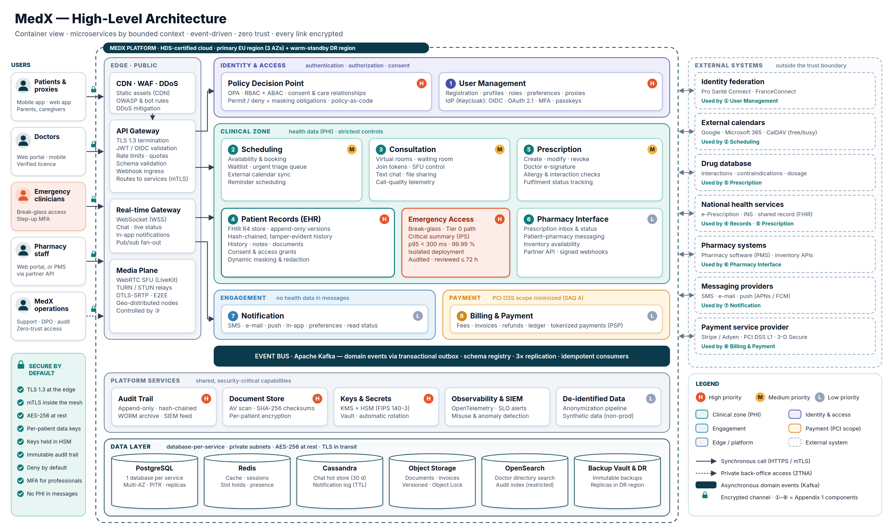

# MedX Health Platform — Technical Solution Design

**5DESI mini-project.** Technical solution for **MedX**, a healthcare platform for **telehealth consultations**,
**patient records management** and **prescription tracking**: high-level architecture, detailed component design,
data model and storage strategy, scalability and performance, security and compliance, and a presentation.

> **One-sentence summary** — a zero-trust, event-driven platform of eight microservices grouped in security zones,
> where health data is encrypted twice (per-patient keys in HSM-backed KMS on top of storage encryption), clinical
> history cannot be silently rewritten, and authorised professionals get a patient's critical summary in under a
> second during an emergency — even if a whole cloud region fails.



## Deliverables

| # | Deliverable (brief) | Where |
|---|---------------------|-------|
| 1 | **High-level architecture diagram** | [docs/01 — High-level architecture](docs/01-high-level-architecture.md) · diagrams: [architecture](diagrams/medx-high-level-architecture.png) ([SVG](diagrams/medx-high-level-architecture.svg)), [system context](diagrams/medx-system-context.png), [deployment & security zones](diagrams/medx-deployment-view.png) |
| 2 | **Detailed component designs** | [docs/02 — Component designs](docs/02-component-design/README.md): one document per component (8 services + platform components) |
| 3 | **Data model & storage strategy** | [docs/03 — Data model & storage](docs/03-data-model-and-storage.md) |
| 4 | **Scalability & performance considerations** | [docs/04 — Scalability & performance](docs/04-scalability-and-performance.md) |
| 5 | **Security & compliance measures** | [docs/05 — Security & compliance](docs/05-security-and-compliance.md) · [encryption diagram](diagrams/medx-encryption-keys.png) · [emergency access](diagrams/medx-emergency-access-flow.png) |
| 6 | **Presentation** | [presentation/MedX-Technical-Solution.pptx](presentation/MedX-Technical-Solution.pptx) (18 slides + 5 backup slides, speaker notes included) · [PDF](presentation/MedX-Technical-Solution.pdf) · [script](presentation/speaker-notes.md) |
| + | **Consolidated report** (all of the above in one file) | [report/MedX-Technical-Design-Report.pdf](report/MedX-Technical-Design-Report.pdf) · [HTML](report/MedX-Technical-Design-Report.html) |

Supporting documents: [0 — Context, assumptions & targets](docs/00-context-and-assumptions.md) ·
[6 — Architecture decisions & trade-offs](docs/06-architecture-decisions.md) ·
[7 — Requirements traceability matrix](docs/07-requirements-traceability.md) ·
[8 — Roadmap & risks](docs/08-roadmap-and-risks.md).

## Reading guide (15 minutes)

1. This page, then the [presentation](presentation/MedX-Technical-Solution.pdf) — the whole design in 18 slides.
2. [§1.1 Architecture at a glance](docs/01-high-level-architecture.md#11-architecture-at-a-glance) and
   [§1.7 key flows](docs/01-high-level-architecture.md#17-key-end-to-end-flows).
3. The High-priority core: [Patient Records & Emergency Access](docs/02-component-design/04-patient-records.md) and
   [User Management](docs/02-component-design/01-user-management.md).
4. [Decisions & trade-offs](docs/06-architecture-decisions.md) and the [traceability matrix](docs/07-requirements-traceability.md).

## The design in eight decisions

1. **Eight microservices, one per component of the brief**, grouped into **security zones** (identity, clinical,
   engagement, payment) — health data stays in the clinical zone.
2. **HL7 FHIR R4** (+ International Patient Summary) as the clinical data model, on **PostgreSQL**; append-only history,
   per-patient **hash chains** and signed daily anchors make records tamper-evident.
3. **Break-glass emergency access**: exact-match identification, justification, step-up MFA, 4-hour read-only grant,
   critical summary in < 300 ms, real-time alert and mandatory review within 72 h — on an **isolated Tier-0 path active
   in two regions**.
4. **Keycloak** (OIDC, MFA, passkeys, e-CPS federation) for authentication and **OPA** policies (RBAC + ABAC:
   care relationship, consent, purpose of use) evaluated beside every service.
5. **Encryption everywhere**: TLS 1.3 at the edge, mTLS in the mesh, DTLS-SRTP + end-to-end encryption for video,
   AES-256 storage encryption **plus** per-patient envelope encryption with keys in HSM-backed KMS (crypto-shredding
   at end of retention).
6. **Event-driven integration** with Kafka and the transactional outbox — synchronous calls only when a user waits.
7. **No health data outside the trust boundary**: SMS, e-mails, calendars, events and logs carry none; non-production
   uses synthetic or anonymised data only.
8. **Delivered in the order of MedX priorities**: secure clinical core (High) → care workflows (Medium) → ecosystem
   services (Low).

## MedX priorities → design

| Priority | Requirement | Design answer |
|----------|-------------|---------------|
| **High** | H1 Data privacy (at rest & in transit) | [§5.5–5.6](docs/05-security-and-compliance.md#55-encryption-in-transit) two encryption layers, per-patient keys, TLS 1.3 / mTLS |
| **High** | H2 Patient records management | [§2.4](docs/02-component-design/04-patient-records.md) FHIR store, signed notes, consent, full audit |
| **High** | H3 Emergency access | [§2.4 break-glass](docs/02-component-design/04-patient-records.md#emergency-access-break-glass), Tier 0, two regions |
| **High** | H4 Authentication & authorization | [§2.1](docs/02-component-design/01-user-management.md) Keycloak + OPA (RBAC + ABAC) |
| **High** | H5 Data integrity & secure files | [§3.8](docs/03-data-model-and-storage.md#38-data-integrity-mechanisms) append-only, hash chains, Object Lock, immutable backups |
| Medium | M1–M5 Scheduling, consultation, prescriptions, masking, calendars | [§2.2](docs/02-component-design/02-scheduling.md), [§2.3](docs/02-component-design/03-consultation.md), [§2.5](docs/02-component-design/05-prescription.md), [§5.7](docs/05-security-and-compliance.md#57-data-masking-redaction-and-anonymization) |
| Low | L1–L6 Pharmacy, preferences, notification tracking, anonymization, payments, refunds | [§2.6–2.8](docs/02-component-design/README.md), [§5.7](docs/05-security-and-compliance.md#57-data-masking-redaction-and-anonymization) |

All 16 priority requirements and all 30 features of Appendix 1 are mapped in the
[traceability matrix](docs/07-requirements-traceability.md).

## Repository structure

```text
.
├── README.md                     ← you are here
├── docs/                         ← the design documents (Markdown, diagrams render on GitHub)
│   ├── 00-context-and-assumptions.md
│   ├── 01-high-level-architecture.md          (Deliverable 1)
│   ├── 02-component-design/                   (Deliverable 2: README + 9 component documents)
│   ├── 03-data-model-and-storage.md           (Deliverable 3)
│   ├── 04-scalability-and-performance.md      (Deliverable 4)
│   ├── 05-security-and-compliance.md          (Deliverable 5)
│   ├── 06-architecture-decisions.md
│   ├── 07-requirements-traceability.md
│   └── 08-roadmap-and-risks.md
├── diagrams/                     ← architecture diagrams (SVG sources + PNG renders)
├── presentation/                 ← Deliverable 6: PPTX, PDF export, speaker notes
├── report/                       ← consolidated design report (PDF + standalone HTML)
└── tools/                        ← scripts that regenerate diagrams, report and slides
```

## Regenerating the artefacts

Everything in `diagrams/`, `report/` and `presentation/` is generated from sources in this repository:

```bash
cd tools
npm install                 # Node 20+; uses a local Chromium via playwright-core (set CHROME_PATH if needed)
npm run diagrams            # diagrams/*.svg + *.png from tools/diagrams/*.diagram.js
npm run check               # validates every Mermaid diagram, relative link and anchor in the docs
npm run report              # report/MedX-Technical-Design-Report.html + .pdf from docs/*.md
npm run slides              # presentation/MedX-Technical-Solution.pptx + speaker-notes.md
```

The slide PDF is exported from the PPTX with PowerPoint or LibreOffice (`soffice --headless --convert-to pdf`).
