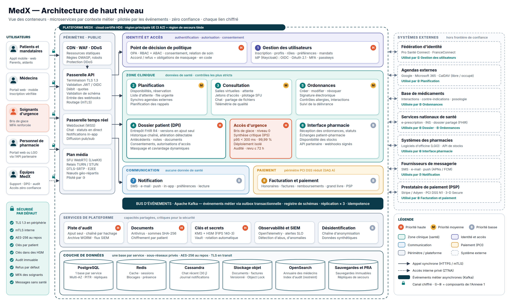
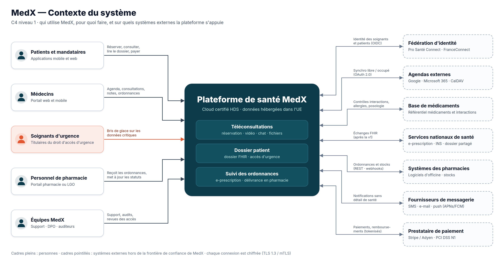
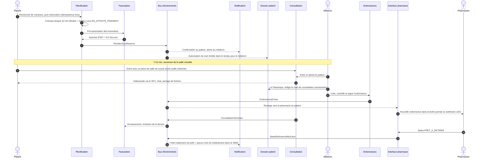
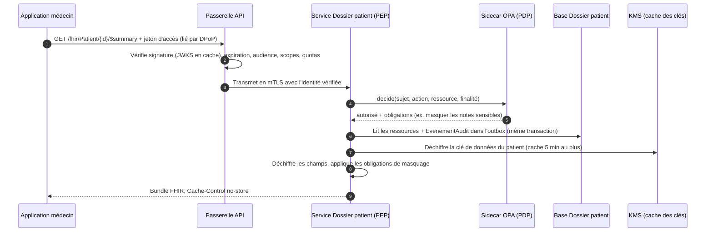
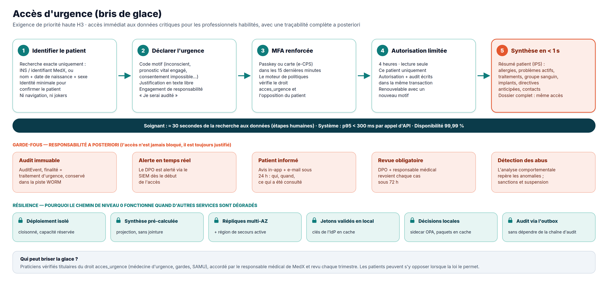
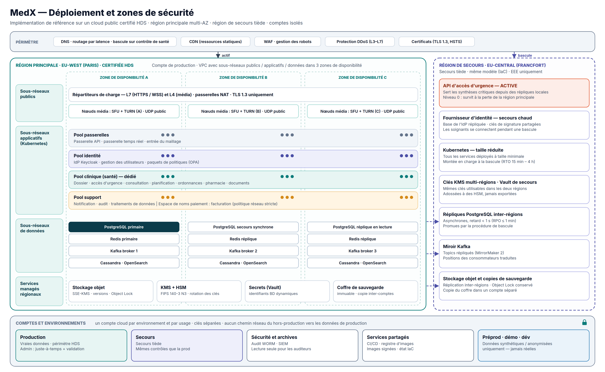

# 1. Architecture de haut niveau

> **Livrable 1.** Représentation visuelle de la structure d'ensemble de MedX et de la logique qui la sous-tend.
> Les hypothèses et les objectifs viennent du [document 0 — Contexte](00-contexte-et-hypotheses.md).

## 1.1 Vue d'ensemble de l'architecture

*Source vectorielle : [`diagrammes/medx-architecture-haut-niveau.svg`](../diagrammes/medx-architecture-haut-niveau.svg).
Les numéros ①–⑧ sont les composants de l'Annexe 1 ; les pastilles H / M / B indiquent les priorités de MedX
(Annexe 2 : haute, moyenne, basse).*

**Sept idées à retenir**

1. **Huit microservices métier, un par composant de l'Annexe 1**, regroupés en **zones de sécurité**. La *zone
   clinique* concentre les données de santé et reçoit les contrôles les plus stricts.
2. **Une seule porte d'entrée, durcie.** Seul le périmètre d'entrée (CDN/WAF, passerelle API, passerelle temps réel,
   plan média) est joignable depuis Internet ; tous les services et toutes les bases sont dans des sous-réseaux privés.
3. **L'identité est centralisée, l'application des règles est locale.** Un fournisseur d'identité éprouvé émet les
   jetons ; un moteur de politiques (OPA) tourne à côté de chaque service, si bien que chaque requête est autorisée en
   environ une milliseconde, sans aller-retour réseau.
4. **Les événements d'abord, le synchrone seulement quand un utilisateur attend.** Les changements d'état sont
   publiés comme événements métier sur Kafka via une outbox transactionnelle : les services restent découplés et les
   pannes restent contenues.
5. **Chaque service possède ses données** (une base par service). PostgreSQL est le choix par défaut ; des bases
   spécialisées ne sont utilisées que lorsqu'un besoin clair existe (Redis, Cassandra, stockage objet, OpenSearch).
6. **Les capacités critiques pour la sécurité sont construites une seule fois, comme services de plateforme** :
   piste d'audit, stockage sécurisé de documents, gestion des clés, observabilité et SIEM, plateforme de données
   désidentifiées.
7. **L'accès d'urgence est un chemin de niveau 0** : un déploiement isolé qui lit des résumés précalculés sur des
   répliques situées dans deux régions, et qui ne dépend de rien d'autre que du strict nécessaire.

## 1.2 Contexte du système (C4 niveau 1)

MedX sert cinq groupes de personnes et s'appuie sur sept familles de systèmes externes. Chaque système externe se
trouve **hors de la frontière de confiance** : il ne reçoit que les données dont il a besoin (par exemple, les
agendas reçoivent des plages occupées et un titre générique « Téléconsultation MedX » — jamais le nom d'un patient ni
une spécialité), via des adaptateurs détenus par le service qui les consomme.

## 1.3 Style d'architecture et justification

| Option | Points forts | Faiblesses pour MedX | Verdict |
|--------|--------------|----------------------|---------|
| Monolithe | Simple à construire et à déployer | Un seul rayon d'impact pour les données de santé et les paiements ; vidéo, dossiers et facturation ne peuvent pas monter en charge séparément ; un bogue peut faire tomber l'accès d'urgence | Rejeté |
| Monolithe modulaire | Modules clairs, exploitation simple | Toujours un seul exécutable et une seule base : pas d'isolation du chemin de niveau 0, impossible de séparer les périmètres de conformité (santé, PCI) | Bonne option de démarrage, rejetée à l'échelle visée par MedX |
| **Microservices par contexte délimité** (8 services métier + plateforme) | Isolation des données sensibles et des pannes, montée en charge indépendante (vidéo ≠ dossiers ≠ facturation), cycles de mise en production indépendants, responsabilités claires | Complexité d'exploitation, cohérence des données distribuées | **Retenu** — complexité maîtrisée (voir ci-dessous) |
| Fonctions serverless partout | Aucun serveur à gérer, paiement à l'usage | Démarrages à froid sur le chemin d'urgence, sessions WebSocket/WebRTC longues difficiles, dépendance au fournisseur, périmètre HDS plus difficile à cerner | Utilisées seulement pour de petits traitements d'événements, si utile |

**Pourquoi ce style sert les priorités**

- *Confidentialité des données (H1) et conformité* : les données de santé sont confinées à la zone clinique ; la
  facturation est dans une zone paiement séparée, ce qui garde son périmètre PCI minimal ; le service de notification
  ne stocke jamais de données de santé.
- *Accès d'urgence (H3)* : le chemin de bris de glace est déployé à part (cloisonnement) et ne peut pas être privé de
  ressources par un pic de réservations ou de trafic vidéo.
- *Scalabilité* : le plan média monte en charge selon la bande passante, le dossier patient selon le débit de lecture,
  les notifications selon la profondeur des files — chacun avec sa propre métrique de mise à l'échelle automatique.

**Comment la complexité est maîtrisée**

- Le nombre de services est volontairement **limité aux composants métier** (pas de « nano-services »).
- Un **modèle de service standard** (*golden path*) donne à chaque service le même squelette : contrat OpenAPI,
  point d'autorisation, outbox, sondes de santé, OpenTelemetry, en-têtes de sécurité, chaîne d'intégration continue.
- Un **maillage de services** (*service mesh*) fournit uniformément mTLS, nouvelles tentatives, délais d'expiration
  et disjoncteurs.
- Une **équipe plateforme** est responsable de Kubernetes, du bus d'événements, de l'observabilité et des briques de
  sécurité.

## 1.4 Couches et composants

| Couche | Composants | Responsabilité |
|--------|------------|----------------|
| **Canaux** | Application mobile patient (iOS/Android), application web patient, portail web médecin, portail pharmacie, console d'administration | Interfaces utilisateur. Aucune logique métier, stockage local minimal des données de santé (chiffré, effacé à la déconnexion). |
| **Périmètre d'entrée** | CDN + WAF + protection DDoS · **passerelle API** · **passerelle temps réel** (WebSocket) · **plan média** (SFU WebRTC + TURN/STUN) | Point d'entrée unique : terminaison TLS, validation des jetons, limitation de débit, validation des requêtes, routage, réception des webhooks, diffusion temps réel, relais média. |
| **Identité et accès** | ① **Gestion des utilisateurs** (+ fournisseur d'identité Keycloak) · **point de décision de politique** (OPA) | Qui vous êtes (authentification, MFA, fédération) et ce que vous pouvez faire (RBAC + ABAC, consentement, relation de soin, obligations de masquage). |
| **Zone clinique** | ② Planification · ③ Consultation · ④ Dossier patient + **accès d'urgence** · ⑤ Ordonnances · ⑥ Interface pharmacie | Parcours de soins et données de santé. |
| **Zone communication** | ⑦ Notification | Messages multicanaux sans détail médical, préférences, suivi de distribution et de lecture. |
| **Zone paiement** | ⑧ Facturation et paiement | Honoraires, pré-autorisation puis encaissement, factures, remboursements, grand livre — les données de carte restent chez le PSP. |
| **Colonne vertébrale événementielle** | Apache Kafka + registre de schémas + relais d'outbox (CDC) | Intégration asynchrone, flux d'audit, projections. |
| **Services de plateforme** | Piste d'audit · stockage sécurisé de documents · clés et secrets (KMS/HSM, Vault) · observabilité et SIEM · plateforme de données désidentifiées | Capacités partagées et critiques pour la sécurité. |
| **Couche de données** | PostgreSQL (une base par service) · Redis · Cassandra · stockage objet · OpenSearch · coffre de sauvegardes | Persistance — voir le [document 3](03-modele-donnees-et-stockage.md). |

Les responsabilités, API, événements et flux détaillés de chaque composant sont décrits dans le
[document 2 — Conception détaillée des composants](02-conception-composants/README.md).

## 1.5 Zones de sécurité et frontières de confiance

| Zone | Contient | Données autorisées | Contrôles principaux |
|------|----------|--------------------|----------------------|
| **Périmètre d'entrée (public)** | CDN/WAF, passerelles, nœuds média | Trafic chiffré en transit uniquement ; aucune base de données | Règles WAF, protection DDoS, TLS 1.3, validation des jetons, limites de débit |
| **Identité et accès** | Gestion des utilisateurs, fournisseur d'identité, PDP | Identité, secrets d'authentification (hachés), rôles, préférences | MFA, hachage des mots de passe, accès administrateur juste-à-temps, base séparée |
| **Clinique (données de santé)** | Planification, Consultation, Dossier patient, Accès d'urgence, Ordonnances, Interface pharmacie, stockage de documents | Données de santé, chiffrées par patient | Groupe de nœuds dédié, politiques réseau strictes, ABAC à chaque requête, chiffrement au niveau des champs, audit complet |
| **Communication** | Notification | Coordonnées, préférences, métadonnées des messages — **aucune donnée de santé** | Modèles relus pour exclure toute donnée de santé, contrats de sous-traitance avec les fournisseurs, consentements |
| **Paiement** | Facturation et paiement | Montants, factures, jetons PSP — **aucun numéro de carte, aucun diagnostic** | Espace de noms et politique réseau séparés, champs de paiement hébergés par le PSP, signatures des webhooks |
| **Plateforme** | Audit, KMS/Vault, observabilité, plateforme de données | Enregistrements d'audit (accès restreint), clés (jamais exportées), journaux expurgés des données de santé, jeux de données désidentifiés | Compte de sécurité séparé pour l'audit et les journaux, stockage WORM, séparation des tâches |
| **Hors production** | Développement, recette, démonstration | **Données synthétiques ou anonymisées uniquement** | Comptes séparés, aucun chemin réseau vers la production |

**Règles de circulation entre zones**

- Les données de santé ne quittent la zone clinique que (a) vers un utilisateur autorisé via la passerelle, (b) vers
  une pharmacie via l'Interface pharmacie, réduites à ce que la délivrance exige, ou (c) vers la plateforme de données
  désidentifiées **après** anonymisation.
- Les événements du bus transportent **des identifiants et des statuts, jamais de contenu clinique** (patron
  *claim-check* : le consommateur récupère le détail auprès du service propriétaire, avec sa propre autorisation).
- Rien dans la zone clinique n'accepte de connexion entrante depuis Internet, sauf via les passerelles.

## 1.6 Modes de communication

| Mode | Utilisé pour | Protocole et format | Règles |
|------|--------------|---------------------|--------|
| **Requête/réponse synchrone** | Lectures et commandes des utilisateurs ; contrôles qui exigent une réponse immédiate (ex. contrôle des allergies pendant la prescription) | HTTPS/REST, JSON, OpenAPI 3.1 ; **FHIR R4 REST** pour les données cliniques ; appels internes en mTLS | Délai d'expiration sur chaque appel, nouvelles tentatives seulement pour les opérations idempotentes (avec gigue), disjoncteurs, **deux sauts synchrones au plus** par requête utilisateur, `Idempotency-Key` sur chaque création |
| **Événements métier asynchrones** | Propagation des changements d'état (réservation, ordonnance, paiement…), notifications, projections, audit | Topics Kafka, enveloppe CloudEvents, schémas versionnés (registre de schémas, rétrocompatibles) | Publiés via **l'outbox transactionnelle** (pas de double écriture) ; livraison au moins une fois + **consommateurs idempotents** ; ordre garanti par clé d'agrégat (ex. `idRendezVous`) |
| **Poussée temps réel** | Chat, statuts en direct (ordonnance, position dans la file), notifications dans l'application | WebSocket (WSS) via la passerelle temps réel, adossée à un pub/sub | Authentification à la connexion, canaux par utilisateur, ré-autorisation au renouvellement du jeton |
| **Média** | Vidéo et audio | WebRTC : DTLS-SRTP (+ chiffrement de bout en bout SFrame quand c'est possible), ICE/STUN/TURN | Le média ne traverse jamais les services métier ; salles et jetons contrôlés par le service Consultation |
| **Intégration externe** | Agendas, PSP, messagerie, logiciels de pharmacie, base médicaments, services nationaux | REST/FHIR en TLS ou mTLS, OAuth 2.0 ; webhooks entrants via la passerelle API | Un **adaptateur (couche anti-corruption)** par système externe, détenu par le service consommateur ; webhooks signés ; nouvelles tentatives avec temporisation ; files de lettres mortes |

## 1.7 Flux de bout en bout clés

### 1.7.1 Le parcours de soin : réservation → consultation → ordonnance → pharmacie

### 1.7.2 Comment chaque requête sur des données de santé est autorisée

Deux propriétés comptent ici : **aucun accès sans enregistrement d'audit** (l'événement d'audit est écrit dans la
même transaction que la lecture ou l'écriture), et **aucun aller-retour réseau pour la décision d'autorisation** (OPA
tourne en *sidecar*, avec des politiques distribuées sous forme de paquets signés).

### 1.7.3 Accès d'urgence (bris de glace)

La conception détaillée (droit d'accès, modèle d'autorisation, contenu du résumé critique, processus de revue) est
dans le [document 2.4 — Dossier patient et accès d'urgence](02-conception-composants/04-dossier-patient.md#accès-durgence-bris-de-glace).

## 1.8 Vue de déploiement

- **Région principale** en France (certifiée HDS), répartie sur **trois zones de disponibilité**. Chaque couche est
  redondée entre zones : répartiteurs de charge, groupes de nœuds Kubernetes, base principale + **réplique synchrone**
  + réplique de lecture, répliques Redis, trois brokers Kafka, nœuds Cassandra et OpenSearch.
- Les **groupes de nœuds Kubernetes** suivent les zones de sécurité : passerelles, identité, **clinique (nœuds
  dédiés)** et support, plus un **espace de noms paiement** isolé par politique réseau. Les nœuds média sont dans des
  sous-réseaux publics car WebRTC a besoin de ports UDP publics ; ils ne détiennent aucune donnée.
- La **région de reprise** (deuxième région européenne, EEE uniquement) est un **secours tiède** construit à partir
  du même code d'infrastructure : répliques de bases (retard < 1 s), miroir Kafka, stockage objet répliqué, clés KMS
  multirégions. **L'API d'accès d'urgence et le fournisseur d'identité sont actifs dans les deux régions** : le chemin
  de niveau 0 survit à la perte de la région principale.
- **Un compte cloud par environnement et par usage** : production, reprise, sécurité et archives de journaux (audit
  WORM, SIEM), services partagés (CI/CD, images signées), hors production (données synthétiques uniquement).

## 1.9 Pile technologique (implémentation de référence)

La conception est indépendante du fournisseur cloud ; les choix ci-dessous constituent l'implémentation de référence
utilisée pour le dimensionnement et le chiffrage.

| Sujet | Choix de référence | Pourquoi | Alternatives |
|-------|--------------------|----------|--------------|
| Hébergement | Cloud public certifié HDS — principal à Paris, reprise à Francfort | Périmètre certifié, services managés, résidence des données dans l'UE | Azure France, Google Cloud Paris, OVHcloud |
| Calcul | Kubernetes managé + maillage de services Istio | Mise à l'échelle standard, mTLS uniforme, politiques de trafic | Linkerd ; Nomad |
| Services métier | Java/Kotlin sur un JDK LTS récent, Spring Boot | Écosystème mature, bibliothèques santé solides (HAPI FHIR), vivier de recrutement | Go, .NET |
| Données cliniques | Serveur **HAPI FHIR** sur PostgreSQL | Open source, validation FHIR R4, versionnage, recherche | Services FHIR managés (Azure Health Data Services, Google Cloud Healthcare API, AWS HealthLake) |
| Identité | **Keycloak** (OIDC, MFA, WebAuthn/passkeys, fédération d'identité) | Auto-hébergeable dans le périmètre HDS, fondé sur les standards, pas de coût par utilisateur | Fournisseurs d'identité commerciaux si leur hébergement est conforme HDS |
| Autorisations | **Open Policy Agent** (politiques en tant que code, sidecar) | Décisions locales à faible latence, politiques testables et versionnées | AWS Cedar, OpenFGA |
| Vidéo | SFU **LiveKit** (open source) + serveurs TURN | Auto-hébergement dans l'UE, simulcast, chiffrement de bout en bout, mise à l'échelle horizontale | Jitsi, mediasoup ; CPaaS (Vonage, Daily) si le délai de mise sur le marché prime |
| Événements | **Apache Kafka** (managé) + registre de schémas + relais d'outbox Debezium | Journal durable et rejouable, ordre par clé, débit élevé | RabbitMQ, NATS JetStream, Pulsar |
| Bases de données | PostgreSQL (managé, multi-AZ), Redis/Valkey, Cassandra, OpenSearch, stockage objet compatible S3 | Chacune justifiée composant par composant — voir le [document 3](03-modele-donnees-et-stockage.md) | — |
| Clés et secrets | KMS cloud adossé à des HSM (FIPS 140-3) + HashiCorp Vault | Clés protégées matériellement, rotation, secrets dynamiques | Gestionnaire de secrets natif du cloud |
| Observabilité | OpenTelemetry → Prometheus / Grafana / Loki / Tempo ; SIEM | Standards ouverts, un identifiant de corrélation de bout en bout | Datadog, Elastic (selon l'hébergement) |
| Livraison | Chaînes CI, Argo CD (GitOps), Terraform, signature des images (cosign), analyse (Trivy) | Chaque modification est revue, reproductible et traçable | Flux, Pulumi |
| Interfaces | React + TypeScript (web), React Native (mobile) | Compétences et composants partagés entre applications patient, médecin et pharmacie | Swift/Kotlin natifs |

## 1.10 Comment l'architecture sert les priorités de MedX

| Priorité | Réponse de l'architecture | Détails |
|----------|---------------------------|---------|
| **H1 Confidentialité des données** | TLS 1.3 / mTLS sur chaque saut ; chiffrement AES-256 du stockage + chiffrement d'enveloppe par patient ; données de santé confinées à la zone clinique | [§5.5–5.6](05-securite-et-conformite.md#55-chiffrement-en-transit) |
| **H2 Dossiers patients** | Service Dossier patient dédié fondé sur FHIR, historique en ajout seul, registre des consentements, audit complet | [§2.4](02-conception-composants/04-dossier-patient.md) |
| **H3 Accès d'urgence** | Bris de glace sur un chemin de niveau 0 isolé et présent dans deux régions ; revue a posteriori | [§2.4](02-conception-composants/04-dossier-patient.md#accès-durgence-bris-de-glace) |
| **H4 Authentification / autorisations** | Keycloak (OIDC, MFA, passkeys) + OPA (RBAC + ABAC) évalué à côté de chaque service | [§2.1](02-conception-composants/01-gestion-utilisateurs.md) |
| **H5 Intégrité des données et fichiers sécurisés** | Bases ACID, versionnage, chaînes de hachage, sommes de contrôle, Object Lock, sauvegardes immuables, stockage de documents analysé et chiffré | [§3.8](03-modele-donnees-et-stockage.md#38-mécanismes-dintégrité-des-données) |
| Moyenne M1–M5 | Services Planification, Consultation, Ordonnances ; obligations de masquage dans le PDP ; adaptateurs d'agendas | [§2.2](02-conception-composants/02-planification.md), [§2.3](02-conception-composants/03-consultation.md), [§2.5](02-conception-composants/05-ordonnances.md) |
| Basse B1–B6 | Services Pharmacie, Notification, Facturation ; chaîne d'anonymisation — conçus maintenant, livrés en dernier | [§8 Feuille de route](08-feuille-de-route-et-risques.md) |

La correspondance exigence par exigence figure dans la [matrice de traçabilité](07-tracabilite-exigences.md).
