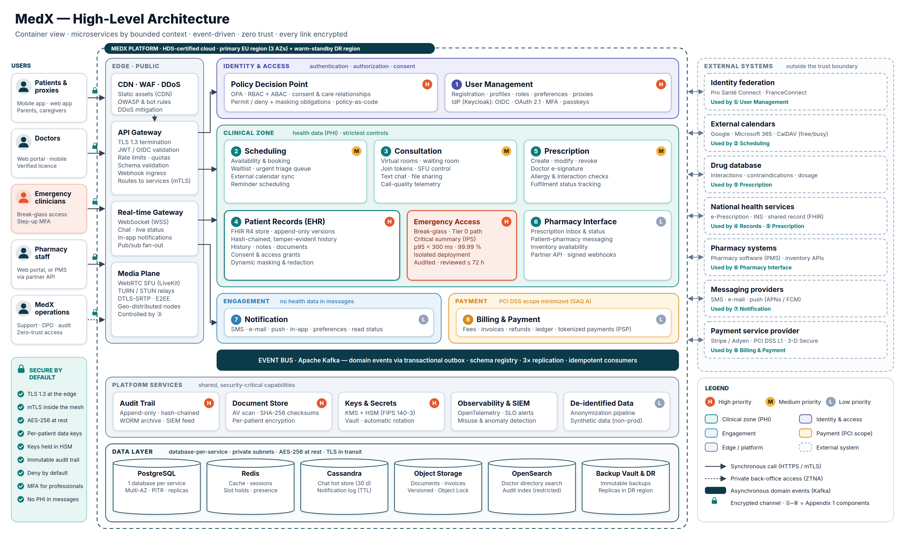
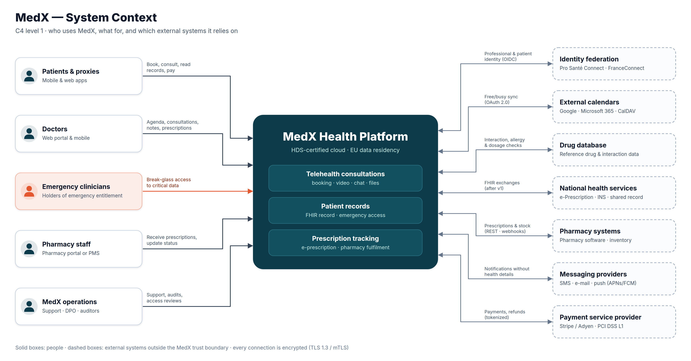
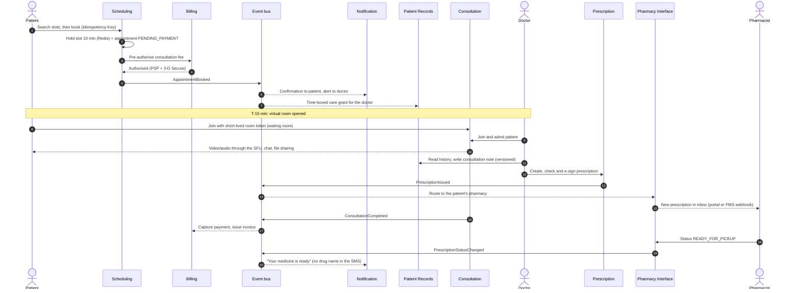
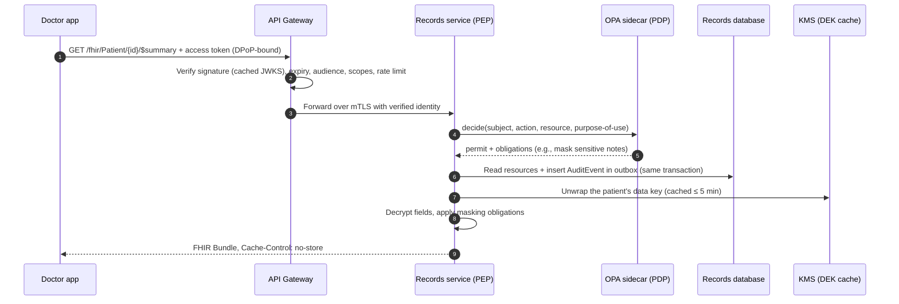
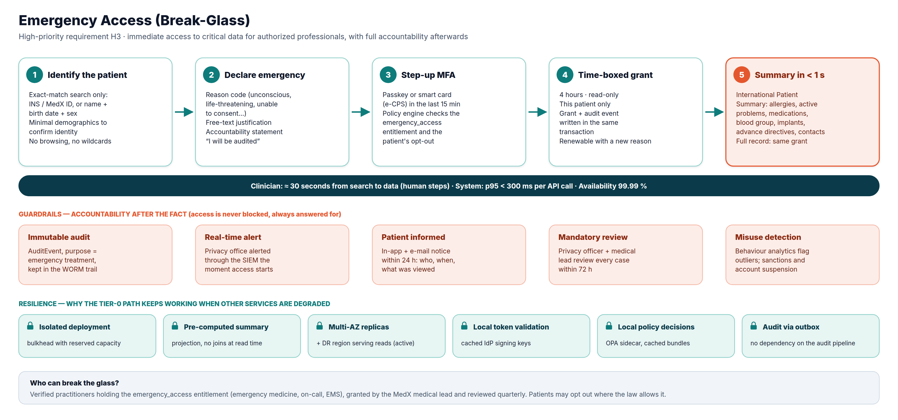
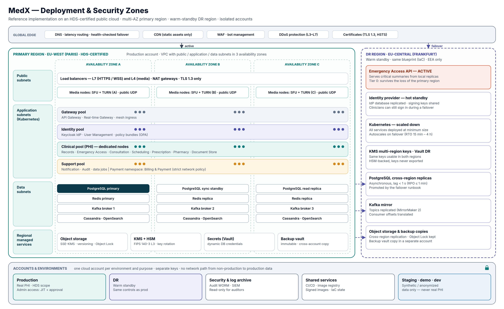

# 1. High-Level Architecture

> **Deliverable 1.** Visual representation of the overall structure of MedX and the logic behind it.
> Assumptions and targets come from [0. Context](00-context-and-assumptions.md).

## 1.1 Architecture at a glance

*Vector source: [`diagrams/medx-high-level-architecture.svg`](../diagrams/medx-high-level-architecture.svg). Circled numbers ①–⑧ are the
components of Appendix 1; H / M / L badges are MedX priorities (Appendix 2).*

**Seven ideas to remember**

1. **Eight business microservices, one per component of Appendix 1**, grouped into **security zones**. The
   *clinical zone* concentrates health data (PHI) and receives the strictest controls.
2. **One hardened front door.** Only the edge (CDN/WAF, API gateway, real-time gateway, media plane) is
   reachable from the internet; every service and datastore lives in private subnets.
3. **Identity is centralised, enforcement is local.** A proven identity provider issues tokens; a policy engine
   (OPA) runs next to each service so every request is authorised in about a millisecond without a network hop.
4. **Events first, synchronous calls only when a user is waiting.** State changes are published as domain events
   on Kafka through a transactional outbox; this keeps services decoupled and failures contained.
5. **Each service owns its data** (database-per-service). PostgreSQL is the default; specialised stores are used
   only where a clear need exists (Redis, Cassandra, object storage, OpenSearch).
6. **Security-critical capabilities are built once, as platform services**: audit trail, secure document store,
   key management, observability & SIEM, de-identified data platform.
7. **Emergency access is a Tier-0 path**: an isolated deployment that reads pre-computed summaries from
   replicas in two regions and depends on nothing that is not strictly necessary.

## 1.2 System context (C4 level 1)

MedX serves five groups of people and relies on seven families of external systems. Every external system sits
**outside the trust boundary**: it only receives the data it needs (for example, calendars get free/busy slots and
a generic "MedX teleconsultation" title — never a patient name or a specialty), through adapters owned by the
consuming service.

## 1.3 Architectural style and rationale

| Option | Strengths | Weaknesses for MedX | Verdict |
|--------|-----------|---------------------|---------|
| Monolith | Simple to build and deploy | One blast radius for PHI and payments; video, records and billing cannot scale independently; one bug can take down emergency access | Rejected |
| Modular monolith | Clear modules, simple operations | Still one runtime and one database: no isolation of the Tier-0 path, compliance scopes (PHI, PCI) cannot be separated | Good start-up option, rejected at MedX's target scale |
| **Microservices by bounded context** (8 business services + platform) | Isolation of sensitive data and of failures, independent scaling (video ≠ records ≠ billing), independent release cadence, clear ownership | Operational complexity, distributed data consistency | **Chosen** — complexity mitigated below |
| Serverless functions everywhere | No servers to operate, pay-per-use | Cold starts on the emergency path, hard long-lived WebSocket/WebRTC sessions, vendor lock-in, harder HDS scoping | Used only for small event handlers if useful |

**Why the chosen style fits the priorities**

- *Data privacy (H1) and compliance*: PHI is confined to the clinical zone; billing sits in a separate payment zone
  so its PCI scope stays minimal; the notification service never stores health data.
- *Emergency access (H3)*: the break-glass path is deployed separately (bulkhead) and cannot be starved by a
  spike in bookings or video traffic.
- *Scalability*: the media plane scales on bandwidth, the records service on read throughput, the notification
  service on queue depth — each with its own autoscaling metric.

**How the complexity is kept under control**

- The number of services is deliberately **limited to the business components** (no nano-services).
- A **golden-path service template** gives every service the same skeleton: OpenAPI contract, authorization
  hook, outbox, health checks, OpenTelemetry, security headers, CI pipeline.
- A **service mesh** provides mTLS, retries, timeouts and circuit breaking uniformly.
- A **platform team** owns Kubernetes, the event bus, observability, and the security building blocks.

## 1.4 Layers and components

| Layer | Components | Responsibility |
|-------|------------|----------------|
| **Channels** | Patient mobile app (iOS/Android), patient web app, doctor web portal, pharmacy portal, back-office console | User interfaces. No business logic, minimal local storage of health data (encrypted, wiped on logout). |
| **Edge** | CDN + WAF + DDoS protection · **API Gateway** · **Real-time Gateway** (WebSocket) · **Media plane** (WebRTC SFU + TURN/STUN) | Single entry point: TLS termination, token validation, rate limiting, request validation, routing, webhook ingress, real-time fan-out, media relay. |
| **Identity & access** | ① **User Management** (+ Keycloak IdP) · **Policy Decision Point** (OPA) | Who you are (authentication, MFA, federation) and what you may do (RBAC + ABAC, consent, care relationships, masking obligations). |
| **Clinical zone** | ② Scheduling · ③ Consultation · ④ Patient Records + **Emergency Access** · ⑤ Prescription · ⑥ Pharmacy Interface | Care workflows and health data. |
| **Engagement zone** | ⑦ Notification | Multi-channel messages without health details, preferences, delivery/read tracking. |
| **Payment zone** | ⑧ Billing & Payment | Fees, pre-authorisation and capture, invoices, refunds, ledger — card data stays at the PSP. |
| **Event backbone** | Apache Kafka + schema registry + outbox relay (CDC) | Asynchronous integration, audit feed, projections. |
| **Platform services** | Audit trail · Secure document store · Keys & secrets (KMS/HSM, Vault) · Observability & SIEM · De-identified data platform | Shared, security-critical capabilities. |
| **Data layer** | PostgreSQL (one database per service) · Redis · Cassandra · Object storage · OpenSearch · Backup vault | Persistence — see [3. Data model & storage](03-data-model-and-storage.md). |

Detailed responsibilities, APIs, events and flows of each component are in
[2. Detailed component designs](02-component-design/README.md).

## 1.5 Security zones and trust boundaries

| Zone | Contains | Data allowed | Main controls |
|------|----------|--------------|---------------|
| **Edge (public)** | CDN/WAF, gateways, media nodes | Encrypted traffic in transit only; no datastore | WAF rules, DDoS protection, TLS 1.3, token validation, rate limits |
| **Identity & access** | User Management, IdP, PDP | Identity, credentials (hashed), roles, preferences | MFA, credential hashing, admin JIT access, separate database |
| **Clinical (PHI)** | Scheduling, Consultation, Records, Emergency Access, Prescription, Pharmacy Interface, Document Store | Health data, per-patient encrypted | Dedicated node pool, strict network policies, ABAC on every request, field-level encryption, full audit |
| **Engagement** | Notification | Contact details, preferences, message metadata — **no PHI** | Templates reviewed for PHI, provider DPAs, opt-in/opt-out |
| **Payment** | Billing & Payment | Amounts, invoices, PSP tokens — **no card numbers, no diagnosis** | Separate namespace & network policy, PSP hosted fields, webhook signatures |
| **Platform** | Audit, KMS/Vault, observability, data platform | Audit records (restricted), keys (never exported), logs scrubbed of PHI, de-identified datasets | Separate security account for audit/logs, WORM storage, separation of duties |
| **Non-production** | Dev, staging, demo | **Synthetic or anonymised data only** | Separate accounts, no network path to production |

**Flow rules across boundaries**

- Health data leaves the clinical zone only (a) towards an authorised user through the gateway, (b) towards a
  pharmacy through the Pharmacy Interface, minimised to what dispensing requires, or (c) towards the
  de-identified data platform **after** anonymisation.
- Events on the bus carry **identifiers and status, not clinical content** ("claim-check" pattern: consumers fetch
  details from the owning service under their own authorisation).
- Nothing in the clinical zone accepts inbound connections from the internet except through the gateways.

## 1.6 Communication patterns

| Pattern | Used for | Protocol & format | Rules |
|---------|----------|-------------------|-------|
| **Synchronous request/response** | User-facing reads and commands; checks that need an immediate answer (e.g., allergy check while prescribing) | HTTPS/REST, JSON, OpenAPI 3.1; **FHIR R4 REST** for clinical data; internal calls over mTLS | Timeouts on every call, retries only for idempotent operations (with jitter), circuit breakers, at most **two synchronous hops** per user request, `Idempotency-Key` on every create |
| **Asynchronous domain events** | Propagating state changes (booking, prescription, payment…), notifications, projections, audit | Kafka topics, CloudEvents envelope, versioned schemas (schema registry, backward compatible) | Published through the **transactional outbox** (no dual writes); at-least-once delivery + **idempotent consumers**; ordering by aggregate key (e.g., `appointmentId`) |
| **Real-time push** | Chat, live statuses (prescription, queue position), in-app notifications | WebSocket (WSS) via the Real-time Gateway, backed by pub/sub | Authenticated at connection time, per-user channels, re-authorised on token refresh |
| **Media** | Video and audio | WebRTC: DTLS-SRTP (+ E2EE with SFrame when supported), ICE/STUN/TURN | Media never transits through business services; rooms and tokens controlled by the Consultation service |
| **External integration** | Calendars, PSP, messaging, pharmacy systems, drug database, national services | REST/FHIR over TLS or mTLS, OAuth 2.0; inbound webhooks through the API gateway | One **adapter (anti-corruption layer)** per external system, owned by the consuming service; signed webhooks; retries with backoff; dead-letter queues |

## 1.7 Key end-to-end flows

### 1.7.1 The care journey: booking → consultation → prescription → pharmacy

### 1.7.2 How every request on health data is authorised

Two properties matter here: **no access without an audit record** (the audit event is written in the same
database transaction as the read or write), and **no network hop for the authorisation decision** (OPA runs as a
sidecar with policies distributed as signed bundles).

### 1.7.3 Emergency access (break-glass)

The detailed design (entitlement, grant model, critical summary content, review process) is in
[2.4 Patient Records & Emergency Access](02-component-design/04-patient-records.md#emergency-access-break-glass).

## 1.8 Deployment view

- **Primary region** in France (HDS-certified), spread over **three availability zones**. Every tier is
  redundant across zones: load balancers, Kubernetes node pools, database primary + **synchronous standby** +
  read replica, Redis replicas, three Kafka brokers, Cassandra and OpenSearch nodes.
- **Kubernetes node pools** follow the security zones: gateway, identity, **clinical (dedicated nodes)** and
  support pools, plus a **payment namespace** isolated by network policy. Media nodes run in public subnets
  because WebRTC needs public UDP ports; they hold no data.
- **DR region** (second EU region, EEA only) runs as a **warm standby** built from the same infrastructure-as-code:
  database replicas (lag < 1 s), Kafka mirror, replicated object storage, multi-region KMS keys. The
  **Emergency Access API and the identity provider are active in both regions**, so the Tier-0 path survives the
  loss of the primary region.
- **One cloud account per environment and purpose**: production, DR, security & log archive (audit WORM,
  SIEM), shared services (CI/CD, signed images), non-production (synthetic data only).

## 1.9 Technology stack (reference implementation)

The design is cloud-agnostic; the choices below are the reference implementation used for sizing and costing.

| Concern | Reference choice | Why | Alternatives |
|---------|------------------|-----|--------------|
| Hosting | HDS-certified public cloud — primary Paris, DR Frankfurt | Certified scope, managed services, EU data residency | Azure France, Google Cloud Paris, OVHcloud |
| Compute | Managed Kubernetes + Istio service mesh | Standard autoscaling, uniform mTLS, traffic policies | Linkerd; Nomad |
| Business services | Java/Kotlin on a current LTS JDK, Spring Boot | Mature ecosystem, strong healthcare libraries (HAPI FHIR), large talent pool | Go, .NET |
| Clinical data | **HAPI FHIR** server on PostgreSQL | Open-source, FHIR R4 validation, versioning, search | Managed FHIR services (Azure Health Data Services, Google Cloud Healthcare API, AWS HealthLake) |
| Identity | **Keycloak** (OIDC, MFA, WebAuthn/passkeys, identity brokering) | Self-hostable inside the HDS scope, standards-based, no per-user fee | Commercial IdPs if their hosting is HDS-compliant |
| Authorization | **Open Policy Agent** (policies as code, sidecar) | Low-latency local decisions, testable and versioned policies | AWS Cedar, OpenFGA |
| Video | **LiveKit** SFU (open-source) + TURN servers | EU self-hosting, simulcast, E2EE support, horizontal scaling | Jitsi, mediasoup; CPaaS (Vonage, Daily) if time-to-market dominates |
| Events | **Apache Kafka** (managed) + schema registry + Debezium outbox relay | Durable, replayable log, per-key ordering, high throughput | RabbitMQ, NATS JetStream, Pulsar |
| Datastores | PostgreSQL (managed, Multi-AZ), Redis/Valkey, Cassandra, OpenSearch, S3-compatible object storage | Each justified per component — see [§3](03-data-model-and-storage.md) | — |
| Keys & secrets | Cloud KMS backed by HSM (FIPS 140-3) + HashiCorp Vault | Hardware-protected keys, rotation, dynamic credentials | Cloud-native secrets manager |
| Observability | OpenTelemetry → Prometheus / Grafana / Loki / Tempo; SIEM | Open standards, one correlation ID end-to-end | Datadog, Elastic (hosting permitting) |
| Delivery | CI pipelines, Argo CD (GitOps), Terraform, image signing (cosign), scanning (Trivy) | Every change reviewed, reproducible and traceable | Flux, Pulumi |
| Front-ends | React + TypeScript (web), React Native (mobile) | Shared skills and components across patient, doctor and pharmacy apps | Native Swift/Kotlin |

## 1.10 How the architecture serves MedX priorities

| Priority | Architectural answer | Details |
|----------|----------------------|---------|
| **H1 Data privacy** | TLS 1.3 / mTLS on every hop; AES-256 storage encryption + per-patient envelope encryption; PHI confined to the clinical zone | [§5.5–5.6](05-security-and-compliance.md#55-encryption-in-transit) |
| **H2 Patient records** | Dedicated FHIR-based Records service, append-only history, consent registry, full audit | [§2.4](02-component-design/04-patient-records.md) |
| **H3 Emergency access** | Break-glass on an isolated, two-region, Tier-0 path; post-hoc review | [§2.4](02-component-design/04-patient-records.md#emergency-access-break-glass) |
| **H4 AuthN / AuthZ** | Keycloak (OIDC, MFA, passkeys) + OPA (RBAC + ABAC) evaluated beside each service | [§2.1](02-component-design/01-user-management.md) |
| **H5 Data integrity & secure files** | ACID stores, versioning, hash chains, checksums, Object Lock, immutable backups, scanned & encrypted document store | [§3.8](03-data-model-and-storage.md#38-data-integrity-mechanisms) |
| Medium M1–M5 | Scheduling, consultation, prescription services; masking obligations in the PDP; calendar adapters | [§2.2](02-component-design/02-scheduling.md), [§2.3](02-component-design/03-consultation.md), [§2.5](02-component-design/05-prescription.md) |
| Low L1–L6 | Pharmacy, notification, billing services; anonymisation pipeline — designed now, delivered last | [§8 Roadmap](08-roadmap-and-risks.md) |

The complete requirement-by-requirement mapping is in the [traceability matrix](07-requirements-traceability.md).
