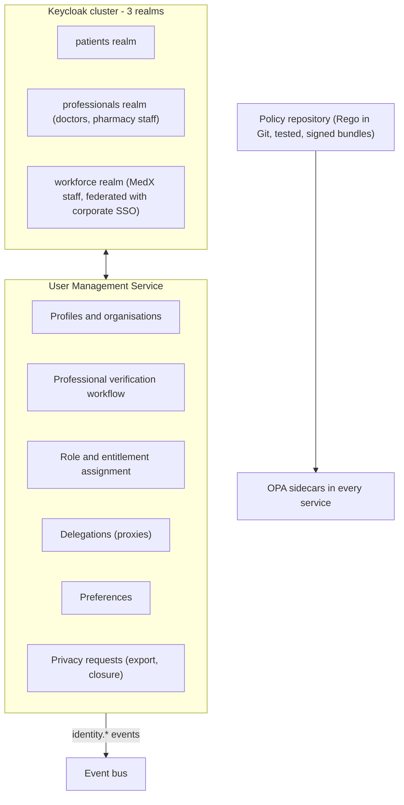
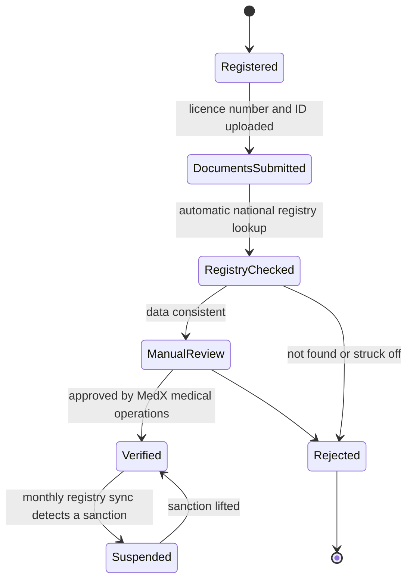

# 2.1 ① User Management Service — Identity & Access

| Priority | Zone | Criticality | Owns |
|----------|------|-------------|------|
| **HIGH** — H4 authentication & authorization · Low — L2 user preferences | Identity & access | Tier 0 (login, token validation) | Identities, profiles, roles, organisations, delegations, preferences |

**Mission** — know who every user is, prove it strongly, and give every other service a trustworthy basis to
decide what that user may do.

## Responsibilities

| Appendix 1 feature | How MedX delivers it |
|--------------------|----------------------|
| Handle user registrations and profile updates | **Patients** self-register (e-mail + phone verification). Access to their medical record requires a verified identity (FranceConnect or ID-document check). **Doctors** go through professional onboarding: licence number checked against the national registry (RPPS / *Annuaire Santé*), identity document, manual approval. **Pharmacies** register as organisations (FINESS number checked); the pharmacy administrator invites staff. |
| Authenticate users | **Keycloak** identity provider: OpenID Connect Authorization Code + PKCE, mandatory **MFA for all professionals** (passkeys/WebAuthn, TOTP, or the professional smart card through Pro Santé Connect), risk-based MFA for patients, step-up for sensitive actions. |
| Authorize access based on user roles | Coarse **RBAC** roles carried in tokens + fine-grained **ABAC** decisions by the policy engine (OPA) beside each service: care relationship, consent, purpose of use, data sensitivity, organisation. |
| Store and manage user preferences | Preferences API (language, time zone, accessibility, notification channels per category, quiet hours, frequency caps). Changes are published as `PreferencesUpdated` so the Notification service applies them without calling back. |

## Internal design



- **Three realms** isolate populations with different risks: patient policies favour usability (passkeys,
  biometrics on mobile), professional policies are strict (MFA always, 15-minute idle timeout, 12-hour absolute
  session), workforce identities come from the corporate IdP with hardware security keys.
- **Policies are code**: Rego files in Git, unit-tested in CI (`opa test`), packaged as **signed bundles** pulled
  by the OPA sidecars. A policy change is reviewed like any code change and is fully traceable.
- The service keeps **attributes** (roles, organisation memberships, entitlements such as `emergency_access`) and
  exposes them in tokens; facts that change per request (care grants, consents) are looked up by the calling
  service and passed to OPA as input.

## Roles and permissions (RBAC layer)

| Capability | Patient | Proxy | Doctor | Doctor + `emergency_access` | Pharmacist / technician | Support agent | Privacy officer | Platform admin |
|------------|:-------:|:-----:|:------:|:---------------------------:|:-----------------------:|:-------------:|:---------------:|:--------------:|
| Manage own profile & preferences | ✅ | ✅ (delegated) | ✅ | ✅ | ✅ | — | — | — |
| Book / cancel consultations | own | dependant's | — | — | — | assist, no PHI | — | — |
| Manage availability & agenda | — | — | own | own | — | — | — | — |
| Read medical record | own (with release rules) | scoped | **with care grant** | + **break-glass** | ❌ | ❌ | audit metadata only | ❌ |
| Write clinical notes | upload own documents | — | with care grant | emergency note | ❌ | ❌ | ❌ | ❌ |
| Create / modify / revoke prescriptions | — | — | own patients | — | ❌ | ❌ | ❌ | ❌ |
| View prescriptions | own | dependant's | issued by self | via break-glass | **assigned to their pharmacy only** (minimised) | ❌ | ❌ | ❌ |
| Update fulfilment status | — | — | — | — | ✅ | ❌ | ❌ | ❌ |
| Issue refunds | request | request | — | — | — | ≤ threshold (4-eyes above) | — | ❌ |
| View audit trail | own access history | — | — | — | — | ❌ | ✅ | ❌ |
| Operate infrastructure | — | — | — | — | — | — | — | JIT, time-boxed, **no PHI** |

## ABAC layer (illustrative policy)

RBAC answers "can a doctor read records?"; ABAC answers "can **this** doctor read **this** patient's record
**now**, for **this** purpose?".

```rego
package medx.records

import rego.v1

default allow := false

# Treating doctor: verified, MFA-authenticated, holding an unexpired care grant for this patient
allow if {
    input.subject.role == "doctor"
    input.subject.verified
    input.subject.aal >= 2
    input.facts.care_grant.expires_at > input.now
    not sensitive_without_consent
}

# Break-glass: read-only, time-boxed, and never if the patient has lawfully opted out
allow if {
    "emergency_access" in input.subject.entitlements
    input.purpose_of_use == "ETREAT"
    input.action == "read"
    input.facts.emergency_grant.expires_at > input.now
    not input.facts.patient_opted_out_of_break_glass
}

sensitive_without_consent if {
    input.resource.security_label == "restricted"
    not input.facts.explicit_consent
}

# Obligations returned with the decision and applied by the service before responding
obligations contains {"mask": "psychotherapy-notes"} if input.purpose_of_use == "ETREAT"
```

## Authentication flows

| Audience | Flow | Factors | Session & tokens |
|----------|------|---------|------------------|
| Patient mobile app | OIDC Authorization Code + PKCE through the system browser | Password or passkey; risk-based second factor (new device, record download); biometric unlock of the stored refresh token | Access token 10 min, **DPoP-bound** (RFC 9449); refresh token rotated on every use, 30-day sliding window, device-bound |
| Patient web app | Same, confidential client via a thin backend-for-frontend holding tokens server-side | Same | HttpOnly, Secure, SameSite cookies; no tokens in browser storage |
| Doctor / pharmacy portals | OIDC Authorization Code + PKCE | **Mandatory MFA**: passkey/WebAuthn, TOTP or professional smart card (e-CPS via Pro Santé Connect); SMS OTP not allowed (SIM-swap risk) | Access token 5 min, idle timeout 15 min, absolute 12 h; step-up (`max_age`/`acr`) before signing a prescription or breaking the glass |
| Pharmacy systems (PMS) | OAuth 2.0 client credentials | **mTLS client certificate**, certificate-bound tokens (RFC 8705) | Token 5 min, per-pharmacy scopes and rate limits |
| MedX workforce | SSO with corporate IdP | FIDO2 hardware key | Privileged roles only through just-in-time elevation (approval, time-boxed, session recorded) |

**Token content** — access tokens are JWTs signed with ES256 (keys rotated, published on the JWKS endpoint) and
contain an opaque subject UUID, realm, roles, organisation, entitlements, authentication assurance (`acr`/`amr`)
and audience. They **never contain personal data** (no name, no e-mail, no birth date).

**Revocation** — logout, password reset and account suspension revoke the refresh-token family immediately; the
short access-token lifetime bounds the remaining exposure, and a denylist in Redis (checked by the gateway) cuts
suspended accounts within seconds.

**Account protection** — passwords hashed with Argon2id (PBKDF2-SHA512 in FIPS mode), minimum 12 characters,
breached-password check, no forced periodic rotation (NIST SP 800-63B); progressive rate limiting and lockout;
bot detection on registration and login; alerts for logins from new devices; account recovery that never
downgrades assurance (a professional who loses a factor goes through identity re-verification).

## Key flows

**Professional onboarding**



**Proxy access (delegation)** — a parent is linked to a minor after document verification (the link expires at
majority; care the minor asked to keep confidential is hidden from the parent by policy); an adult patient can
delegate scoped rights (book, view prescriptions, view records) to a caregiver and revoke them at any time.

## API (selection)

| Method | Endpoint | Purpose |
|--------|----------|---------|
| `POST` | `/v1/users` | Patient registration |
| `POST` | `/v1/practitioner-registrations` | Start professional onboarding |
| `GET` / `PATCH` | `/v1/users/me` | Read / update own profile |
| `GET` / `PUT` | `/v1/users/me/preferences` | Read / replace preferences (versioned, `If-Match`) |
| `POST` / `DELETE` | `/v1/users/me/delegations` | Grant / revoke proxy access |
| `POST` | `/v1/organizations/{orgId}/members` | Pharmacy administrator invites staff |
| `POST` | `/v1/admin/practitioner-registrations/{id}/decision` | Approve / reject (back-office, 4-eyes) |
| `POST` | `/v1/users/me/privacy-requests` | GDPR access/portability request, account closure |
| — | `/realms/{realm}/protocol/openid-connect/*` | Standard OIDC endpoints (authorize, token, JWKS, logout) |

## Data owned

PostgreSQL (`usermgmt` database) + Keycloak's own PostgreSQL database — details in
[§3.4](../03-data-model-and-storage.md#34-logical-data-models-per-service). Contact data (phone, address, national
identifier) is encrypted at field level; e-mail is stored encrypted **with a blind index** (keyed HMAC) so it can
still be looked up for login without being readable.

## Scalability & resilience

- Token **validation** is local everywhere (gateway and services cache the JWKS), so the IdP only handles logins
  and refreshes: ~3 M per day at Year 3, about 35/s on average and 300/s at peak — modest, but password hashing is
  CPU-intensive, so login endpoints are rate-limited and Keycloak nodes sized on hashing cost.
- Keycloak runs as a 3+ node cluster across AZs with a distributed session cache, **active in both regions**
  (Tier 0): clinicians can still sign in during a regional failover.
- The User Management service itself is stateless and scales horizontally; profile reads are cached for 60 s.

## Design decisions & trade-offs

| Decision | Alternative | Why this choice |
|----------|-------------|-----------------|
| Reuse a proven IdP (Keycloak) | Build authentication in-house | Authentication is where custom code fails most dangerously; Keycloak brings OIDC, MFA, WebAuthn, brokering and audits. Cost: running and patching a stateful cluster. |
| Short-lived JWTs validated locally | Opaque tokens + introspection on every call | Removes the IdP from the hot path (latency, resilience of the emergency path). Cost: revocation is not instant → 5–10 min lifetimes + denylist for high-risk events. |
| RBAC + ABAC with OPA | RBAC only | RBAC alone cannot express care relationships, consent or break-glass. OPA keeps policies testable and versioned. |
| Separate realms per population | One realm | Different assurance levels and session rules; a misconfiguration on the patient side cannot weaken professional accounts. |
