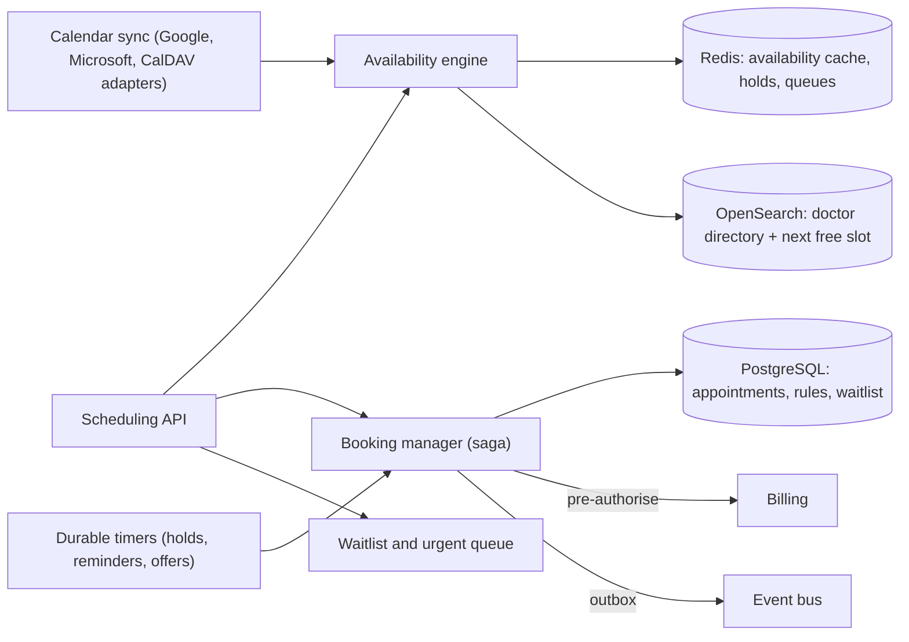
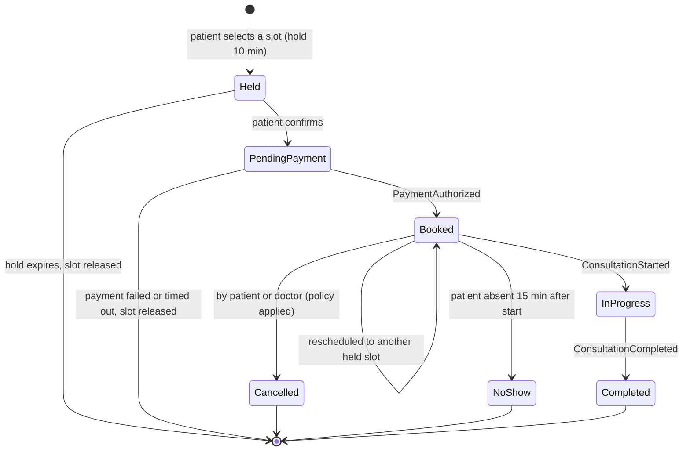
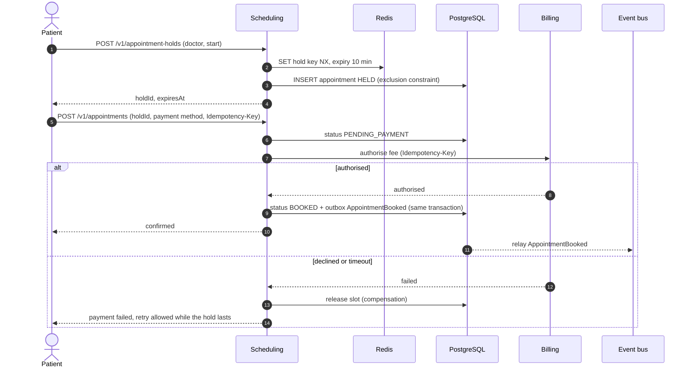

# 2.2 ② Teleconsultation Scheduling Service

| Priority | Zone | Criticality | Owns |
|----------|------|-------------|------|
| Medium — M1 scheduling · M5 external calendars | Clinical (an appointment with a specialist is health data) | Tier 1 | Availability rules, appointments, waitlists, urgent requests, calendar connections |

**Mission** — let patients find and book the right consultation in a few taps, never double-book a doctor,
keep doctors informed in real time, and give urgent cases a faster lane.

## Responsibilities

| Appendix 1 feature | How MedX delivers it |
|--------------------|----------------------|
| Book, reschedule, cancel consultations | Slot search → short **hold** → confirmation with payment pre-authorisation (saga with Billing). Rescheduling moves the same appointment to a new held slot; cancellation applies the cancellation policy (free until 24 h before). |
| Notify doctors of new bookings or changes | `AppointmentBooked/Rescheduled/Cancelled` events → Notification (push/e-mail per preferences) **and** live update of the doctor's agenda through the Real-time Gateway. |
| Integrate with doctors' calendars | Connectors for Google Calendar, Microsoft 365 (Graph) and CalDAV: external busy times block MedX slots; MedX appointments are written back **without any patient data**. |
| Waitlists and priority scheduling for urgent cases | Waitlist per doctor or specialty with automatic offers when a slot is released; triage questionnaire → urgency level; **on-demand urgent queue** served by on-call doctors; reserved urgent capacity. |

## Internal design



| Module | Role |
|--------|------|
| **Availability engine** | Computes free slots = recurring rules (RRULE, per consultation type) − exceptions (leave) − external busy blocks − booked/held slots − reserved urgent capacity. Pre-computes the next 60 days per doctor in Redis; recomputes incrementally on every relevant event. |
| **Booking manager** | Holds, confirmations, rescheduling, cancellations; orchestrates the payment saga; owns the appointment state machine. |
| **Waitlist & urgent queue** | Priority queues, slot offers with exclusive time-boxed holds, matching of urgent requests to on-call doctors. |
| **Calendar sync** | OAuth connections, push-notification webhooks, incremental delta sync, outbound event writing, subscription renewal, nightly reconciliation. |
| **Durable timers** | Database-backed scheduler (survives restarts) for hold expiry, reminders (T-24 h, T-1 h, T-10 min), waitlist offer expiry. |
| **Directory projection** | Denormalised doctor profiles (specialty, languages, fees, next available slot) in OpenSearch for fast search. |

## Appointment lifecycle



## Booking saga and double-booking prevention



Two independent safeguards prevent double booking:

1. **Fast path** — an atomic Redis hold (`SET … NX PX 600000`) rejects concurrent attempts on the same slot in
   under a millisecond.
2. **Source of truth** — a PostgreSQL **exclusion constraint** makes overlapping active appointments for a doctor
   physically impossible, even if Redis is unavailable or a bug bypasses the hold:

```sql
CREATE EXTENSION IF NOT EXISTS btree_gist;

ALTER TABLE appointment
  ADD CONSTRAINT appointment_no_overlap
  EXCLUDE USING gist (
    practitioner_id WITH =,
    tstzrange(starts_at, ends_at, '[)') WITH &&
  )
  WHERE (status IN ('HELD', 'PENDING_PAYMENT', 'BOOKED', 'IN_PROGRESS'));
```

## Waitlist and urgent cases

- **Waitlist** — a patient can wait for an earlier slot with a doctor or any doctor of a specialty. When a slot is
  released, the matcher offers it to the best candidate, ordered by **urgency level then waiting time**, with an
  exclusive 15-minute hold; if declined or expired, the next candidate gets it.
- **Triage** — a short, medically validated questionnaire (rule-based, conservative) classifies the request:
  `EMERGENCY` (red flags → **booking stopped, the app displays the emergency number 15/112**), `URGENT` (same day),
  `SOON` (≤ 48 h), `ROUTINE`. Telehealth must never delay emergency care.
- **Urgent on-demand queue** — `URGENT` requests enter a queue served by on-call doctors (matched on specialty,
  language, licence). A doctor has 2 minutes to accept before the request moves on; a supervisor dashboard tracks
  the waiting-time objective (< 30 min) and escalates.
- **Reserved capacity** — doctors may reserve a share of their slots for urgent cases; unused reserved slots are
  released to everyone 2 hours in advance.

## External calendar integration

| Aspect | Design |
|--------|--------|
| Providers | Google Calendar API, Microsoft Graph (Outlook / Microsoft 365), CalDAV (Apple iCloud and others) |
| Consent & scopes | Doctor connects through OAuth 2.0 with **minimum scopes**: read free/busy, write only MedX events (a dedicated "MedX" calendar where the provider supports it). CalDAV uses an app-specific password stored in Vault. |
| Inbound (busy times) | Provider push notifications (Google watch channels, Graph change subscriptions) → webhook through the gateway → incremental fetch (sync token / delta link) → `external_busy_block` updated → availability recomputed within seconds. Fallback polling every 10 min; nightly full reconciliation; automatic renewal of expiring subscriptions. |
| Outbound (MedX bookings) | Each booking creates an event titled **"MedX teleconsultation"** with a link to the portal — **no patient name, no reason, no specialty**. Reschedules and cancellations update or delete it (mapping `appointment_id ↔ external_event_id`, idempotent). |
| Data minimisation | Only start/end of busy periods are stored — never titles, attendees or descriptions of the doctor's private events. |
| Conflicts | MedX appointments are the source of truth. If the doctor adds an overlapping private event, MedX alerts the doctor; it never cancels a patient automatically. |
| Failures | Per-provider rate-limit handling with exponential backoff and circuit breaker; if a provider is down, the last known busy blocks are used and the doctor sees a "calendar sync delayed" banner. |
| Secrets | OAuth refresh tokens encrypted with Vault Transit, revoked when the doctor disconnects. |

## API (selection)

| Method | Endpoint | Purpose |
|--------|----------|---------|
| `GET` | `/v1/practitioners?specialty=&language=&date=` | Directory search (OpenSearch) |
| `GET` | `/v1/practitioners/{id}/slots?from=&to=&type=` | Free slots (Redis cache) |
| `POST` | `/v1/appointment-holds` | Hold a slot for 10 min |
| `POST` | `/v1/appointments` | Confirm booking (`Idempotency-Key`, `holdId`, payment method) |
| `POST` | `/v1/appointments/{id}/reschedule` | Move to another held slot |
| `POST` | `/v1/appointments/{id}/cancel` | Cancel with reason (policy → refund/void) |
| `POST` | `/v1/waitlist-entries` | Join a waitlist |
| `POST` | `/v1/urgent-requests` | Triage answers → urgent queue or emergency advice |
| `PUT` | `/v1/practitioners/me/availability-rules` | Doctor's recurring availability |
| `POST` | `/v1/practitioners/me/calendar-connections` | Start OAuth connection to an external calendar |
| `POST` | `/v1/webhooks/calendars/{provider}` | Provider push notifications (validated channel tokens) |

## Events

- **Publishes** `scheduling.appointment.v1`: AppointmentBooked, AppointmentRescheduled, AppointmentCancelled,
  AppointmentNoShow, AppointmentReminderDue, WaitlistSlotOffered, UrgentRequestCreated, UrgentRequestAssigned.
- **Consumes** `billing.payment.v1` (PaymentAuthorized/Failed), `consultation.session.v1` (Started/Completed →
  status), `identity.user.v1` (PractitionerVerified enables the agenda; PractitionerSuspended freezes it and
  triggers patient rebooking).

## Data owned

PostgreSQL: `availability_rule`, `availability_exception`, `appointment` (+ append-only `appointment_history`),
`waitlist_entry`, `urgent_request`, `calendar_connection`, `external_busy_block`, `timer`, `outbox`.
Redis: holds, per-doctor-day availability, waitlist queues. OpenSearch: doctor directory (public profile data only).
Details in [§3.4](../03-data-model-and-storage.md#34-logical-data-models-per-service).

## Security & privacy

- Patients see only their own appointments; doctors only their own agenda; support agents see masked data.
- Appointment reason and triage answers are health data: encrypted at field level, visible only to the patient and
  the booked doctor.
- Directory search is public (profiles only) and protected by rate limiting and bot detection against scraping.

## Scalability & resilience

- **Reads dominate** (search and availability): served from OpenSearch and the Redis availability cache, so the
  database is not hit by browsing; cache entries are recomputed on events, not on reads.
- **Writes are modest** (200 k bookings/day at Year 3 ≈ 2–3/s, peaks ≈ 30/s) and contention is local to one doctor.
- Peaks (Monday 8–10 am, epidemics) are absorbed by autoscaling on request rate; if the payment provider is slow,
  holds keep the slot for the patient.

## Design decisions & trade-offs

| Decision | Alternative | Why this choice |
|----------|-------------|-----------------|
| Pre-computed availability | Compute on every request | Fast, predictable search under peak load. Cost: invalidation logic, bounded staleness (seconds). |
| Redis hold **and** DB exclusion constraint | Only one of them | Redis gives speed; the constraint gives a guarantee. Belt and braces for a problem users notice immediately. |
| Payment pre-authorisation at booking, capture after the consultation | Pay at the end | Reduces no-shows and failed payments; the patient pays only for a consultation that happened. Cost: authorisations expire after ~7 days → for distant appointments the card is saved (SCA) and authorised 24 h before. |
| Free/busy only, no PHI in external calendars | Full two-way sync | External calendars are outside MedX's trust boundary and HDS scope. |
