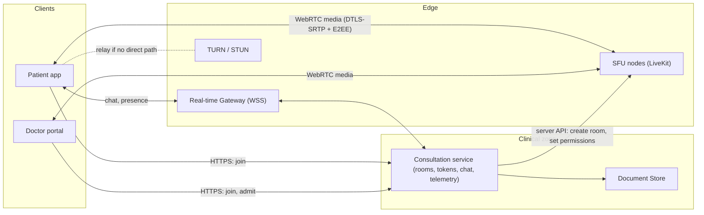
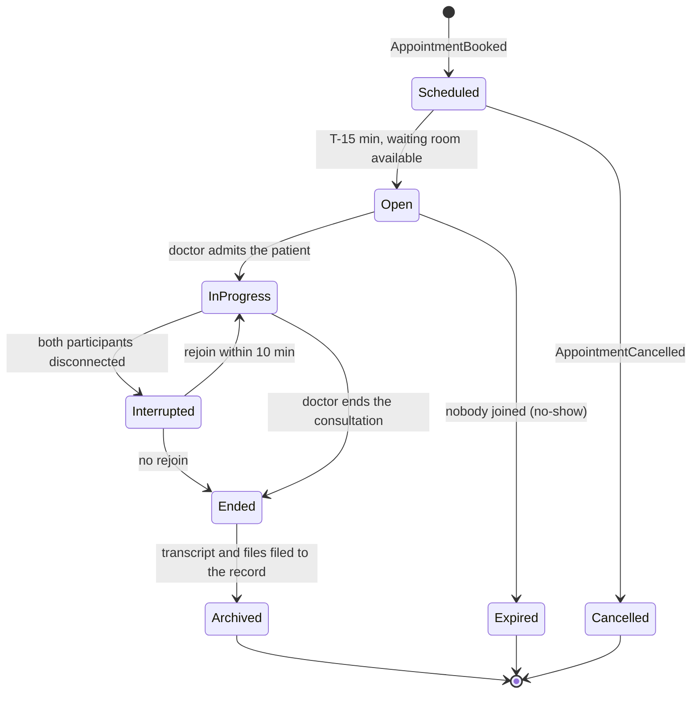
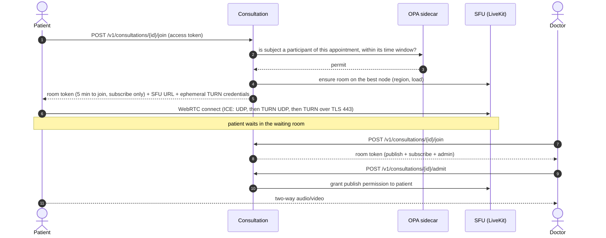
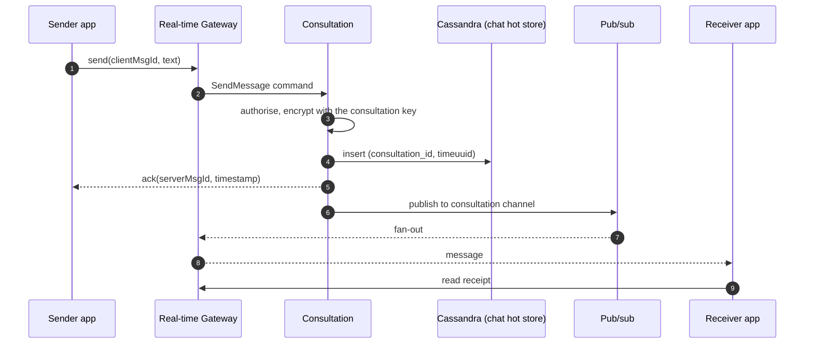

# 2.3 ③ Consultation Service — Video, Audio, Chat & Files

| Priority | Zone | Criticality | Owns |
|----------|------|-------------|------|
| Medium — M2 consultation services | Control plane in the clinical zone · media plane at the edge | Tier 1 | Virtual rooms, participants, session events, chat history (hot), call-quality telemetry |

**Mission** — give patient and doctor a reliable, private virtual room: good video on a bad network, a chat that
never loses a message, and a safe way to exchange medical documents.

## Responsibilities

| Appendix 1 feature | How MedX delivers it |
|--------------------|----------------------|
| Create virtual rooms | One room per appointment, planned when the appointment is booked and opened 15 min before; **waiting room** until the doctor admits the patient; unguessable 128-bit room identifiers. |
| Handle video and audio streaming | **WebRTC** through a self-hosted **SFU** (LiveKit) with TURN/STUN relays; simulcast and adaptive bitrate; automatic audio-only fallback; reconnection with ICE restart. |
| Enable text chat during consultations | Chat over the Real-time Gateway (WSS), persisted and ordered per room, with delivery/read receipts; transcript archived into the patient record at the end. |
| Allow file transfers for medical documents | Uploads through the **Secure Document Store** (quarantine, antivirus, type checks, encryption); files shared in the chat; doctor can file them into the record. |

## Control plane vs media plane

- The **control plane** (Consultation service) decides *who* may enter *which* room *when*; it never touches media.
- The **media plane** (SFU + TURN) only forwards encrypted packets; it stores nothing and holds no health data at
  rest. Media nodes live in public subnets because WebRTC needs public UDP ports.

## Room lifecycle

## Joining a consultation

Tokens are **short-lived, room-scoped and participant-scoped**; the participant identity inside the SFU is a
pseudonymous ID, never the patient's name. Additional participants (interpreter, caregiver) can be invited only
with the patient's consent and receive their own scoped token.

## Media quality on real-world networks

| Technique | Effect |
|-----------|--------|
| Simulcast (3 layers) + dynacast | Each receiver gets the layer its bandwidth supports; unused layers are paused to save uplink. |
| Opus audio with in-band FEC and DTX | Speech stays intelligible up to ~20 % packet loss; audio is prioritised over video. |
| Congestion control (transport-wide CC) | Bitrate adapts continuously; below ~150 kbit/s the call switches to **audio-only** automatically. |
| TURN over TLS on port 443 | Works on restrictive hospital and corporate networks. |
| ICE restart + reconnect | Moving from Wi-Fi to 4G does not end the consultation. |
| Pre-call test | Camera, microphone and bandwidth checked before the patient enters the waiting room. |
| Quality telemetry | WebRTC statistics (RTT, jitter, loss, freezes) sampled every 10 s — no media, no PHI — feed dashboards and alerts per region and per TURN node. |

## Privacy of the media

- **Hop-by-hop encryption is mandatory**: WebRTC always uses DTLS-SRTP.
- **End-to-end encryption (E2EE)** with insertable streams (SFrame) is **on by default for 1-to-1 consultations**
  when both devices support it: keys are negotiated between participants' devices and never stored by MedX, so
  neither MedX nor the SFU operator can decrypt audio or video.
- **No recording** of consultations (privacy by design). If recording is ever introduced (e.g., for training),
  it would require explicit consent, disable E2EE for that session and be stored as a document of the record.

## Chat

- **Exactly-once effect**: at-least-once delivery + deduplication on `clientMsgId`; ordering by server time-UUID.
- **Retention**: the hot store keeps messages 30 days (TTL) for convenience; when the consultation ends, the full
  transcript is **archived into the patient record** (`ChatTranscriptReady` → Records creates a document), which
  is the legal, long-term copy.
- Typing indicators and presence are ephemeral (never stored).

## File sharing

1. The app asks the Document Store for an upload slot → pre-signed URL to a **quarantine** bucket (5 min validity,
   size ≤ 50 MB, allowed types: PDF, JPEG, PNG, HEIC).
2. The file is scanned (antivirus, real type from magic bytes, PDF active content removed, image metadata such as
   GPS location stripped), then encrypted and moved to the documents bucket with its SHA-256 checksum.
3. A "file shared" message referencing the document ID appears in the chat; downloads go through the Document Store
   with the same authorisation as the consultation and are audited.
4. Files sent by the patient are attached automatically to the encounter as *patient-provided documents*; the
   doctor decides which files to file permanently into the record.

## API (selection)

| Method | Endpoint | Purpose |
|--------|----------|---------|
| `POST` | `/v1/consultations/{id}/join` | Room token + SFU URL + ephemeral TURN credentials |
| `POST` | `/v1/consultations/{id}/admit` | Doctor admits the patient from the waiting room |
| `POST` | `/v1/consultations/{id}/participants` | Invite interpreter/caregiver (patient consent required) |
| `POST` | `/v1/consultations/{id}/end` | Doctor ends the consultation |
| `GET` | `/v1/consultations/{id}/messages?cursor=` | Chat history (paginated) |
| `POST` | `/v1/consultations/{id}/files` | Request an upload slot (delegated to the Document Store) |
| `POST` | `/v1/telemetry/webrtc` | Call-quality statistics |
| `WSS` | `/v1/realtime` → channel `consultation:{id}` | Chat, receipts, presence |

## Events

- **Publishes** `consultation.session.v1`: ConsultationOpened, ConsultationStarted, ConsultationCompleted (duration,
  participants), ConsultationFailed (nobody could connect → automatic refund), ChatTranscriptReady.
- **Consumes** `scheduling.appointment.v1` (plan, move or cancel rooms).

## Data owned

PostgreSQL (`consultation`, `participant`, `session_event`, `quality_summary`), Cassandra (`chat_message`, 30-day
TTL, encrypted content), Redis (room → SFU node routing, presence). Files belong to the Document Store.

## Scalability & resilience

- **Sizing (Year 3)**: 10 k concurrent sessions → 20 k participants; ~1.2 Mbit/s average per received stream →
  ~24 Gbit/s of SFU egress. At ~200 participants per 8-vCPU node (to be confirmed by load tests), about **100 media
  nodes at peak**, autoscaled up to 200 for the ×2 headroom, spread over three AZs.
- **Placement**: each 1-to-1 room lives on one node in the region closest to its participants; nodes are
  **drained, never killed** on scale-in (no new rooms, existing calls finish).
- **TURN** capacity sized for ~20 % of sessions relayed (restrictive networks).
- **Failure of a media node**: clients reconnect automatically to another node within seconds (ICE restart); the
  room state is re-created from the control plane.
- **Degraded mode**: if video is impossible, audio-only; if media fails entirely, chat keeps working and the doctor
  can call the patient by phone (the event is logged).

## Design decisions & trade-offs

| Decision | Alternative | Why this choice |
|----------|-------------|-----------------|
| Self-hosted open-source SFU (LiveKit) | Video CPaaS (Vonage, Daily…) | Media stays on HDS-certified EU infrastructure; lower cost at scale; E2EE support. Cost: operating media servers (UDP, autoscaling, TURN). A CPaaS remains a fallback option for time-to-market. |
| SFU | Peer-to-peer mesh / MCU | P2P gives no control on quality, relaying or multi-party (interpreter); an MCU decodes and mixes streams (CPU-heavy, breaks E2EE). The SFU forwards packets: scalable and compatible with E2EE. |
| E2EE on by default for 1-to-1 | Hop-by-hop encryption only | Maximum confidentiality for the most sensitive conversations. Cost: no server-side recording or transcription, a little more device CPU. |
| Chat hot store + archive in the record | Chat written directly in the record | Low-latency messaging without loading the records store; the record still receives the complete, signed transcript. |
