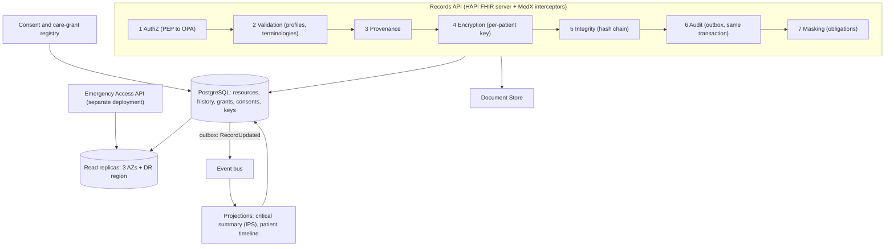
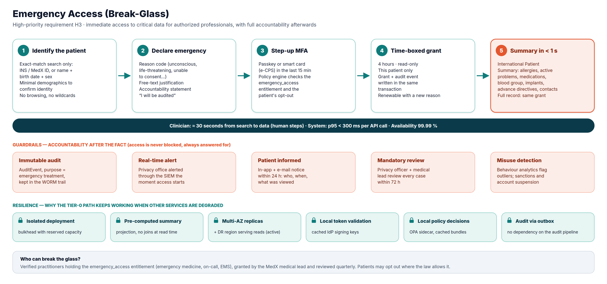
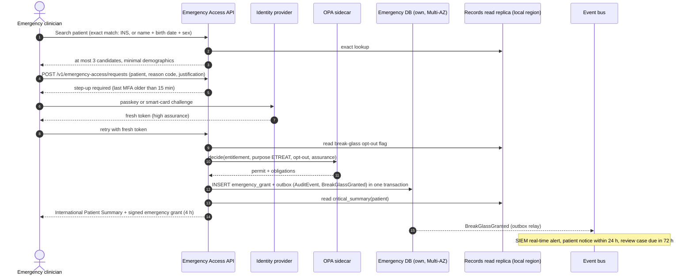

# 2.4 ④ Patient Records Management Service & Emergency Access

| Priority | Zone | Criticality | Owns |
|----------|------|-------------|------|
| **HIGH** — H2 records management · H3 emergency access · H5 integrity · Medium — M4 masking & redaction | Clinical | **Tier 0** (read path, emergency access) · Tier 1 (writes) | The medical record (FHIR resources and history), consents, care grants, emergency grants, critical summaries, patient data keys |

**Mission** — keep each patient's lifelong medical record **complete, correct and tamper-evident**, show it only
to the right people for the right reason, and make its critical part available **in seconds** in an emergency.

## Responsibilities

| Appendix 1 feature | How MedX delivers it |
|--------------------|----------------------|
| Store and manage medical histories, consultation notes and other records | **HL7 FHIR R4** resources (conditions, allergies, medications, immunisations, procedures, observations, reports, encounters, clinical notes, documents) stored by a FHIR server (HAPI FHIR on PostgreSQL); binaries in the Secure Document Store. |
| Allow doctors to add/edit records post-consultation | Validated writes with optimistic concurrency; notes are drafts until **signed**; after signature, changes are **addenda** (new version with a reason) — the original is never lost. Wrong-patient entries are marked *entered-in-error*, not deleted. |
| Give patients access to their records (with restrictions) | Patient portal API with patient-scoped tokens; release rules (e.g., results released after doctor review where the law allows), third-party information redacted, proxy scopes, adolescent confidentiality. |
| Ensure data integrity and regulatory compliance | Append-only history, per-patient hash chain anchored daily in WORM storage, provenance on every write, profile validation, full audit of reads and writes, consent registry, retention rules, per-patient encryption and crypto-shredding. |
| **Emergency access** (Appendix 2, H3) | Dedicated **Emergency Access** module deployed separately, serving a pre-computed **International Patient Summary** under a time-boxed break-glass grant — see [below](#emergency-access-break-glass). |

## Clinical data model (FHIR R4)

| MedX concept | FHIR resource(s) | Notes |
|--------------|------------------|-------|
| Patient identity | `Patient` | MedX ID + national health identifier (INS) stored encrypted |
| Medical history | `Condition`, `AllergyIntolerance`, `Procedure`, `Immunization`, `FamilyMemberHistory` | Coded with SNOMED CT / ICD-10 |
| Medications | `MedicationStatement`, `MedicationRequest` (from Prescription) | Coded with ATC and national drug codes |
| Measurements & results | `Observation`, `DiagnosticReport` | LOINC codes; release rules apply |
| Consultation | `Encounter` + `Composition` (clinical note) | Composition signed by the author |
| Documents | `DocumentReference` → binary in the Document Store | SHA-256 hash in `attachment.hash` |
| Who did what | `Provenance` (every write) · `AuditEvent` (every access, in the Audit Trail) | |
| Patient choices | `Consent` | Sharing, research opt-in, break-glass opt-out where allowed |
| Emergency summary | `Composition` following the **IPS** profile | Pre-computed projection |

Profiles: International Patient Summary (IPS) and national profiles (e.g., FR Core) — validation rejects
malformed or uncoded data at write time.

## Internal design

Every request crosses the same **interceptor chain**, so no endpoint can forget a control: authorisation →
validation → provenance → encryption → integrity → audit → masking.

## Write path, versioning and integrity

1. **Optimistic concurrency** — updates must send `If-Match: W/"<version>"`; a concurrent change returns `412` and
   the doctor merges — no silent lost update.
2. **Append-only history** — every change inserts a new row in `resource_history`; the database role used by the
   service has **no `UPDATE`/`DELETE` privilege** on history tables (enforced by grants and triggers).
3. **Signature of notes** — `Composition.status` goes `preliminary → final` when the author signs; afterwards only
   addenda are possible (`amended`, with reason and attestation).
4. **Hash chain per patient** — each version stores
   `h(n) = SHA-256( h(n-1) ‖ JCS(resource version) ‖ author ‖ timestamp )` (JCS = RFC 8785 canonical JSON).
   A nightly job recomputes chains; any break raises a security incident.
5. **Daily anchoring** — the Merkle root of all chain heads of the day is signed with an HSM key, timestamped
   (RFC 3161 qualified timestamp) and written to **WORM** storage: even a database administrator could not rewrite
   history without detection.
6. **Provenance** — who, when, from which encounter, on whose behalf, and why.
7. **Documents** — binaries carry a SHA-256 checksum computed at upload and verified at every download.

## Access control

| Access path | Who | Conditions | Scope |
|-------------|-----|-----------|-------|
| Self | Patient | Verified identity | Own record, subject to release rules |
| Proxy | Parent / caregiver | Delegation from User Management | Delegated scope; adolescent-confidential items hidden |
| Care grant | Doctor | Created automatically at booking with the patient's consent; valid until 30 days after the consultation; renewable; "treating doctor" designation for long-term follow-up | Full record except restricted categories without explicit consent |
| Patient share | Any verified doctor | Patient shares the record (e.g., with a specialist) for a chosen period | As chosen by the patient |
| **Break-glass** | Doctor holding `emergency_access` | Emergency declared, step-up MFA, not opted out | Read-only, 4 hours, this patient, restricted notes excluded |
| Pharmacist | — | **No access to the record** — only to prescriptions assigned to the pharmacy, through the Prescription service | — |
| MedX staff | Support, admins | **No access to clinical data**; privacy officers see audit metadata only | — |

**Sensitivity labels** — resources in sensitive categories (mental health, sexual and reproductive health, HIV,
genetics, addiction) are labelled `restricted` and require explicit patient consent to be shared beyond their
author.

**Patient view restrictions** — (1) *release rules*: a new result can be held until the doctor has reviewed it
(configurable per jurisdiction; immediate release where the law requires it, e.g., US information-blocking rules);
(2) information about third parties written in a note can be redacted from the patient view; (3) proxies see only
their delegated scope.

## Data masking & redaction (M4)

The policy engine returns **obligations** with each decision; a shared masking library applies them to the FHIR
response before it leaves the service.

| Situation | Technique | Example |
|-----------|-----------|---------|
| Support agent looks up an account | Partial masking | `+33 6 •• •• •• 42`, `j•••@g•••.com`, no clinical data at all |
| Pharmacist opens a prescription | Field allow-list | Name, birth date, prescribed items, prescriber — no diagnosis, no notes |
| Break-glass access | Category exclusion | Psychotherapy notes excluded; medications and allergies always shown |
| Patient portal | Release rules + redaction | Held results hidden; third-party information redacted |
| Export / sharing a document | Tagged-section redaction; PDF redaction that removes the text layer (not a black box drawn over text) | Shared discharge letter without family history |
| Logs, traces, analytics | Never logged; tokenised identifiers; de-identification | See [§5.7](../05-security-and-compliance.md#57-data-masking-redaction-and-anonymization) |

## Emergency access (break-glass)

**Principle** — in an emergency, *access is never blocked by process; it is always answered for afterwards*.
Pre-approval workflows are too slow when a patient is unconscious; MedX grants immediate, narrow, time-boxed
access and makes misuse highly visible and sanctioned.

| Aspect | Design |
|--------|--------|
| **Who** | Verified practitioners holding the `emergency_access` entitlement (emergency medicine, on-call, EMS), granted by the MedX medical lead and re-certified quarterly. |
| **Identification** | Exact-match search only (national health identifier, MedX ID, or name + birth date + sex) returning at most three candidates with minimal demographics — no browsing, no wildcard, rate-limited. |
| **Declaration** | Coded reason (unconscious patient, life-threatening situation, patient unable to communicate…) + free-text justification + accountability statement. |
| **Authentication** | Step-up MFA if the last strong authentication is older than 15 minutes (passkey or professional smart card). |
| **Grant** | Read-only, this patient only, **4 hours**, renewable with a new justification; issued as a **signed emergency grant** (JWT bound to the clinician's key) that the regular Records API also accepts for the full record. |
| **Data returned** | **International Patient Summary**: allergies & intolerances, active problems, current medications, immunisations, implants & devices, past procedures, blood group, pregnancy status, advance directives, emergency contacts. The full record is available under the same grant, restricted notes excluded. |
| **Patient choice** | Patients can opt out of break-glass where the law allows it (warned about the risk); where it does not, the flag is ignored. |
| **Accountability** | AuditEvent with `purposeOfUse = ETREAT` written **in the same transaction** as the grant (no access without audit); real-time SIEM alert to the privacy office; patient notified (in-app + e-mail) within 24 h with who/when/what; **mandatory review within 72 h** by the privacy officer and a medical lead; unjustified use → suspension and referral to the professional body; behaviour analytics flag outliers. |

**Why it keeps working when the rest is degraded (Tier 0)**

| Failure | Effect on emergency access |
|---------|----------------------------|
| Records primary database down | None — summaries are read from replicas; grants are written in the Emergency Access service's own database. |
| Primary region lost | None beyond DNS failover — the Emergency Access API is **active in the DR region** with its own grant database and local replicas (lag < 1 s). |
| Event bus / audit pipeline down | None — audit events wait in the outbox and are delivered later; nothing is lost. |
| Policy bundle server down | None — OPA sidecars keep the last signed bundle. |
| Identity provider slow | Clinicians with a recent strong authentication proceed; tokens are validated locally with cached keys. The IdP itself is active in both regions. |
| Traffic spike on the rest of MedX | None — separate deployment with reserved capacity (bulkhead) and its own rate limits. |

**Performance** — the critical summary is a pre-computed projection refreshed within seconds of any change
(event-driven), stored as one encrypted row per patient: one indexed read from the nearest replica, one cached key
unwrap, one decryption → **p95 < 300 ms**.

## API (selection)

| Method | Endpoint | Purpose |
|--------|----------|---------|
| `GET` | `/fhir/Patient/{id}/$summary` | IPS summary (patient, care team) |
| `GET` | `/fhir/{type}?patient={id}&…` | FHIR search |
| `POST` / `PUT` | `/fhir/{type}` · `/fhir/{type}/{id}` | Create / update (`If-Match` required) |
| `GET` | `/fhir/{type}/{id}/_history` | Version history |
| `POST` | `/fhir/Composition/{id}/$sign` | Sign a clinical note |
| `GET` | `/fhir/Patient/{id}/$everything` | Full export (right of access / portability) — FHIR bundle or PDF |
| `POST` | `/v1/emergency-access/requests` | Break-glass request → grant + critical summary |
| `GET` | `/v1/patients/me/access-log` | "Who accessed my record" (from the audit trail) |
| `PUT` | `/v1/patients/me/consents/{type}` | Sharing, research, break-glass opt-out |

## Events

- **Publishes** `records.record.v1` (RecordUpdated, DocumentAdded, ResultReleased, ConsentChanged) and
  `records.emergency.v1` (BreakGlassGranted, BreakGlassReviewDue, BreakGlassReviewed).
- **Consumes** `identity.user.v1` (create patient record and data keys; revoke grants of suspended practitioners),
  `scheduling.appointment.v1` (create/revoke care grants), `consultation.session.v1` (Encounter, chat transcript
  archive), `prescription.v1` (medication list and summary refresh).

## Data owned

PostgreSQL `records` database: `resource` (current versions, JSONB, sensitive elements encrypted), `resource_history`
(append-only, hash chain), search-parameter indexes, `care_grant`, `consent`, `critical_summary`, `patient_key`
(wrapped data keys), `outbox`. Emergency Access has its own small database (`emergency_grant`, `review_case`,
`outbox`). Binaries in the Document Store. Details in [§3.4](../03-data-model-and-storage.md#34-logical-data-models-per-service).

## Scalability & resilience

- **Read-heavy** (≈ 5–10 reads per write; ≈ 600 reads/s at Year-3 peak): a synchronous standby and two read replicas across the three AZs, plus replicas in the DR region;
  read-your-writes guaranteed for the author by routing their reads to the primary for a few seconds after a write.
- UI screens read the **patient timeline projection** (one query per screen) instead of assembling many FHIR searches.
- Growth path: table partitioning by patient hash from day one; if write throughput ever exceeds one primary,
  **shard by `patient_id`** (e.g., Citus) — almost every query is patient-scoped, so shards stay independent.
- No PHI in shared caches; the only cache of clinical data is the encrypted critical summary.

## Design decisions & trade-offs

| Decision | Alternative | Why this choice |
|----------|-------------|-----------------|
| FHIR R4 as the internal model (HAPI FHIR on PostgreSQL) | Custom relational schema | Interoperability (national services, hospitals), built-in validation, versioning and search; hiring and audit are easier. Cost: generic storage is less efficient → projections for UI screens. |
| Append-only history + hash chain + anchoring | In-place updates with an audit table | Integrity is a High priority: history cannot be rewritten silently, even by an administrator. Cost: storage growth (≈ +30 %), acceptable. |
| Break-glass with post-hoc review | Pre-approval by a supervisor | Minutes matter in an emergency; deterrence (audit, alerts, notice to patient, review, sanctions) controls misuse. |
| Per-patient encryption keys | Database encryption only | A leaked backup, replica or query result is useless without KMS; crypto-shredding at end of retention. Cost: key management and ~1 ms per request with key caching. |
| Separate Emergency Access deployment and database | Endpoint of the main Records API | Isolation from load and failures of the main API; can run active in two regions. Cost: one more deployable unit. |
