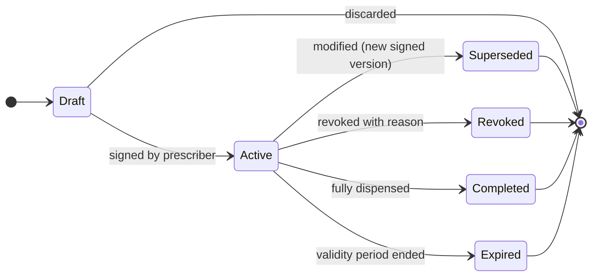
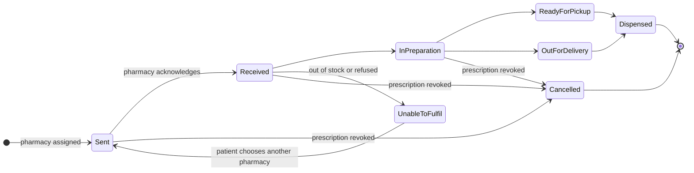
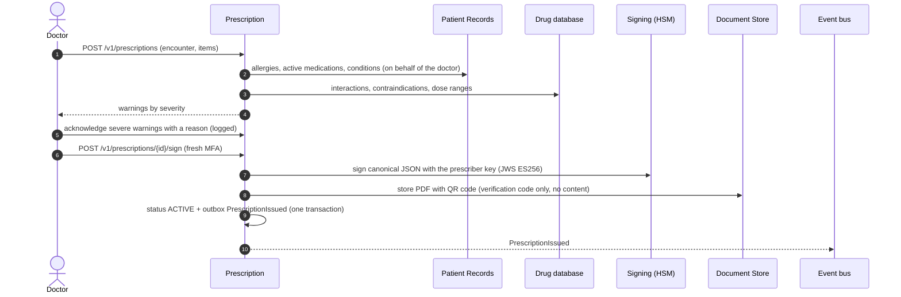

# 2.5 ⑤ Prescription Management Service

| Priority | Zone | Criticality | Owns |
|----------|------|-------------|------|
| Medium — M3 prescription management | Clinical | Tier 1 | Prescriptions and their versions, signatures, safety-check results, fulfilment status, renewal requests |

**Mission** — turn a doctor's decision into a **safe, signed, verifiable** electronic prescription that reaches the
right pharmacy in seconds, can be corrected or revoked instantly, and whose progress the patient can follow.

## Responsibilities

| Appendix 1 feature | How MedX delivers it |
|--------------------|----------------------|
| Doctors create, modify or revoke prescriptions post-consultation | Draft within an encounter → automatic **safety checks** → **e-signature** (step-up MFA) → active. Modification creates a new signed version that supersedes the previous one; revocation is a signed status change with a reason. |
| Notify pharmacies of new prescriptions or changes | `PrescriptionIssued / Modified / Revoked` events → Pharmacy Interface pushes to the pharmacy inbox and PMS webhook; revocations are **critical** (multi-channel, escalated until acknowledged). |
| Enable patients to view active prescriptions | Patient API and app screen: active prescriptions, remaining renewals, validity dates, printable PDF with QR code. |
| Track prescription fulfilment status | Fulfilment state machine fed by pharmacy updates; each change is visible to the patient and the prescriber. |

## Prescription and fulfilment lifecycles

The **legal status** of the prescription and the **fulfilment status** at the pharmacy are two separate state
machines — mixing them is a classic source of errors (e.g., "ready for pickup" on a revoked prescription).

Partial dispensing and renewals are tracked per line item (`dispensed_quantity`, `refills_remaining`).

## Creating and signing a prescription

- **Safety checks (clinical decision support)**: drug–drug interactions, allergy and cross-allergy, duplicate
  therapy, contraindications (pregnancy, age, renal function when known), dose range. The call to Records uses
  **token exchange** (RFC 8693) so the request is authorised as the doctor, not as a privileged service. If a check
  is unavailable, the doctor is told so explicitly and must acknowledge before signing.
- **Signature**: the canonical prescription (RFC 8785 JSON) is signed with the prescriber's key, held in the HSM and
  usable only after a fresh MFA; alternatively a qualified signature from a trust service provider or the
  professional smart card (eIDAS). The signed version is **immutable**.
- **QR code / verification code**: lets a pharmacy verify authenticity and **current status** (not revoked, not
  already dispensed, not expired) — it does not contain the prescription content.

## Modify and revoke

| Action | Rules | Pharmacy side |
|--------|-------|---------------|
| **Modify** | Only if not fully dispensed. Creates version *n+1* (new signature) referencing version *n*, which becomes *Superseded*; dispensed quantities stay valid. | `PrescriptionModified` (high priority); if preparation had started, the pharmacist must acknowledge the change before continuing. |
| **Revoke** | Reason required (error, adverse reaction, change of treatment). Signed status change. | `PrescriptionRevoked` (**critical**): portal alert + PMS webhook; if not acknowledged within 15 min, SMS/phone escalation to the pharmacy. If already dispensed, the prescriber is alerted to contact the patient. |
| **Renew** | Patient requests a renewal from the app → task for the prescriber → new prescription linked to the previous one, or refusal with a message. | New `PrescriptionIssued`. |

Controlled substances follow stricter, configurable rules per jurisdiction (secure prescription requirements,
maximum durations, no remote renewal, additional identity checks at the pharmacy).

## API (selection)

| Method | Endpoint | Purpose |
|--------|----------|---------|
| `POST` | `/v1/prescriptions` | Create a draft (encounter, items) |
| `POST` | `/v1/prescriptions/{id}/checks` | Run / re-run safety checks |
| `POST` | `/v1/prescriptions/{id}/sign` | Sign (step-up MFA) → Active |
| `POST` | `/v1/prescriptions/{id}/versions` | Modify → new signed version |
| `POST` | `/v1/prescriptions/{id}/revoke` | Revoke with reason |
| `PUT` | `/v1/prescriptions/{id}/pharmacy` | Patient assigns or changes the pharmacy |
| `GET` | `/v1/patients/me/prescriptions?status=active` | Patient view |
| `GET` | `/v1/prescriptions/{id}/fulfilment` | Fulfilment status timeline |
| `GET` | `/v1/prescriptions/verify?code=` | Pharmacy verification (authenticity + status) |
| `GET` | `/fhir/MedicationRequest?patient=` | Interoperability view |

## Events

- **Publishes** `prescription.v1`: PrescriptionIssued, PrescriptionModified, PrescriptionRevoked,
  PrescriptionExpired, PharmacyAssigned, FulfilmentStatusChanged.
- **Consumes** `pharmacy.fulfilment.v1` (acknowledgements and status updates, idempotent by sequence number),
  `identity.user.v1` (a suspended prescriber can no longer sign; active prescriptions are flagged for review).

## Data owned

PostgreSQL: `prescription`, `prescription_version` (signed, immutable), `prescription_item` (drug code, structured
dosage, quantity, refills, substitution allowed), `signature`, `status_history` (append-only), `fulfilment`,
`safety_check` (warnings and overrides with reason), `renewal_request`, `outbox`. Drug reference data is a read-only
replica refreshed from the drug database (public reference data, not PHI). Details in
[§3.4](../03-data-model-and-storage.md#34-logical-data-models-per-service).

## Security & privacy

- Signing requires a fresh strong authentication; signing keys never leave the HSM.
- **Minimum necessary for pharmacies**: patient name, birth date, (insurance number where required), items,
  prescriber identity and signature — never diagnosis or notes.
- Every read by a pharmacy is audited; verification endpoint rate-limited against enumeration of codes.

## Scalability & resilience

- 120 k prescriptions/day at Year 3 (≈ 1.4/s average, ≈ 15/s peak) plus ≈ 5 status updates each — light load;
  the service scales horizontally and the drug search is cached.
- Revocation delivery is designed for **safety, not throughput**: outbox (no lost event), push + webhook + escalation,
  and a reconciliation job that compares prescription and pharmacy states every 5 minutes.

## Design decisions & trade-offs

| Decision | Alternative | Why this choice |
|----------|-------------|-----------------|
| Modification = new signed version | Edit in place | Legal traceability: the pharmacy and the auditor can always see what was signed, when, and what replaced it. |
| Separate legal status and fulfilment status | One status field | Prevents contradictory states; each has a single owner (prescriber vs pharmacy). |
| FHIR `MedicationRequest` / `MedicationDispense` / `Task` mapping | Proprietary format | Direct path to national e-prescription services: where such a service exists (e.g., France's *ordonnance numérique*), an adapter registers each prescription there and the national service becomes the reference for dispensing. |
| Allergy check via Records at signing time | Local copy of allergies | Always current data for a safety decision; failure is explicit, never silent. |
