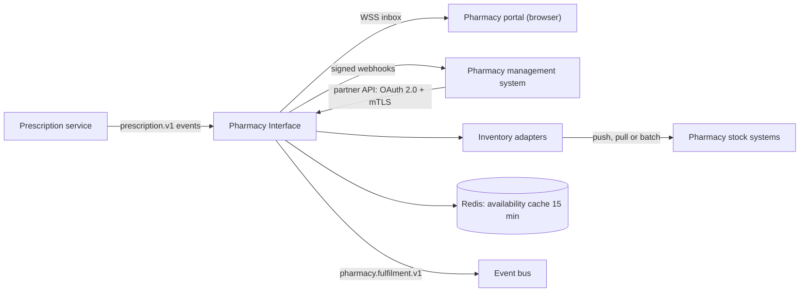
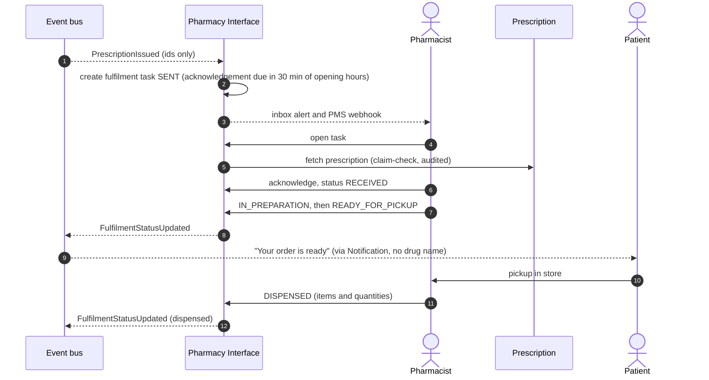

# 2.6 ⑥ Pharmacy Interface Service

| Priority | Zone | Criticality | Owns |
|----------|------|-------------|------|
| Low — L1 pharmacy interface | Clinical (minimised prescription data) | Tier 2 | Pharmacy registry, integrations, fulfilment tasks, patient–pharmacy conversations, inventory availability cache |

**Mission** — connect every pharmacy, from the independent shop with a web browser to the chain with its own
pharmacy management system (PMS), to MedX prescriptions — reliably and with the minimum patient data.

## Responsibilities

| Appendix 1 feature | How MedX delivers it |
|--------------------|----------------------|
| Confirm prescription receipt and update statuses ("Ready for pickup", "Dispatched"…) | Real-time **inbox** (portal) or **webhook + partner API** (PMS); acknowledgement with SLA tracking; status updates validated against the fulfilment state machine and forwarded to the Prescription service. |
| Interaction between patients and pharmacies | Secure **conversation threads** attached to a prescription (availability questions, substitution proposals, pickup times), with notifications on both sides and message templates. |
| Integrate with inventory systems | **Inventory adapters** per PMS vendor behind a common availability port; cached availability levels; "find a pharmacy that has my medicine nearby". |

## Integration modes

| Mode | For whom | Details |
|------|----------|---------|
| **Pharmacy portal** | Every pharmacy, no integration needed | Web app with real-time inbox, prescription view and printing, QR-code scan (webcam) for verification, status buttons, conversations. |
| **Partner API + webhooks** | Pharmacies whose PMS vendor integrates | REST and FHIR (`Task`, `MedicationDispense`) API; OAuth 2.0 client credentials with **mTLS**-bound tokens; outbound webhooks **signed (HMAC-SHA256 + timestamp)** with replay protection, retries with exponential backoff for 24 h, then dead-letter and portal fallback. |
| **Inventory adapters** | Pharmacies sharing stock data | Common port `checkAvailability(pharmacy, items)` returning IN_STOCK, LOW, OUT_OF_STOCK or UNKNOWN; strategies: push of stock deltas, real-time pull (2–3 s timeout) or nightly batch, depending on the vendor. |

## Fulfilment flow

- **Unable to fulfil** (out of stock, substitution refused): the patient is notified and offered nearby pharmacies
  that report the medicine in stock; reassignment restarts the flow.
- **Unacknowledged prescriptions**: if the SLA is missed, the patient is told and can choose another pharmacy.
- **Status updates are idempotent**: each update carries a sequence number; duplicates and out-of-order webhook
  retries are ignored.

## Data minimisation

A pharmacy only ever sees prescriptions **assigned to it** (or presented by the patient via the QR code), and only
the fields needed to dispense: patient name, birth date, insurance number where required, items, prescriber
identity and signature. **No diagnosis, no consultation notes, no record access.** Inventory data is exposed to
patients as availability levels, not quantities (commercial confidentiality).

## API (selection)

| Method | Endpoint | Purpose |
|--------|----------|---------|
| `GET` | `/v1/pharmacy/inbox?status=` | Pharmacy inbox |
| `POST` | `/v1/pharmacy/fulfilments/{id}/acknowledge` | Confirm receipt |
| `POST` | `/v1/pharmacy/fulfilments/{id}/status` | Update status (sequence number, idempotent) |
| `POST` | `/v1/pharmacy/fulfilments/{id}/dispense` | Record dispensed items and quantities |
| `GET` | `/v1/pharmacies/search?lat=&lon=&item=` | Nearby pharmacies with availability (patient) |
| `POST` | `/v1/conversations` · `/v1/conversations/{id}/messages` | Patient–pharmacy conversation |
| `GET` | `/partner/fhir/Task?owner={pharmacy}&status=requested` | PMS pull mode |
| `POST` | `/partner/v1/fulfilments/{id}/status` | PMS status push |

## Events

- **Publishes** `pharmacy.fulfilment.v1`: FulfilmentAcknowledged, FulfilmentStatusUpdated, UnableToFulfil,
  InquiryMessagePosted.
- **Consumes** `prescription.v1`: Issued, Modified, Revoked, PharmacyAssigned.

## Data owned

PostgreSQL: `pharmacy` (registry number, address, geolocation, opening hours, services), `integration` (mode,
endpoint, credential references in Vault), `fulfilment_task`, `status_event` (append-only), `conversation`,
`message` (encrypted), `outbox`. Redis: availability cache. Geo search with PostGIS. Details in
[§3.4](../03-data-model-and-storage.md#34-logical-data-models-per-service).

## Scalability & resilience

- 15 k pharmacies, ≈ 600 k status updates/day at Year 3 (≈ 7/s): light; webhook delivery workers scale on queue lag.
- A slow or failing PMS never blocks MedX: webhooks are asynchronous with retries and dead-letter, and the portal
  is always available as a fallback.
- Inventory queries are cached (15 min) and time-boxed; "unknown" is an acceptable answer.

## Design decisions & trade-offs

| Decision | Alternative | Why this choice |
|----------|-------------|-----------------|
| Portal **and** API | API only | Inclusion: small pharmacies can join on day one; integrated ones get automation. Cost: two channels to maintain. |
| Adapter per PMS vendor behind one port | Force one format on all vendors | Vendors integrate at their own pace; MedX's core stays clean (anti-corruption layer). |
| Availability levels, not quantities | Exact stock | Enough for the patient's decision; protects pharmacies' commercial data. |
| Low priority, delivered after the clinical core | Early delivery | Follows MedX priorities; until then, prescriptions are printable with a verifiable QR code usable in any pharmacy. |
