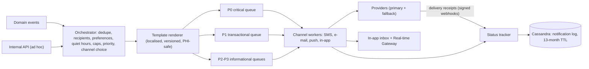
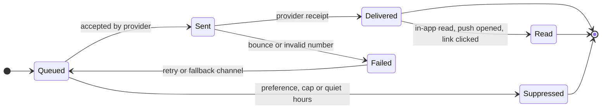

# 2.7 ⑦ Notification Service

| Priority | Zone | Criticality | Owns |
|----------|------|-------------|------|
| Low — L2 preferences (applied) · L3 delivery & read tracking — **a minimal version ships with the Medium features** (booking confirmations, reminders) | Engagement (no PHI) | Tier 2 (critical messages have their own lane) | Templates, local replica of preferences, notification log, delivery statuses, in-app inbox |

**Mission** — tell the right person the right thing on the right channel at the right time, **without ever putting
health information in an SMS, an e-mail or a push banner**.

## Responsibilities

| Appendix 1 feature | How MedX delivers it |
|--------------------|----------------------|
| Send alerts, reminders, updates (SMS, e-mail, in-app) | Event-driven pipeline with channel workers for **SMS, e-mail, push (APNs/FCM) and in-app** (Real-time Gateway + inbox); two providers per external channel with automatic failover. |
| Handle notification preferences (opt-in/opt-out, frequency) | Preferences owned by User Management and replicated locally from `PreferencesUpdated`; evaluated per category × channel, with quiet hours, frequency caps and digests. |
| Track delivery and read status | Status machine fed by provider receipts and client read receipts, stored in an append-only notification log; bounce handling; delivery dashboards. |

## Pipeline

## Priority lanes

| Lane | Examples | Behaviour | Target |
|------|----------|-----------|--------|
| **P0 critical** | Prescription revoked (to the pharmacy), urgent consultation assigned (to a doctor), break-glass alert (to the privacy office) | Ignores quiet hours; several channels in parallel; escalation if not read (e.g., SMS after 5 min, then phone) | dispatched < 10 s |
| **P1 transactional** | Booking confirmation or change, reminders, "medicine ready", payment receipt | Mandatory category (channel can be chosen, not disabled) | dispatched < 60 s |
| **P2 informational** | New document or message available | Fully controlled by preferences; digest possible | < 5 min |
| **P3 marketing** | Newsletter, surveys | **Explicit opt-in only** (GDPR/ePrivacy), frequency caps | batch |

Each lane has its own Kafka topic and worker pool, so a burst of reminders can never delay a revocation alert.

## PHI-safe content

| Channel | Example of what MedX sends | What it never contains |
|---------|---------------------------|------------------------|
| SMS | "MedX: your teleconsultation is tomorrow at 10:30. Join from the app." | Doctor name or specialty, reason, drug names, results |
| E-mail | Generic subject, deep link to the app, sender authentication (SPF, DKIM, DMARC) | Attachments with health data (invoices and documents are downloaded in the app) |
| Push | "You have a new message" | Message content on the lock screen |
| In-app | Full details after authentication | — |

Templates can only use **allow-listed variables**; a CI check rejects any template referencing a clinical field.

## Preferences

- Owned and edited in User Management (single source of truth); replicated here through `PreferencesUpdated`
  events into a local table and a Redis cache → no synchronous dependency at send time.
- Evaluated per **category × channel** (appointments, prescriptions, documents, messages, marketing), with quiet
  hours in the user's time zone, frequency caps (e.g., max 3 non-critical SMS per day) and daily digests.
- Mandatory notifications (security, legal, P0/P1) cannot be switched off entirely, only routed.

## Delivery and read tracking (L3)

- Status events are appended (never updated in place) with provider references and timestamps.
- **No tracking pixels in e-mails** (privacy): "read" for e-mail means a link was clicked or the item was opened in
  the app.
- Hard bounces mark the contact point invalid and emit `ContactPointInvalid` so the user is asked to update it.
- Dashboards: delivery rate per channel and provider, latency per lane; alert when a provider degrades (automatic
  failover to the second provider).

## Reliability

- **Idempotency**: deduplication key = event ID + recipient + channel (Redis, 24 h) — replays never double-send.
- Retries with exponential backoff and jitter, provider failover, dead-letter queue with operator replay.
- Reminder batches (e.g., all 9:00 appointments) are spread with jitter across the sending window.

## API (selection)

| Method | Endpoint | Purpose |
|--------|----------|---------|
| `POST` | `/v1/notifications` | Internal ad hoc send (service-to-service only) |
| `GET` | `/v1/users/me/notifications?cursor=` | In-app inbox |
| `POST` | `/v1/users/me/notifications/{id}/read` | Read receipt |
| `POST` | `/v1/webhooks/providers/{provider}` | Delivery receipts (signature verified) |
| `GET` | `/v1/admin/notifications/metrics` | Delivery statistics (aggregated, no content) |

## Events

- **Consumes** almost every business topic (see the [event catalogue](README.md#23-event-catalogue)) and
  `identity.preferences.v1`.
- **Publishes** `notification.delivery.v1`: NotificationSent, NotificationDelivered, NotificationRead,
  NotificationFailed, ContactPointInvalid.

## Data owned

PostgreSQL: `template` (versioned, per locale), `preference_replica`, `provider_config`. Cassandra:
`notification_by_recipient` (partition = recipient + month), `notification_status_event`, TTL 13 months. Redis:
deduplication keys, frequency counters, rate limits. Details in
[§3.4](../03-data-model-and-storage.md#34-logical-data-models-per-service).

## Scalability & resilience

- 2 M notifications/day at Year 3 (≈ 25/s average, **≈ 500/s at reminder peaks**): Kafka absorbs bursts; workers
  autoscale on consumer lag per lane; providers are rate-limited per account.
- Cassandra handles the write-heavy log (≈ 4 status events per notification) linearly, with TTL-based expiry
  instead of costly deletes.

## Design decisions & trade-offs

| Decision | Alternative | Why this choice |
|----------|-------------|-----------------|
| Generic, PHI-free external messages | Rich messages ("your dermatology appointment…") | SMS and e-mail are neither private nor within the HDS scope; convenience is kept by deep links into the authenticated app. |
| Wide-column store (Cassandra) for the log | PostgreSQL | Append-heavy time series queried by recipient, with TTL expiry: a natural fit; PostgreSQL stays for templates and preferences. |
| Build the orchestrator, buy the channels | Notification SaaS for everything | Preference, PHI and priority rules are MedX-specific and sensitive; message delivery is a commodity. |
| Separate lanes per priority | One queue | Guarantees that critical safety messages are never stuck behind bulk reminders. |
