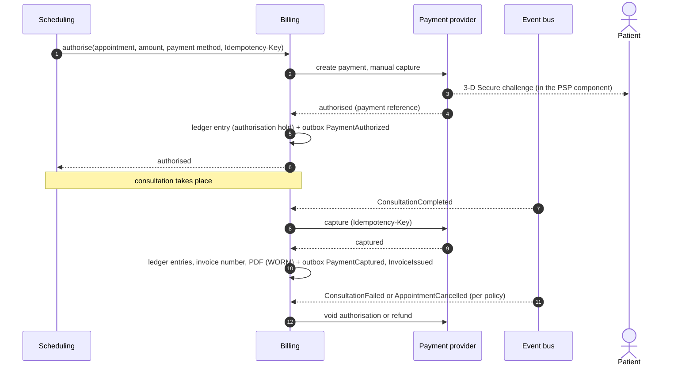
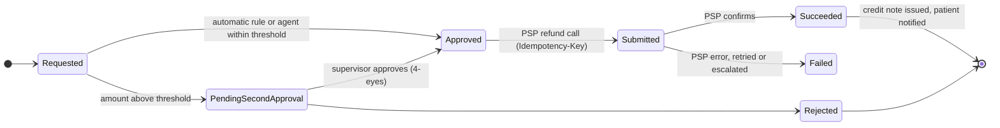

# 2.8 ⑧ Billing & Payment Service

| Priority | Zone | Criticality | Owns |
|----------|------|-------------|------|
| Low — L5 secure payment · L6 refunds | Payment (PCI scope minimised) | Tier 2 | Prices, payments (PSP references), double-entry ledger, invoices and credit notes, refunds, payouts |

**Mission** — charge the right amount at the right time, never touch a card number, keep books that reconcile to
the cent, and refund quickly and traceably when something goes wrong.

## Responsibilities

| Appendix 1 feature | How MedX delivers it |
|--------------------|----------------------|
| Handle consultation fees and process payments | Price per practitioner and consultation type; **pre-authorisation at booking, capture after the consultation**; cancellation policy; marketplace payouts to practitioners and pharmacies through the PSP. |
| Generate invoices for consultations and medication | Invoice issued on capture (on behalf of the practitioner or pharmacy): gapless numbering per issuer, immutable PDF stored WORM, **no clinical detail** on the invoice. |
| Process refunds if necessary | Automatic (doctor cancels, consultation failed technically) or manual (support within a threshold, 4-eyes above it); credit notes; full ledger trace. |
| Provide secure transaction mechanisms | **PSP hosted payment fields** (card data never reaches MedX) → PCI DSS **SAQ A**; 3-D Secure 2 (PSD2 strong customer authentication); tokenised payment methods; signed webhooks; idempotency everywhere. |

## Payment lifecycle

- **Authorisation expiry** — card authorisations expire after about 7 days, so for appointments booked further
  ahead the card is saved with strong authentication (setup intent) and authorised automatically 24 h before.
- **Cancellation policy** — free until 24 h before; late cancellation or no-show fee as disclosed at booking;
  **doctor cancellation or technical failure → automatic full release/refund**.
- **Medication charges** — when a pharmacy offers delivery or click-and-collect with online payment, the order is
  paid through the same flow; the invoice is issued on behalf of the pharmacy.
- **Payouts** — marketplace accounts at the PSP split each payment between the practitioner or pharmacy and the
  MedX fee; the PSP performs the payees' identity checks (KYC).

## Refunds (L6)

## Ledger and reconciliation

- **Double-entry, append-only ledger**: every money movement is a balanced journal entry (patient receivable,
  practitioner/pharmacy payable, MedX revenue, PSP clearing, refunds). Entries are never updated — corrections are
  new entries.
- **Idempotency**: every PSP call carries an idempotency key; every PSP webhook is de-duplicated by event ID and its
  raw payload kept for audit.
- **Daily reconciliation** with the PSP settlement report; any difference opens an incident.
- **Invoices** are immutable; a refund produces a **credit note**, never an edited invoice. Retention 10 years
  (commercial law), WORM storage.

## PCI DSS scope minimisation

| Measure | Effect |
|---------|--------|
| PSP-hosted fields / drop-in components (iframes) in the apps | Card numbers go from the device straight to the PSP; MedX stores only tokens, brand and last 4 digits. |
| Payment page script integrity (CSP, SRI, change detection — PCI DSS v4 req. 6.4.3 and 11.6.1) | Protects the page that embeds the PSP component against script injection (e-skimming). |
| Restricted PSP API keys in Vault, rotated | A leaked key cannot read card data or move funds beyond its permissions. |
| Payment namespace isolated by network policy | Only Scheduling, the gateway (webhooks) and the event bus can reach Billing. |
| No PHI in billing | Invoices say "Teleconsultation", never a specialty or a diagnosis. |

## API (selection)

| Method | Endpoint | Purpose |
|--------|----------|---------|
| `POST` | `/v1/payment-methods/setup` | Returns a PSP client secret for the hosted fields |
| `POST` | `/v1/payments/authorizations` | Internal (Scheduling): authorise a fee |
| `POST` | `/v1/payments/{id}/capture` | Internal: capture after the consultation |
| `POST` | `/v1/refunds` | Request a refund (automatic rules, support agent) |
| `POST` | `/v1/refunds/{id}/approve` | Second approval above threshold |
| `GET` | `/v1/users/me/invoices` · `/v1/invoices/{id}/pdf` | Patient invoices |
| `POST` | `/v1/webhooks/psp` | PSP events (signature verified, deduplicated) |

## Events

- **Publishes** `billing.payment.v1`: PaymentAuthorized, PaymentFailed, PaymentCaptured, PaymentVoided,
  RefundSucceeded, RefundFailed, InvoiceIssued.
- **Consumes** `consultation.session.v1` (capture or refund), `scheduling.appointment.v1` (cancellations, no-shows),
  `pharmacy.fulfilment.v1` (paid medication orders).

## Data owned

PostgreSQL: `customer` (PSP customer reference), `payment_method` (token, brand, last 4), `payment`, `ledger_account`,
`journal_entry` + `journal_line` (append-only), `invoice` + `invoice_line`, `credit_note`, `refund`, `psp_event`
(raw, deduplication), `payout`, `outbox`. Amounts stored as **integers in minor units + ISO 4217 currency**.
Invoice PDFs in the Document Store (WORM). Details in [§3.4](../03-data-model-and-storage.md#34-logical-data-models-per-service).

## Scalability & resilience

- ≈ 200 k payments/day at Year 3 (≈ 2–3/s): throughput is not the challenge, **correctness** is — hence idempotency,
  outbox, ledger and reconciliation.
- If the PSP is unavailable, bookings can proceed in "pay later" mode (configurable by risk), captured when the PSP
  recovers; no request is lost thanks to the outbox and retries.

## Design decisions & trade-offs

| Decision | Alternative | Why this choice |
|----------|-------------|-----------------|
| PSP hosted fields (SAQ A) | Handle card data (SAQ D) | Removes the heaviest compliance scope and the most attractive target. Cost: less control of the payment UI. |
| Own double-entry ledger | Rely on the PSP dashboard | Auditability, marketplace splits, refunds and reconciliation require MedX's own books. |
| Pre-authorise then capture | Charge at booking | Patient pays only for consultations that happened; fewer refunds. Cost: authorisation-expiry handling. |
| Low priority, but security by design from day one | Postpone security with the feature | Payment is delivered last, but its design already keeps card data out of MedX. |
