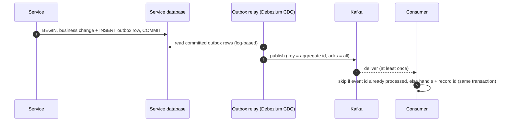
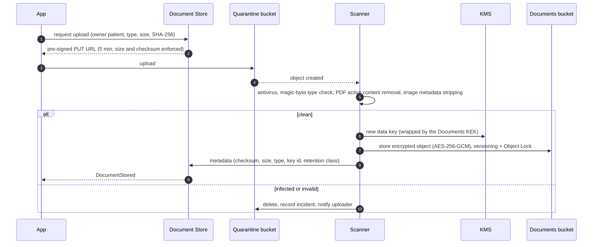

# 2.9 Platform Components

Shared capabilities used by every business service. Several of them carry **High-priority** requirements (H1
encryption, H4 authorization, H5 integrity and secure files), so they are built once, by the platform team, and
reused everywhere.

| Component | Priority served | Tier |
|-----------|-----------------|------|
| [API Gateway & edge](#api-gateway--edge) | H1, H4 | 0 |
| [Real-time Gateway](#real-time-gateway) | M2 | 1 |
| [Policy Decision Point (OPA)](#policy-decision-point-opa) | H4, M4 | 0 |
| [Event bus (Kafka) & outbox](#event-bus-kafka--outbox) | H5 | 1 |
| [Secure Document Store](#secure-document-store) | H1, H5 | 1 |
| [Audit Trail](#audit-trail) | H2, H3, H5 | 1 (writes buffered in outboxes) |
| [Keys & secrets](#keys--secrets) | H1 | 0 |
| [Observability & security monitoring](#observability--security-monitoring) | all | 1 |
| [De-identified data platform](#de-identified-data-platform) | L4 | 2 |

## API Gateway & edge

- **CDN** serves only static assets (app bundles, images); API responses containing personal data are sent with
  `Cache-Control: no-store` and never cached at the edge.
- **WAF** with OWASP core rules, bot management, geo/IP reputation, virtual patching; **DDoS protection** L3–L7.
- **API Gateway** (Envoy-based): TLS 1.3 termination (HSTS), routing by audience (`/patient`, `/clinician`,
  `/pharmacy`, `/partner`; `/admin` is **not exposed publicly** — reachable only through the zero-trust access proxy),
  JWT validation for three issuers (realms) with cached JWKS, DPoP proof validation, mTLS for partners, per-user /
  per-IP / per-client **rate limits and quotas** (stricter on login, search and verification endpoints), request size
  limits, OpenAPI schema validation, CORS, security headers, correlation IDs, webhook ingress per provider with
  signature verification.
- Access logs contain metadata only (route, status, latency, pseudonymous subject) — never bodies or query strings
  with personal data.

## Real-time Gateway

- WebSocket (WSS) connections for chat, presence, live statuses and in-app notifications — **one connection per app**,
  multiplexing channels.
- Authentication at connection time (access token); every channel subscription (`user:{id}`,
  `consultation:{id}`, `pharmacy:{id}`) is authorised by the owning service; connections are re-validated on token
  refresh and closed on revocation.
- Stateless fan-out through Redis pub/sub (or NATS): any node can deliver to any user; heartbeats, resume tokens
  after reconnect, connection draining on deployment.
- Sizing: 200 k concurrent connections at Year 3 peak ≈ 10 pods at ~25 k connections each, autoscaled on connection
  count.

## Policy Decision Point (OPA)

- **Sidecar** next to every service: decisions in < 1 ms, no network hop, keeps working if the policy server is down.
- Policies written in Rego, stored in Git, reviewed, **unit-tested in CI** (positive and negative cases for every
  rule), compiled into **signed bundles**, distributed to sidecars (pull every 60 s, last good bundle kept).
- Inputs: subject (from the validated token), action, resource (type, owner patient, security labels), purpose of
  use, and per-request **facts** looked up by the service (care grant, consent, emergency grant).
- Outputs: `allow` + **obligations** (masking, exclusions, audit level).
- Decision logs (without PHI) go to the audit pipeline for forensics.

## Event bus (Kafka) & outbox

- **No dual writes**: an event exists if and only if the business change was committed.
- Kafka: 3 brokers over 3 AZs, replication factor 3, `min.insync.replicas = 2`, `acks = all`, idempotent producers;
  TLS + SASL/mTLS authentication, **ACLs per service** (a service can only produce its own topics and consume what it
  needs), encryption at rest.
- Schema registry with backward-compatibility checks in CI; breaking changes = new topic version.
- Retention 7 days (30 days for `audit.events.v1`); dead-letter topic per consumer group with alerting and replay.

## Secure Document Store

- **Double encryption**: application-level AES-256-GCM with a per-file data key (wrapped by the Documents KEK and
  registered against the owner patient for crypto-shredding) **plus** bucket-level SSE-KMS.
- **Integrity**: SHA-256 computed by the client, verified at upload, re-verified at every download and by a weekly
  scrub job; object versioning; **Object Lock** (compliance mode) for documents under legal retention.
- **Access**: downloads go through the Document Store, which asks the owning service's policy (Records,
  Consultation, Billing) whether the caller may read this document; streamed decryption; every download audited.
  Quarantine objects are deleted after 24 h at the latest.
- **Limits**: 50 MB per file; allowed types PDF, JPEG, PNG, HEIC (DICOM imaging is out of scope for v1).
- **Durability**: object storage durability of 11 nines + cross-region replication + immutable backup copy.

## Audit Trail

- **What is audited**: every read, creation, update, export, sharing, break-glass, authentication event and
  administrative action on personal data. Schema aligned with FHIR `AuditEvent` / IHE BALP: who (subject, role,
  organisation, assurance level, device, IP), what (action, resource type/ID, patient), when, why (**purpose of use**:
  treatment, emergency treatment, patient request, payment, operations, support), outcome, correlation ID.
- **Pipeline**: services write audit events to their **outbox in the same transaction** as the access → Kafka
  `audit.events.v1` (restricted ACL) → Audit service → (1) **WORM archive**: batches hash-chained, Merkle root signed
  by an HSM key and timestamped daily, stored with Object Lock in the **security account**; (2) **search index**
  (restricted OpenSearch, 13 months) for investigations and for the patient's "who accessed my record" page;
  (3) **SIEM** stream for real-time rules.
- **Who can read it**: privacy officers and auditors (read-only, themselves audited); patients see their own access
  history; no engineer can modify or delete audit data.
- **Retention**: at least 6 years, configurable up to the medical-record retention.

## Keys & secrets

- **KMS backed by HSMs** (FIPS 140-3 level 3): key-encryption keys per service × environment × data class; usage
  restricted by IAM policy (the Billing role cannot decrypt Records keys); automatic yearly rotation; multi-region
  keys for DR; every use logged.
- **Envelope encryption** in the services (see [§5.6](../05-security-and-compliance.md#56-encryption-at-rest-and-key-management)):
  per-patient / per-file / per-consultation data keys, cached unwrapped in memory ≤ 5 min.
- **HashiCorp Vault**: dynamic database credentials (1 h TTL), Transit engine for encrypting integration secrets
  (calendar OAuth tokens, PMS credentials), PKI for internal certificates, secrets injected at runtime — **no secret
  in code, images or plain environment variables**; separation of duties between key custodians and data
  administrators.

## Observability & security monitoring

- **OpenTelemetry** everywhere: traces (W3C `traceparent` propagated through HTTP and Kafka headers), metrics (RED
  for services, USE for resources), structured logs. Backends: Prometheus/Grafana, Loki, Tempo.
- **PHI never in telemetry**: log fields are allow-listed, identifiers tokenised, request bodies never logged; a
  scanner samples logs for PHI patterns and alerts.
- **SLOs and error budgets** per service tier; multi-window burn-rate alerts; **synthetic probes** call the emergency
  path every minute from both regions.
- **SIEM** correlation rules: break-glass events, mass record access, access without care grant attempts, impossible
  travel, MFA disabled, privilege escalation, anomalous exports; **user and entity behaviour analytics** to detect
  "curious insiders" (e.g., a doctor opening records of patients with no appointment, or of a celebrity).

## De-identified data platform

- Purpose: product analytics, capacity planning, quality indicators, research (with consent), and **datasets for
  staging, demo and tests** (L4).
- Change-data-capture from service replicas into a **secure processing enclave** in the production account, where
  pseudonymisation/anonymisation jobs run; only de-identified outputs leave the enclave (columnar files queried by an
  analytics engine).
- Techniques and controls are described in [§5.7](../05-security-and-compliance.md#57-data-masking-redaction-and-anonymization):
  removal of direct identifiers, keyed pseudonyms, generalisation, date shifting, k-anonymity checks, DPO approval.
- Staging and demo use **synthetic patients** (e.g., generated with Synthea in FHIR format) — never real PHI.
