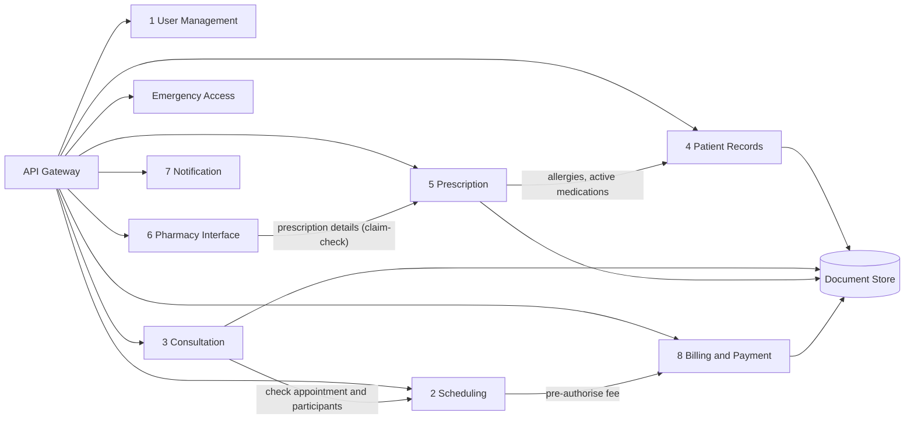

# 2. Detailed Component Designs

> **Deliverable 2.** Functionalities, interfaces and interactions of every MedX component.
> Architecture overview: [1. High-level architecture](../01-high-level-architecture.md).

## 2.0 How to read this section

Each of the eight business components of Appendix 1 has its own document with the same structure:
**mission & priority → responsibilities (mapped to Appendix 1) → internal design → key flows → API → events →
data owned → security → scalability & resilience → design decisions & trade-offs.**

| # | Component | Priority (Appendix 2) | Zone | Tier | Document |
|---|-----------|-----------------------|------|------|----------|
| ① | User Management (identity & access) | **HIGH** (H4) · Low (L2 preferences) | Identity & access | 0 | [01-user-management.md](01-user-management.md) |
| ② | Teleconsultation Scheduling | Medium (M1, M5) | Clinical | 1 | [02-scheduling.md](02-scheduling.md) |
| ③ | Consultation (video, chat, files) | Medium (M2) | Clinical + media plane | 1 | [03-consultation.md](03-consultation.md) |
| ④ | Patient Records + Emergency Access | **HIGH** (H2, H3, H5) · Medium (M4) | Clinical | 0 / 1 | [04-patient-records.md](04-patient-records.md) |
| ⑤ | Prescription Management | Medium (M3) | Clinical | 1 | [05-prescription.md](05-prescription.md) |
| ⑥ | Pharmacy Interface | Low (L1) | Clinical (minimised data) | 2 | [06-pharmacy-interface.md](06-pharmacy-interface.md) |
| ⑦ | Notification | Low (L2, L3) | Engagement | 2 | [07-notification.md](07-notification.md) |
| ⑧ | Billing & Payment | Low (L5, L6) | Payment | 2 | [08-billing-payment.md](08-billing-payment.md) |
| — | Platform components (gateways, policy engine, event bus, document store, audit, keys, observability, data platform) | **HIGH** (H1, H4, H5) · Low (L4) | Edge / platform | 0–2 | [09-platform-components.md](09-platform-components.md) |

## 2.1 Common service blueprint

Every service is generated from the same **golden-path template**, so security and operability do not depend on
each team's memory.

| Concern | Standard applied to every service |
|---------|-----------------------------------|
| **API contract** | OpenAPI 3.1 (FHIR CapabilityStatement for the Records service), URI versioning (`/v1`), additive changes only within a version, cursor pagination, errors as `application/problem+json` (RFC 9457), `Idempotency-Key` required on every `POST` that creates something. |
| **Authentication** | JWT validated again in the service (defence in depth, even behind the gateway); service-to-service identity through mesh mTLS (SPIFFE IDs). |
| **Authorization** | A Policy Enforcement Point (PEP) in the service calls the local OPA sidecar with `subject · action · resource · purpose`; deny by default; obligations (masking) applied before the response leaves. |
| **Data** | Private database/schema and credentials (issued by Vault, 1 h TTL); reviewed migrations (Flyway); **UUIDv7** identifiers (time-ordered, never sequential integers exposed to clients); `outbox` table for events. |
| **Events** | CloudEvents envelope, schema in the registry, published via the outbox relay; consumers idempotent (processed-event table), dead-letter topic after 5 attempts. |
| **Resilience** | ≥ 3 replicas spread over 3 AZs (Tier 0/1), readiness/liveness probes, graceful shutdown, pod disruption budgets, timeouts + retries with jitter + circuit breakers (mesh), bulkheads for critical paths. |
| **Observability** | OpenTelemetry traces (W3C `traceparent` also propagated in Kafka headers), RED metrics, structured JSON logs **without PHI** (allow-listed fields, tokenised identifiers), SLO dashboard and alerts. |
| **Delivery** | CI: unit, contract (consumer-driven) and integration tests, SAST, dependency and container scanning, signed images; CD: GitOps, canary release through the mesh with automatic rollback. |

## 2.2 Synchronous dependencies

Synchronous calls are limited to cases where a user is waiting for an answer. The graph is acyclic and never
deeper than two hops; everything else goes through events.



| Caller → callee | Why synchronous | Failure handling |
|-----------------|-----------------|------------------|
| Scheduling → Billing | The patient is waiting for the booking confirmation that depends on the payment authorisation | Timeout 5 s, slot hold kept 10 min so the patient can retry; no retry on non-idempotent calls without the idempotency key |
| Consultation → Scheduling | Join tokens are issued only to the appointment's participants within its time window | Local replica of today's appointments (built from events) used if Scheduling is unavailable |
| Prescription → Records | Allergy and interaction checks need the current allergy and medication lists | On failure the doctor sees "safety check unavailable" and must explicitly acknowledge before signing |
| Pharmacy Interface → Prescription | Pharmacies fetch the full prescription only when they open it (events carry identifiers only) | Retries with backoff; the pharmacy portal shows the item as "loading" |
| Services → Document Store | Upload/download of files | Uploads resumable; downloads retried |

## 2.3 Event catalogue

Topic naming: `<domain>.<aggregate>.v<major>`. Partition key = aggregate identifier (keeps per-aggregate ordering).
Events carry **identifiers, statuses and timestamps — never clinical content**; consumers fetch details from the
owning service under their own authorisation (claim-check).

| Topic | Events | Producer | Main consumers |
|-------|--------|----------|----------------|
| `identity.user.v1` | UserRegistered, ProfileUpdated, PractitionerVerified, PractitionerSuspended, UserDeactivated, RoleAssigned, DelegationGranted/Revoked | ① User Management | ② (enable/disable agendas), ④ (create patient record & keys, revoke grants), ⑦, ⑧ |
| `identity.preferences.v1` | PreferencesUpdated | ① | ⑦ |
| `scheduling.appointment.v1` | AppointmentBooked, AppointmentRescheduled, AppointmentCancelled, AppointmentNoShow, AppointmentReminderDue, WaitlistSlotOffered, UrgentRequestCreated/Assigned | ② | ③ (plan rooms), ④ (care grants), ⑦, ⑧ (void/refund) |
| `consultation.session.v1` | ConsultationOpened, ConsultationStarted, ConsultationCompleted, ConsultationFailed, ChatTranscriptReady | ③ | ② (complete/no-show), ④ (encounter, transcript archive), ⑧ (capture or refund), ⑦ |
| `records.record.v1` | RecordUpdated, DocumentAdded, ResultReleased, ConsentChanged | ④ | ④ projections (critical summary, timeline), ⑦ ("new document available") |
| `records.emergency.v1` | BreakGlassGranted, BreakGlassReviewDue, BreakGlassReviewed | ④ | Audit/SIEM (real-time alert), ⑦ (privacy office, patient notice) |
| `prescription.v1` | PrescriptionIssued, PrescriptionModified, PrescriptionRevoked, PrescriptionExpired, PharmacyAssigned, FulfilmentStatusChanged | ⑤ | ⑥, ④ (medication list), ⑦, ⑧ (medication orders) |
| `pharmacy.fulfilment.v1` | FulfilmentAcknowledged, FulfilmentStatusUpdated, UnableToFulfil, InquiryMessagePosted | ⑥ | ⑤ (status of record), ⑦ |
| `notification.delivery.v1` | NotificationSent, NotificationDelivered, NotificationRead, NotificationFailed, ContactPointInvalid | ⑦ | ① (invalid contact), analytics |
| `billing.payment.v1` | PaymentAuthorized, PaymentFailed, PaymentCaptured, PaymentVoided, RefundSucceeded, RefundFailed, InvoiceIssued | ⑧ | ② (booking saga), ⑦ (receipts), ⑥ (paid orders) |
| `audit.events.v1` | AuditEvent (one per access or change to personal data) | every service, via its outbox | Audit Trail, SIEM |

**Example event** (no drug name, no diagnosis — only what a consumer needs to decide whether to fetch more):

```json
{
  "specversion": "1.0",
  "id": "01929e8c-6f1a-7c2b-9d3e-5a4b3c2d1e0f",
  "source": "medx/prescription-service",
  "type": "medx.prescription.issued.v1",
  "subject": "prescription/01929e8c-51aa-7d10-8f00-1b2c3d4e5f60",
  "time": "2026-03-02T10:15:30Z",
  "datacontenttype": "application/json",
  "traceparent": "00-4bf92f3577b34da6a3ce929d0e0e4736-00f067aa0ba902b7-01",
  "data": {
    "prescriptionId": "01929e8c-51aa-7d10-8f00-1b2c3d4e5f60",
    "version": 1,
    "patientId": "01927f3a-0c55-7e21-a9f4-6d7e8f9a0b1c",
    "prescriberId": "01920b11-7a2e-7c3d-8e4f-5a6b7c8d9e0f",
    "pharmacyId": "01925d22-3b4c-7d5e-8f6a-7b8c9d0e1f2a",
    "validUntil": "2026-06-02"
  }
}
```

## 2.4 Component interaction summary

| Component | Calls (sync) | Publishes | Consumes |
|-----------|--------------|-----------|----------|
| ① User Management | IdP (embedded), identity federation | `identity.*` | `notification.delivery.v1` (invalid contacts) |
| ② Scheduling | Billing, calendar providers | `scheduling.appointment.v1` | `identity.user.v1`, `consultation.session.v1`, `billing.payment.v1` |
| ③ Consultation | Scheduling, Document Store, SFU API | `consultation.session.v1` | `scheduling.appointment.v1` |
| ④ Patient Records | Document Store, KMS | `records.*` | `identity.user.v1`, `scheduling.appointment.v1`, `consultation.session.v1`, `prescription.v1` |
| ⑤ Prescription | Records, drug database, Document Store, HSM signing | `prescription.v1` | `pharmacy.fulfilment.v1`, `identity.user.v1` |
| ⑥ Pharmacy Interface | Prescription, pharmacy systems | `pharmacy.fulfilment.v1` | `prescription.v1` |
| ⑦ Notification | Messaging providers | `notification.delivery.v1` | almost every topic |
| ⑧ Billing & Payment | PSP, Document Store | `billing.payment.v1` | `scheduling.appointment.v1`, `consultation.session.v1`, `prescription.v1` |
