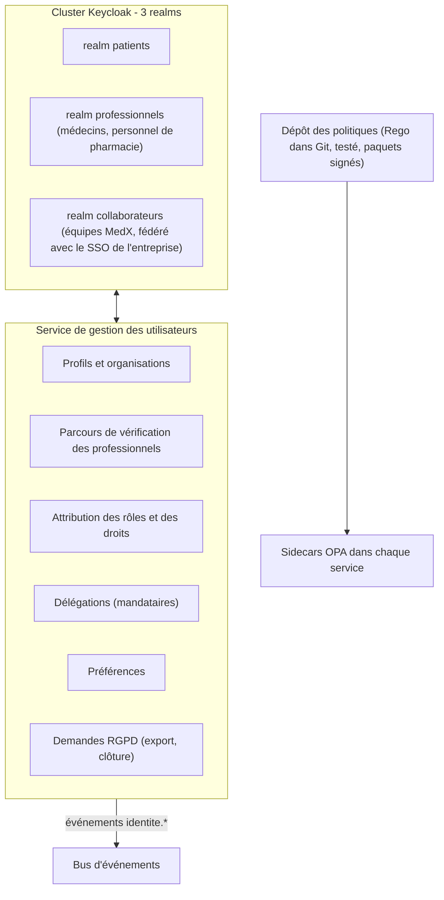
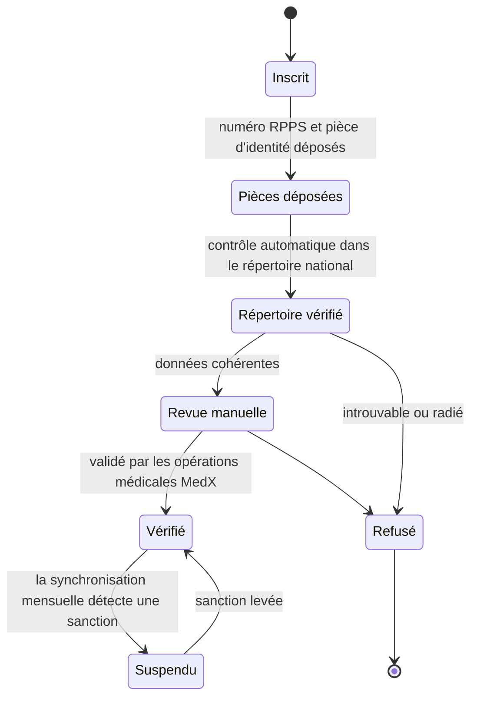

# 2.1 ① Service de gestion des utilisateurs — identité et accès

| Priorité | Zone | Criticité | Détient |
|----------|------|-----------|---------|
| **Haute** — H4 authentification et autorisations · Basse — B2 préférences des utilisateurs | Identité et accès | Niveau 0 (connexion, validation des jetons) | Identités, profils, rôles, organisations, délégations, préférences |

**Mission** — savoir qui est chaque utilisateur, le prouver de manière forte, et donner à tous les autres services une
base fiable pour décider de ce que cet utilisateur a le droit de faire.

## Responsabilités

| Fonctionnalité de l'Annexe 1 | Comment MedX la réalise |
|------------------------------|-------------------------|
| Gérer les inscriptions et les mises à jour de profil | Les **patients** s'inscrivent eux-mêmes (vérification de l'e-mail et du téléphone). L'accès à leur dossier médical exige une identité vérifiée (FranceConnect ou contrôle de pièce d'identité). Les **médecins** suivent un parcours d'intégration professionnel : numéro vérifié dans le répertoire national (RPPS / Annuaire Santé), pièce d'identité, validation manuelle. Les **pharmacies** s'inscrivent comme organisations (numéro FINESS vérifié) ; l'administrateur de la pharmacie invite son personnel. |
| Authentifier les utilisateurs | Fournisseur d'identité **Keycloak** : OpenID Connect Authorization Code + PKCE, **MFA obligatoire pour tous les professionnels** (passkeys/WebAuthn, TOTP, ou carte professionnelle via Pro Santé Connect), MFA selon le risque pour les patients, authentification renforcée pour les actions sensibles. |
| Autoriser l'accès selon les rôles | Rôles **RBAC** grossiers portés par les jetons + décisions **ABAC** fines prises par le moteur de politiques (OPA) à côté de chaque service : relation de soin, consentement, finalité, sensibilité de la donnée, organisation. |
| Stocker et gérer les préférences | API de préférences (langue, fuseau horaire, accessibilité, canaux de notification par catégorie, heures de silence, plafonds de fréquence). Chaque modification est publiée (`PreferencesMisesAJour`) : le service de notification l'applique sans devoir rappeler ce service. |

## Conception interne



- **Trois *realms*** (espaces d'identité Keycloak) isolent des populations aux risques différents : les règles
  « patients » privilégient la facilité d'usage (passkeys, biométrie sur mobile), les règles « professionnels » sont
  strictes (MFA systématique, déconnexion après 15 minutes d'inactivité, session de 12 heures au plus), et les
  identités des collaborateurs viennent de l'annuaire de l'entreprise, avec des clés de sécurité matérielles.
- **Les politiques sont du code** : fichiers Rego dans Git, testés unitairement en CI (`opa test`), empaquetés en
  **paquets signés** que les sidecars OPA récupèrent. Une modification de politique est relue comme n'importe quel
  code et reste entièrement traçable.
- Le service conserve les **attributs** (rôles, appartenance à une organisation, droits comme `acces_urgence`) et les
  expose dans les jetons ; les faits qui changent à chaque requête (autorisations de soin, consentements) sont lus par
  le service appelant et transmis à OPA en entrée.

## Rôles et permissions (couche RBAC)

| Capacité | Patient | Mandataire | Médecin | Médecin + `acces_urgence` | Pharmacien / préparateur | Agent de support | DPO | Admin plateforme |
|----------|:-------:|:----------:|:-------:|:-------------------------:|:------------------------:|:----------------:|:---:|:----------------:|
| Gérer son profil et ses préférences | ✅ | ✅ (délégué) | ✅ | ✅ | ✅ | — | — | — |
| Prendre / annuler des consultations | les siennes | celles de la personne représentée | — | — | — | assistance, sans donnée de santé | — | — |
| Gérer ses disponibilités et son agenda | — | — | le sien | le sien | — | — | — | — |
| Lire un dossier médical | le sien (selon les règles de publication) | périmètre délégué | **avec autorisation de soin** | + **bris de glace** | ❌ | ❌ | métadonnées d'audit seulement | ❌ |
| Rédiger des notes cliniques | déposer ses propres documents | — | avec autorisation de soin | note d'urgence | ❌ | ❌ | ❌ | ❌ |
| Créer / modifier / révoquer des ordonnances | — | — | pour ses patients | — | ❌ | ❌ | ❌ | ❌ |
| Consulter des ordonnances | les siennes | celles de la personne représentée | celles qu'il a émises | via bris de glace | **uniquement celles attribuées à sa pharmacie** (minimisées) | ❌ | ❌ | ❌ |
| Mettre à jour le statut de délivrance | — | — | — | — | ✅ | ❌ | ❌ | ❌ |
| Effectuer des remboursements | demander | demander | — | — | — | ≤ seuil (double validation au-delà) | — | ❌ |
| Consulter la piste d'audit | l'historique des accès à son dossier | — | — | — | — | ❌ | ✅ | ❌ |
| Exploiter l'infrastructure | — | — | — | — | — | — | — | juste-à-temps, limité dans le temps, **sans donnée de santé** |

## Couche ABAC (politique illustrative)

Le RBAC répond à « un médecin peut-il lire des dossiers ? » ; l'ABAC répond à « **ce** médecin peut-il lire le
dossier de **ce** patient **maintenant**, pour **cette** finalité ? ».

```rego
package medx.dossier

import rego.v1

default allow := false

# Médecin traitant : vérifié, authentifié par MFA, titulaire d'une autorisation de soin non expirée pour ce patient
allow if {
    input.sujet.role == "medecin"
    input.sujet.verifie
    input.sujet.niveau_authentification >= 2
    input.faits.autorisation_soin.expire_le > input.maintenant
    not sensible_sans_consentement
}

# Bris de glace : lecture seule, limité dans le temps, jamais si le patient s'y est légalement opposé
allow if {
    "acces_urgence" in input.sujet.droits
    input.finalite == "ETREAT"
    input.action == "lire"
    input.faits.autorisation_urgence.expire_le > input.maintenant
    not input.faits.opposition_bris_de_glace
}

sensible_sans_consentement if {
    input.ressource.label_securite == "restreint"
    not input.faits.consentement_explicite
}

# Obligations renvoyées avec la décision et appliquées par le service avant de répondre
obligations contains {"masquer": "notes-psychotherapie"} if input.finalite == "ETREAT"
```

## Parcours d'authentification

| Public | Parcours | Facteurs | Session et jetons |
|--------|----------|----------|-------------------|
| Application mobile patient | OIDC Authorization Code + PKCE via le navigateur du système | Mot de passe ou passkey ; second facteur selon le risque (nouvel appareil, téléchargement du dossier) ; déverrouillage biométrique du jeton de rafraîchissement stocké | Jeton d'accès de 10 min, **lié par DPoP** (RFC 9449) ; jeton de rafraîchissement renouvelé à chaque usage, fenêtre glissante de 30 jours, lié à l'appareil |
| Application web patient | Idem, client confidentiel via un petit backend dédié (*BFF*) qui conserve les jetons côté serveur | Idem | Cookies HttpOnly, Secure, SameSite ; aucun jeton dans le stockage du navigateur |
| Portails médecin / pharmacie | OIDC Authorization Code + PKCE | **MFA obligatoire** : passkey/WebAuthn, TOTP ou carte professionnelle (e-CPS via Pro Santé Connect) ; OTP par SMS interdit (risque de détournement de SIM) | Jeton d'accès de 5 min, déconnexion après 15 min d'inactivité, 12 h au plus ; authentification renforcée (`max_age`/`acr`) avant de signer une ordonnance ou de briser la glace |
| Logiciels de pharmacie (LGO) | OAuth 2.0 *client credentials* | **Certificat client mTLS**, jetons liés au certificat (RFC 8705) | Jeton de 5 min, scopes et limites de débit par pharmacie |
| Collaborateurs MedX | SSO avec l'annuaire de l'entreprise | Clé matérielle FIDO2 | Rôles à privilèges uniquement via une élévation juste-à-temps (approbation, durée limitée, session enregistrée) |

**Contenu des jetons** — les jetons d'accès sont des JWT signés en ES256 (clés renouvelées, publiées sur le point JWKS)
qui contiennent un identifiant de sujet opaque (UUID), le realm, les rôles, l'organisation, les droits, le niveau
d'authentification (`acr`/`amr`) et l'audience. Ils **ne contiennent jamais de donnée personnelle** (ni nom, ni e-mail,
ni date de naissance).

**Révocation** — la déconnexion, la réinitialisation du mot de passe et la suspension d'un compte révoquent
immédiatement toute la famille de jetons de rafraîchissement ; la courte durée de vie des jetons d'accès borne
l'exposition restante, et une liste de refus dans Redis (vérifiée par la passerelle) coupe les comptes suspendus en
quelques secondes.

**Protection des comptes** — mots de passe hachés avec Argon2id (PBKDF2-SHA512 en mode FIPS), 12 caractères minimum,
vérification contre les mots de passe compromis, pas de renouvellement périodique forcé (NIST SP 800-63B) ; limitation
progressive du débit et verrouillage ; détection des robots à l'inscription et à la connexion ; alerte lors d'une
connexion depuis un nouvel appareil ; récupération de compte qui ne dégrade jamais le niveau d'assurance (un
professionnel qui perd un facteur repasse par la vérification d'identité).

## Flux clés

**Intégration d'un professionnel**



**Accès par mandataire (délégation)** — un parent est rattaché à un mineur après vérification des justificatifs (le
lien expire à la majorité ; les soins que le mineur a demandé de garder confidentiels sont masqués au parent par la
politique) ; un patient adulte peut déléguer des droits précis (prendre rendez-vous, voir ses ordonnances, voir son
dossier) à un aidant, et les retirer à tout moment.

## API (sélection)

| Méthode | Point d'accès | Rôle |
|---------|---------------|------|
| `POST` | `/v1/utilisateurs` | Inscription d'un patient |
| `POST` | `/v1/inscriptions-praticiens` | Démarrer l'intégration d'un professionnel |
| `GET` / `PATCH` | `/v1/utilisateurs/moi` | Lire / modifier son profil |
| `GET` / `PUT` | `/v1/utilisateurs/moi/preferences` | Lire / remplacer ses préférences (versionnées, `If-Match`) |
| `POST` / `DELETE` | `/v1/utilisateurs/moi/delegations` | Accorder / retirer un accès de mandataire |
| `POST` | `/v1/organisations/{idOrganisation}/membres` | L'administrateur de la pharmacie invite son personnel |
| `POST` | `/v1/admin/inscriptions-praticiens/{id}/decision` | Valider / refuser (console d'administration, double validation) |
| `POST` | `/v1/utilisateurs/moi/demandes-rgpd` | Demande d'accès ou de portabilité, clôture du compte |
| — | `/realms/{realm}/protocol/openid-connect/*` | Points d'accès OIDC standard (authorize, token, JWKS, logout) |

## Données détenues

PostgreSQL (base `gestion_utilisateurs`) + la base PostgreSQL propre à Keycloak — détail au
[§3.4](../03-modele-donnees-et-stockage.md#34-modèles-logiques-par-service). Les coordonnées (téléphone, adresse,
identifiant national) sont chiffrées au niveau du champ ; l'e-mail est stocké chiffré **avec un index aveugle** (HMAC
à clé) : on peut encore retrouver un compte par e-mail pour la connexion sans que l'adresse soit lisible.

## Scalabilité et résilience

- La **validation** des jetons est locale partout (passerelle et services gardent le JWKS en cache) : le fournisseur
  d'identité ne traite que les connexions et les renouvellements, environ 3 M par jour en année 3, soit environ 35/s
  en moyenne et 300/s en pointe — modeste, mais le hachage des mots de passe consomme beaucoup de CPU : les points de
  connexion sont donc limités en débit et les nœuds Keycloak dimensionnés sur ce coût.
- Keycloak tourne en cluster de 3 nœuds ou plus répartis sur les AZ, avec un cache de sessions distribué, **actif dans
  les deux régions** (niveau 0) : les soignants peuvent encore se connecter pendant une bascule régionale.
- Le service de gestion des utilisateurs est lui-même sans état et monte en charge horizontalement ; les lectures de
  profil sont mises en cache 60 s.

## Décisions de conception et compromis

| Décision | Alternative | Pourquoi ce choix |
|----------|-------------|-------------------|
| Réutiliser un fournisseur d'identité éprouvé (Keycloak) | Développer l'authentification en interne | C'est dans l'authentification que le code maison échoue de la manière la plus dangereuse ; Keycloak apporte OIDC, MFA, WebAuthn, fédération et audits. Coût : exploiter et maintenir à jour un cluster avec état. |
| JWT de courte durée validés localement | Jetons opaques + introspection à chaque appel | Retire le fournisseur d'identité du chemin critique (latence, résilience du chemin d'urgence). Coût : la révocation n'est pas instantanée → durées de 5 à 10 min + liste de refus pour les événements à risque. |
| RBAC + ABAC avec OPA | RBAC seul | Le RBAC seul ne sait exprimer ni la relation de soin, ni le consentement, ni le bris de glace. OPA garde des politiques testables et versionnées. |
| Un realm par population | Un seul realm | Niveaux d'assurance et règles de session différents ; une erreur de configuration côté patients ne peut pas affaiblir les comptes professionnels. |
