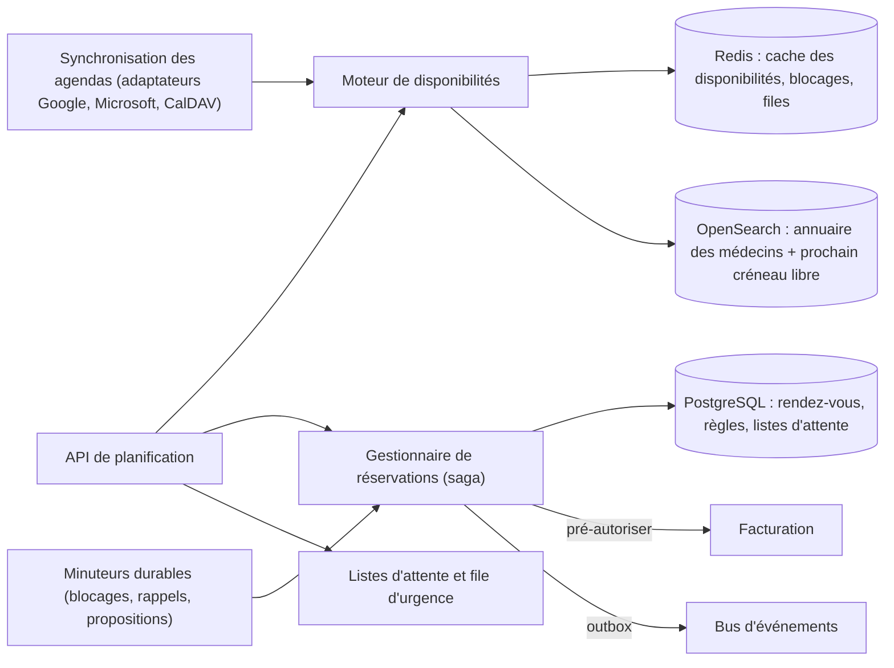
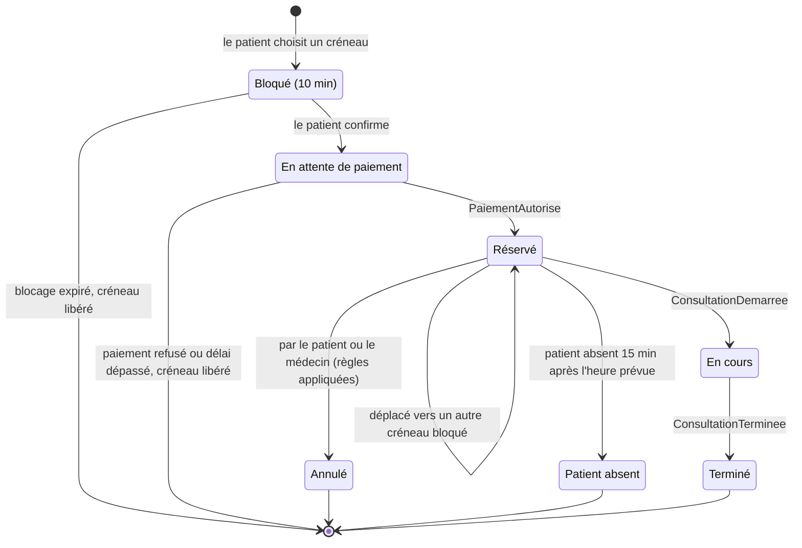
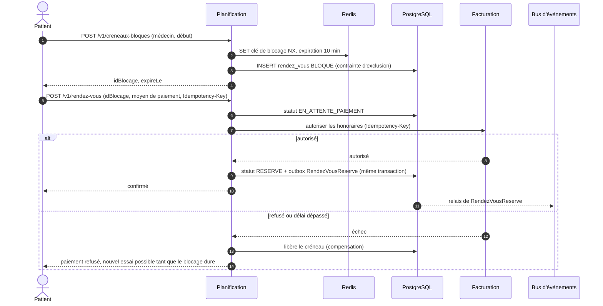

# 2.2 ② Service de planification des téléconsultations

| Priorité | Zone | Criticité | Détient |
|----------|------|-----------|---------|
| Moyenne — M1 planification · M5 agendas externes | Clinique (un rendez-vous chez un spécialiste est une donnée de santé) | Niveau 1 | Règles de disponibilité, rendez-vous, listes d'attente, demandes urgentes, connexions aux agendas |

**Mission** — permettre au patient de trouver et de réserver la bonne consultation en quelques gestes, ne jamais
réserver deux fois le même créneau d'un médecin, tenir les médecins informés en temps réel et offrir une voie plus
rapide aux cas urgents.

## Responsabilités

| Fonctionnalité de l'Annexe 1 | Comment MedX la réalise |
|------------------------------|-------------------------|
| Réserver, déplacer, annuler des consultations | Recherche de créneaux → **blocage** court → confirmation avec pré-autorisation du paiement (saga avec la Facturation). Un déplacement transfère le même rendez-vous vers un nouveau créneau bloqué ; une annulation applique les règles d'annulation (gratuite jusqu'à 24 h avant). |
| Prévenir les médecins des nouvelles réservations ou des changements | Événements `RendezVousReserve / RendezVousDeplace / RendezVousAnnule` → Notification (push/e-mail selon les préférences) **et** mise à jour en direct de l'agenda du médecin via la passerelle temps réel. |
| S'intégrer aux agendas des médecins | Connecteurs Google Agenda, Microsoft 365 (Graph) et CalDAV : les plages occupées externes bloquent les créneaux MedX ; les rendez-vous MedX sont réinscrits dans l'agenda **sans aucune donnée patient**. |
| Listes d'attente et priorité pour les cas urgents | Liste d'attente par médecin ou par spécialité avec proposition automatique quand un créneau se libère ; questionnaire de triage → niveau d'urgence ; **file d'urgence à la demande** servie par des médecins de garde ; capacité réservée à l'urgence. |

## Conception interne



| Module | Rôle |
|--------|------|
| **Moteur de disponibilités** | Calcule les créneaux libres = règles récurrentes (RRULE, par type de consultation) − exceptions (congés) − plages occupées externes − créneaux réservés ou bloqués − capacité réservée à l'urgence. Précalcule les 60 prochains jours de chaque médecin dans Redis ; recalcule de façon incrémentale à chaque événement pertinent. |
| **Gestionnaire de réservations** | Blocages, confirmations, déplacements, annulations ; orchestre la saga de paiement ; porte la machine à états du rendez-vous. |
| **Listes d'attente et file d'urgence** | Files de priorité, propositions de créneaux avec blocage exclusif limité dans le temps, attribution des demandes urgentes aux médecins de garde. |
| **Synchronisation des agendas** | Connexions OAuth, webhooks de notifications poussées, synchronisation incrémentale, écriture des événements sortants, renouvellement des abonnements, rapprochement nocturne. |
| **Minuteurs durables** | Planificateur adossé à la base (survit aux redémarrages) pour l'expiration des blocages, les rappels (J-1, H-1, 10 min avant) et l'expiration des propositions de liste d'attente. |
| **Projection annuaire** | Profils de médecins dénormalisés (spécialité, langues, tarifs, prochain créneau libre) dans OpenSearch pour une recherche rapide. |

## Cycle de vie d'un rendez-vous



## Saga de réservation et prévention des doubles réservations



Deux garde-fous indépendants empêchent les doubles réservations :

1. **Chemin rapide** — un blocage atomique dans Redis (`SET … NX PX 600000`) rejette les tentatives concurrentes sur
   le même créneau en moins d'une milliseconde.
2. **Source de vérité** — une **contrainte d'exclusion** PostgreSQL rend physiquement impossible le chevauchement de
   deux rendez-vous actifs d'un même médecin, même si Redis est indisponible ou si un bogue contourne le blocage :

```sql
CREATE EXTENSION IF NOT EXISTS btree_gist;

ALTER TABLE rendez_vous
  ADD CONSTRAINT rendez_vous_sans_chevauchement
  EXCLUDE USING gist (
    id_praticien WITH =,
    tstzrange(debut, fin, '[)') WITH &&
  )
  WHERE (statut IN ('BLOQUE', 'EN_ATTENTE_PAIEMENT', 'RESERVE', 'EN_COURS'));
```

## Liste d'attente et cas urgents

- **Liste d'attente** — un patient peut attendre un créneau plus tôt avec un médecin donné ou avec n'importe quel
  médecin d'une spécialité. Quand un créneau se libère, il est proposé au meilleur candidat, classé **par niveau
  d'urgence puis par ancienneté d'attente**, avec un blocage exclusif de 15 minutes ; s'il refuse ou ne répond pas,
  le candidat suivant le reçoit.
- **Triage** — un court questionnaire validé médicalement (à base de règles, prudent) classe la demande :
  `URGENCE_VITALE` (signes d'alerte → **la réservation s'arrête et l'application affiche le 15 / 112**), `URGENT`
  (le jour même), `PROCHE` (sous 48 h), `ROUTINE`. La téléconsultation ne doit jamais retarder une prise en charge
  en urgence.
- **File d'urgence à la demande** — les demandes `URGENT` entrent dans une file servie par les médecins de garde
  (appariés selon la spécialité, la langue, l'autorisation d'exercice). Un médecin a 2 minutes pour accepter avant que
  la demande ne passe au suivant ; un tableau de supervision suit l'objectif de temps d'attente (< 30 min) et
  déclenche une escalade.
- **Capacité réservée** — les médecins peuvent réserver une part de leurs créneaux aux cas urgents ; les créneaux
  réservés non utilisés sont ouverts à tous 2 heures avant.

## Intégration des agendas externes

| Aspect | Conception |
|--------|------------|
| Fournisseurs | Google Agenda (API), Microsoft Graph (Outlook / Microsoft 365), CalDAV (Apple iCloud et autres) |
| Consentement et scopes | Le médecin se connecte via OAuth 2.0 avec des **scopes minimaux** : lecture des plages libre/occupé, écriture limitée aux événements MedX (un agenda « MedX » dédié quand le fournisseur le permet). CalDAV utilise un mot de passe d'application stocké dans Vault. |
| Entrant (plages occupées) | Notifications poussées du fournisseur (canaux *watch* Google, abonnements Graph) → webhook via la passerelle → lecture incrémentale (jeton de synchronisation / lien delta) → mise à jour de `plage_occupee_externe` → disponibilités recalculées en quelques secondes. Interrogation de secours toutes les 10 min ; rapprochement complet chaque nuit ; renouvellement automatique des abonnements qui expirent. |
| Sortant (réservations MedX) | Chaque réservation crée un événement intitulé **« Téléconsultation MedX »** avec un lien vers le portail — **ni nom de patient, ni motif, ni spécialité**. Les déplacements et annulations le mettent à jour ou le suppriment (correspondance `id_rendez_vous ↔ id_evenement_externe`, idempotente). |
| Minimisation des données | Seuls le début et la fin des plages occupées sont stockés — jamais les titres, participants ou descriptions des événements privés du médecin. |
| Conflits | Les rendez-vous MedX font foi. Si le médecin ajoute un événement privé qui chevauche une réservation MedX, MedX l'alerte ; il n'annule jamais un patient automatiquement. |
| Pannes | Gestion des limites de débit par fournisseur avec temporisation exponentielle et disjoncteur ; si un fournisseur est indisponible, les dernières plages occupées connues sont utilisées et le médecin voit un bandeau « synchronisation de l'agenda retardée ». |
| Secrets | Jetons de rafraîchissement OAuth chiffrés avec Vault Transit, révoqués quand le médecin se déconnecte. |

## API (sélection)

| Méthode | Point d'accès | Rôle |
|---------|---------------|------|
| `GET` | `/v1/praticiens?specialite=&langue=&date=` | Recherche dans l'annuaire (OpenSearch) |
| `GET` | `/v1/praticiens/{id}/creneaux?du=&au=&type=` | Créneaux libres (cache Redis) |
| `POST` | `/v1/creneaux-bloques` | Bloquer un créneau pendant 10 min |
| `POST` | `/v1/rendez-vous` | Confirmer la réservation (`Idempotency-Key`, `idBlocage`, moyen de paiement) |
| `POST` | `/v1/rendez-vous/{id}/deplacement` | Déplacer vers un autre créneau bloqué |
| `POST` | `/v1/rendez-vous/{id}/annulation` | Annuler avec un motif (règles → remboursement ou annulation de l'autorisation) |
| `POST` | `/v1/listes-attente/inscriptions` | S'inscrire sur une liste d'attente |
| `POST` | `/v1/demandes-urgentes` | Réponses de triage → file d'urgence ou conseil d'appeler le 15 |
| `PUT` | `/v1/praticiens/moi/regles-disponibilite` | Disponibilités récurrentes du médecin |
| `POST` | `/v1/praticiens/moi/connexions-agenda` | Démarrer la connexion OAuth à un agenda externe |
| `POST` | `/v1/webhooks/agendas/{fournisseur}` | Notifications poussées des fournisseurs (jetons de canal vérifiés) |

## Événements

- **Publie** `planification.rendez-vous.v1` : RendezVousReserve, RendezVousDeplace, RendezVousAnnule, PatientAbsent,
  RappelRendezVousDu, CreneauProposeListeAttente, DemandeUrgenteCreee, DemandeUrgenteAttribuee.
- **Consomme** `facturation.paiement.v1` (PaiementAutorise / PaiementEchoue), `consultation.seance.v1`
  (ConsultationDemarree / ConsultationTerminee → statut), `identite.utilisateur.v1` (PraticienVerifie active l'agenda ;
  PraticienSuspendu le gèle et déclenche la reprogrammation des patients).

## Données détenues

PostgreSQL : `regle_disponibilite`, `exception_disponibilite`, `rendez_vous` (+ `historique_rendez_vous` en ajout
seul), `inscription_liste_attente`, `demande_urgente`, `connexion_agenda`, `plage_occupee_externe`, `minuteur`,
`outbox`. Redis : blocages, disponibilités par médecin et par jour, files d'attente. OpenSearch : annuaire des médecins
(données de profil public uniquement). Détail au [§3.4](../03-modele-donnees-et-stockage.md#34-modèles-logiques-par-service).

## Sécurité et confidentialité

- Les patients ne voient que leurs rendez-vous ; les médecins, seulement leur agenda ; les agents de support voient des
  données masquées.
- Le motif du rendez-vous et les réponses de triage sont des données de santé : chiffrés au niveau du champ, visibles
  seulement par le patient et le médecin réservé.
- La recherche dans l'annuaire est publique (profils seulement) et protégée contre l'aspiration de données par
  limitation de débit et détection des robots.

## Scalabilité et résilience

- **Les lectures dominent** (recherche et disponibilités) : elles sont servies par OpenSearch et le cache Redis des
  disponibilités, si bien que la navigation ne sollicite pas la base ; les entrées de cache sont recalculées sur
  événement, pas à la lecture.
- **Les écritures restent modestes** (200 000 réservations par jour en année 3 ≈ 2 à 3/s, pointes ≈ 30/s) et la
  concurrence reste locale à un médecin.
- Les pointes (lundi de 8 h à 10 h, épidémies) sont absorbées par la mise à l'échelle automatique sur le débit de
  requêtes ; si le prestataire de paiement ralentit, le blocage garde le créneau pour le patient.

## Décisions de conception et compromis

| Décision | Alternative | Pourquoi ce choix |
|----------|-------------|-------------------|
| Disponibilités précalculées | Calcul à chaque requête | Recherche rapide et prévisible même en pointe. Coût : logique d'invalidation, fraîcheur bornée (quelques secondes). |
| Blocage Redis **et** contrainte d'exclusion en base | L'un des deux seulement | Redis apporte la vitesse ; la contrainte apporte la garantie. Ceinture et bretelles pour un problème que les utilisateurs remarquent immédiatement. |
| Pré-autorisation du paiement à la réservation, encaissement après la consultation | Paiement à la fin | Moins de rendez-vous non honorés et d'impayés ; le patient ne paie qu'une consultation qui a eu lieu. Coût : les autorisations expirent au bout d'environ 7 jours → pour les rendez-vous lointains, la carte est enregistrée (authentification forte) et l'autorisation demandée 24 h avant. |
| Plages libre/occupé uniquement, aucune donnée de santé dans les agendas externes | Synchronisation complète dans les deux sens | Les agendas externes sont hors de la frontière de confiance de MedX et hors périmètre HDS. |
