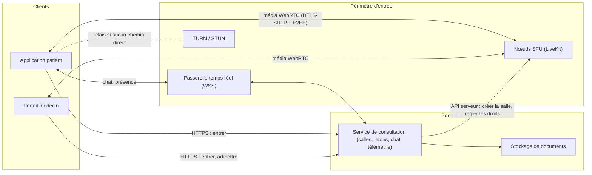
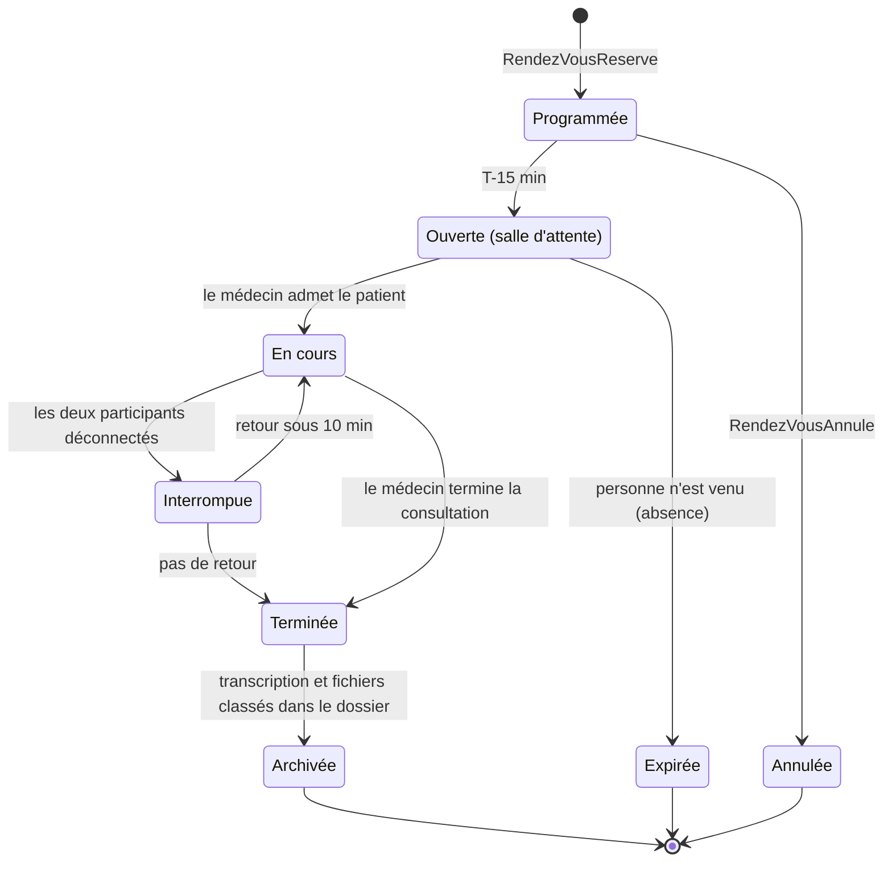
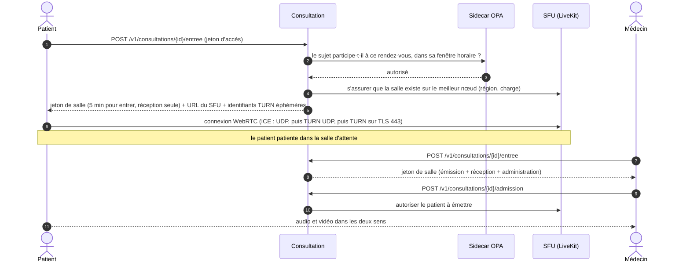
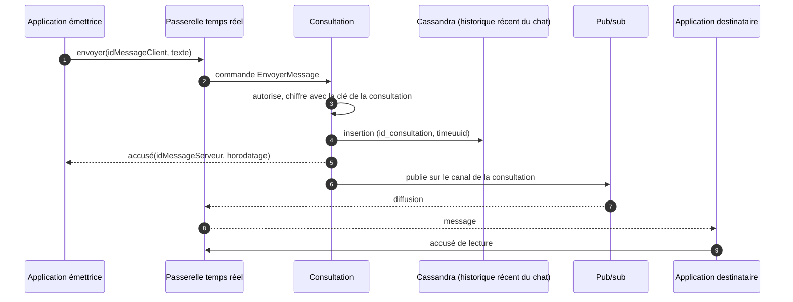

# 2.3 ③ Service de consultation — vidéo, audio, chat et fichiers

| Priorité | Zone | Criticité | Détient |
|----------|------|-----------|---------|
| Moyenne — M2 services de consultation | Plan de contrôle dans la zone clinique · plan média dans le périmètre d'entrée | Niveau 1 | Salles virtuelles, participants, événements de séance, historique récent du chat, télémétrie de qualité d'appel |

**Mission** — offrir au patient et au médecin une salle virtuelle fiable et confidentielle : une bonne vidéo même sur
un mauvais réseau, un chat qui ne perd jamais de message, et un moyen sûr d'échanger des documents médicaux.

## Responsabilités

| Fonctionnalité de l'Annexe 1 | Comment MedX la réalise |
|------------------------------|-------------------------|
| Créer des salles virtuelles | Une salle par rendez-vous, préparée dès la réservation et ouverte 15 min avant ; **salle d'attente** jusqu'à ce que le médecin admette le patient ; identifiants de salle de 128 bits, impossibles à deviner. |
| Gérer les flux vidéo et audio | **WebRTC** via un **SFU** auto-hébergé (LiveKit) avec relais TURN/STUN ; simulcast et débit adaptatif ; repli automatique en audio seul ; reconnexion par redémarrage ICE. |
| Permettre le chat pendant la consultation | Chat via la passerelle temps réel (WSS), persistant et ordonné par salle, avec accusés de réception et de lecture ; transcription archivée dans le dossier patient à la fin. |
| Permettre le transfert de documents médicaux | Dépôts via le **stockage sécurisé de documents** (quarantaine, antivirus, contrôle de type, chiffrement) ; fichiers partagés dans le chat ; le médecin peut les classer dans le dossier. |

## Plan de contrôle et plan média

- Le **plan de contrôle** (service de consultation) décide *qui* peut entrer dans *quelle* salle et *quand* ; il ne
  touche jamais au média.
- Le **plan média** (SFU + TURN) ne fait que relayer des paquets chiffrés ; il ne stocke rien et ne conserve aucune
  donnée de santé. Les nœuds média sont dans des sous-réseaux publics car WebRTC a besoin de ports UDP publics.

## Cycle de vie de la salle

## Rejoindre une consultation

Les jetons sont **de courte durée, limités à une salle et à un participant** ; dans le SFU, l'identité du participant
est un pseudonyme, jamais le nom du patient. Des participants supplémentaires (interprète, aidant) ne peuvent être
invités qu'avec le consentement du patient et reçoivent leur propre jeton limité.

## Qualité média sur des réseaux réels

| Technique | Effet |
|-----------|-------|
| Simulcast (3 couches) + dynacast | Chaque destinataire reçoit la couche que sa bande passante permet ; les couches inutilisées sont suspendues pour économiser la voie montante. |
| Audio Opus avec correction d'erreurs intégrée et DTX | La parole reste intelligible jusqu'à environ 20 % de pertes de paquets ; l'audio est prioritaire sur la vidéo. |
| Contrôle de congestion (*transport-wide CC*) | Le débit s'adapte en continu ; sous environ 150 kbit/s, l'appel bascule automatiquement en **audio seul**. |
| TURN sur TLS, port 443 | Fonctionne sur les réseaux restrictifs d'hôpitaux et d'entreprises. |
| Redémarrage ICE + reconnexion | Passer du Wi-Fi à la 4G ne met pas fin à la consultation. |
| Test avant l'appel | Caméra, micro et bande passante vérifiés avant l'entrée en salle d'attente. |
| Télémétrie de qualité | Statistiques WebRTC (aller-retour, gigue, pertes, gels d'image) relevées toutes les 10 s — ni média, ni donnée de santé — qui alimentent tableaux de bord et alertes par région et par nœud TURN. |

## Confidentialité des flux média

- **Le chiffrement de saut en saut est obligatoire** : WebRTC utilise toujours DTLS-SRTP.
- Le **chiffrement de bout en bout (E2EE)** par *insertable streams* (SFrame) est **activé par défaut pour les
  consultations en tête-à-tête** quand les deux appareils le permettent : les clés sont négociées entre les appareils
  des participants et jamais stockées par MedX, si bien que ni MedX ni l'opérateur du SFU ne peuvent déchiffrer l'audio
  ou la vidéo.
- **Aucun enregistrement** des consultations (confidentialité dès la conception). Si un enregistrement était un jour
  introduit (par exemple pour la formation), il exigerait un consentement explicite, désactiverait l'E2EE pour cette
  séance et serait conservé comme un document du dossier.

## Chat

- **Effet « exactement une fois »** : livraison au moins une fois + déduplication sur `idMessageClient` ; ordre fixé
  par le time-UUID du serveur.
- **Conservation** : l'historique récent garde les messages 30 jours (TTL) pour le confort ; à la fin de la
  consultation, la transcription complète est **archivée dans le dossier patient** (`TranscriptionChatPrete` → le
  dossier crée un document), qui constitue la copie légale et durable.
- Les indicateurs de saisie et la présence sont éphémères (jamais stockés).

## Partage de fichiers

1. L'application demande un emplacement de dépôt au stockage de documents → URL présignée vers un compartiment de
   **quarantaine** (valable 5 min, 50 Mo au plus, types autorisés : PDF, JPEG, PNG, HEIC).
2. Le fichier est analysé (antivirus, vrai type d'après les octets de signature, contenu actif des PDF retiré,
   métadonnées des images comme la position GPS supprimées), puis chiffré et déplacé dans le compartiment des
   documents avec sa somme de contrôle SHA-256.
3. Un message « fichier partagé » qui référence l'identifiant du document apparaît dans le chat ; les téléchargements
   passent par le stockage de documents avec la même autorisation que la consultation, et sont audités.
4. Les fichiers envoyés par le patient sont rattachés automatiquement à la rencontre comme *documents fournis par le
   patient* ; le médecin décide lesquels classer définitivement dans le dossier.

## API (sélection)

| Méthode | Point d'accès | Rôle |
|---------|---------------|------|
| `POST` | `/v1/consultations/{id}/entree` | Jeton de salle + URL du SFU + identifiants TURN éphémères |
| `POST` | `/v1/consultations/{id}/admission` | Le médecin admet le patient depuis la salle d'attente |
| `POST` | `/v1/consultations/{id}/participants` | Inviter un interprète ou un aidant (consentement du patient requis) |
| `POST` | `/v1/consultations/{id}/fin` | Le médecin termine la consultation |
| `GET` | `/v1/consultations/{id}/messages?curseur=` | Historique du chat (paginé) |
| `POST` | `/v1/consultations/{id}/fichiers` | Demander un emplacement de dépôt (délégué au stockage de documents) |
| `POST` | `/v1/telemetrie/webrtc` | Statistiques de qualité d'appel |
| `WSS` | `/v1/temps-reel` → canal `consultation:{id}` | Chat, accusés, présence |

## Événements

- **Publie** `consultation.seance.v1` : ConsultationOuverte, ConsultationDemarree, ConsultationTerminee (durée,
  participants), ConsultationEchouee (personne n'a pu se connecter → remboursement automatique), TranscriptionChatPrete.
- **Consomme** `planification.rendez-vous.v1` (préparer, déplacer ou annuler les salles).

## Données détenues

PostgreSQL (`consultation`, `participant`, `evenement_seance`, `synthese_qualite`), Cassandra (`message_chat`, TTL de
30 jours, contenu chiffré), Redis (routage salle → nœud SFU, présence). Les fichiers appartiennent au stockage de
documents.

## Scalabilité et résilience

- **Dimensionnement (année 3)** : 10 000 séances simultanées → 20 000 participants ; environ 1,2 Mbit/s en moyenne par
  flux reçu → environ 24 Gbit/s en sortie des SFU. À environ 200 participants par nœud de 8 vCPU (à confirmer par des
  tests de charge), il faut **une centaine de nœuds média en pointe**, jusqu'à 200 pour la marge ×2, répartis sur trois
  AZ.
- **Placement** : chaque salle en tête-à-tête vit sur un seul nœud, dans la région la plus proche des participants ;
  lors d'une réduction de capacité, les nœuds sont **vidés, jamais coupés** (plus de nouvelles salles, les appels en
  cours se terminent).
- **TURN** dimensionné pour environ 20 % de séances relayées (réseaux restrictifs).
- **Panne d'un nœud média** : les clients se reconnectent automatiquement à un autre nœud en quelques secondes
  (redémarrage ICE) ; l'état de la salle est recréé depuis le plan de contrôle.
- **Mode dégradé** : si la vidéo est impossible, audio seul ; si le média échoue totalement, le chat continue et le
  médecin peut appeler le patient par téléphone (l'événement est journalisé).

## Décisions de conception et compromis

| Décision | Alternative | Pourquoi ce choix |
|----------|-------------|-------------------|
| SFU open source auto-hébergé (LiveKit) | CPaaS vidéo (Vonage, Daily…) | Le média reste sur une infrastructure européenne certifiée HDS ; coût plus faible à grande échelle ; E2EE possible. Coût : exploiter des serveurs média (UDP, mise à l'échelle, TURN). Un CPaaS reste une solution de repli si le délai de mise sur le marché prime. |
| SFU | Maillage pair-à-pair / MCU | Le pair-à-pair ne donne aucun contrôle sur la qualité, le relais ou les appels à plusieurs (interprète) ; un MCU décode et mixe les flux (très gourmand en CPU, incompatible avec l'E2EE). Le SFU relaie des paquets : il monte en charge et reste compatible avec l'E2EE. |
| E2EE activé par défaut en tête-à-tête | Chiffrement de saut en saut seulement | Confidentialité maximale pour les échanges les plus sensibles. Coût : pas d'enregistrement ni de transcription côté serveur, un peu plus de CPU sur l'appareil. |
| Historique récent du chat + archive dans le dossier | Chat écrit directement dans le dossier | Messagerie à faible latence sans charger le stockage des dossiers ; le dossier reçoit malgré tout la transcription complète. |
