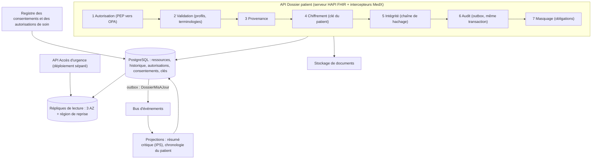
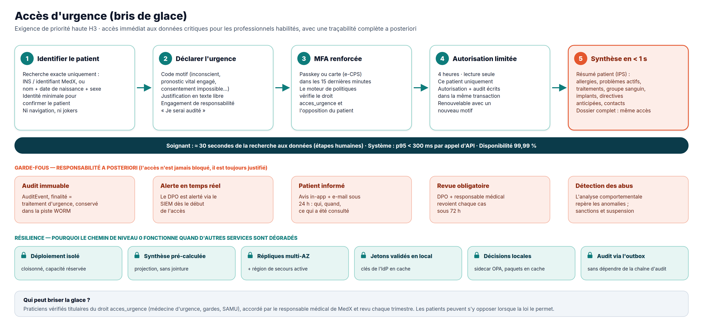
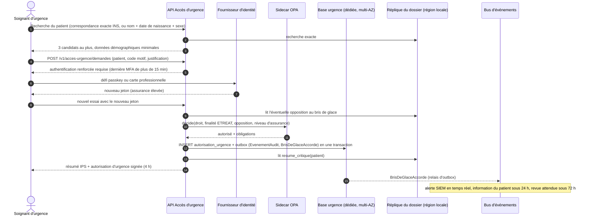

# 2.4 ④ Service de gestion des dossiers patients et accès d'urgence

| Priorité | Zone | Criticité | Détient |
|----------|------|-----------|---------|
| **Haute** — H2 gestion des dossiers · H3 accès d'urgence · H5 intégrité · Moyenne — M4 masquage et caviardage | Clinique | **Niveau 0** (lecture, accès d'urgence) · niveau 1 (écritures) | Le dossier médical (ressources FHIR et leur historique), les consentements, les autorisations de soin, les autorisations d'urgence, les résumés critiques, les clés de données des patients |

**Mission** — tenir le dossier médical de chaque patient, tout au long de sa vie, **complet, exact et infalsifiable**,
ne le montrer qu'aux bonnes personnes et pour de bonnes raisons, et rendre sa partie critique disponible **en quelques
secondes** en cas d'urgence.

## Responsabilités

| Fonctionnalité de l'Annexe 1 | Comment MedX la réalise |
|------------------------------|-------------------------|
| Stocker et gérer les antécédents, les notes de consultation et les autres éléments du dossier | Ressources **HL7 FHIR R4** (pathologies, allergies, traitements, vaccinations, actes, observations, comptes rendus, rencontres, notes cliniques, documents) stockées par un serveur FHIR (HAPI FHIR sur PostgreSQL) ; fichiers dans le stockage sécurisé de documents. |
| Permettre aux médecins d'ajouter / modifier après la consultation | Écritures validées avec contrôle de concurrence optimiste ; les notes restent des brouillons jusqu'à leur **signature** ; après signature, toute modification est un **addendum** (nouvelle version avec motif) — l'original n'est jamais perdu. Une saisie sur le mauvais patient est marquée *entered-in-error*, pas supprimée. |
| Donner aux patients l'accès à leur dossier (avec restrictions) | API du portail patient avec des jetons limités au patient ; règles de publication (par exemple, un résultat publié après la relecture du médecin, là où la loi le permet), informations sur des tiers caviardées, périmètres des mandataires, confidentialité des adolescents. |
| Garantir l'intégrité des données et la conformité réglementaire | Historique en ajout seul, chaîne de hachage par patient ancrée chaque jour dans un stockage WORM, provenance sur chaque écriture, validation par profils, audit complet des lectures et des écritures, registre des consentements, règles de conservation, chiffrement par patient et effacement cryptographique. |
| **Accès d'urgence** (Annexe 2, H3) | Module **Accès d'urgence** déployé à part, qui sert un **résumé patient international** (IPS) précalculé sous une autorisation de bris de glace limitée dans le temps — voir [plus bas](#accès-durgence-bris-de-glace). |

## Modèle de données cliniques (FHIR R4)

| Notion MedX | Ressource(s) FHIR | Remarques |
|-------------|-------------------|-----------|
| Identité du patient | `Patient` | Identifiant MedX + identifiant national de santé (INS) stocké chiffré |
| Antécédents médicaux | `Condition`, `AllergyIntolerance`, `Procedure`, `Immunization`, `FamilyMemberHistory` | Codés en SNOMED CT / CIM-10 |
| Traitements | `MedicationStatement`, `MedicationRequest` (venant des Ordonnances) | Codés en ATC et codes nationaux des médicaments |
| Mesures et résultats | `Observation`, `DiagnosticReport` | Codes LOINC ; règles de publication applicables |
| Consultation | `Encounter` (rencontre) + `Composition` (note clinique) | La `Composition` est signée par son auteur |
| Documents | `DocumentReference` → fichier dans le stockage de documents | Empreinte SHA-256 dans `attachment.hash` |
| Qui a fait quoi | `Provenance` (chaque écriture) · `AuditEvent` (chaque accès, dans la piste d'audit) | |
| Choix du patient | `Consent` | Partage, participation à la recherche, opposition au bris de glace là où elle est permise |
| Résumé d'urgence | `Composition` au profil **IPS** | Projection précalculée |

Profils : International Patient Summary (IPS) et profils nationaux (par exemple FR Core) — la validation rejette à
l'écriture toute donnée mal formée ou non codée.

## Conception interne

Chaque requête traverse la même **chaîne d'intercepteurs**, si bien qu'aucun point d'accès ne peut oublier un
contrôle : autorisation → validation → provenance → chiffrement → intégrité → audit → masquage.

## Écriture, versionnage et intégrité

1. **Concurrence optimiste** — une mise à jour doit envoyer `If-Match: W/"<version>"` ; une modification concurrente
   renvoie `412` et le médecin fusionne — aucune mise à jour perdue en silence.
2. **Historique en ajout seul** — chaque modification insère une nouvelle ligne dans `historique_ressource` ; le rôle
   de base de données du service n'a **aucun droit `UPDATE`/`DELETE`** sur les tables d'historique (imposé par les
   droits et par des déclencheurs).
3. **Signature des notes** — `Composition.status` passe de `preliminary` à `final` quand l'auteur signe ; ensuite, seuls
   des addenda sont possibles (`amended`, avec motif et attestation).
4. **Chaîne de hachage par patient** — chaque version stocke
   `h(n) = SHA-256( h(n-1) ‖ JCS(version de la ressource) ‖ auteur ‖ horodatage )` (JCS = JSON canonique, RFC 8785).
   Une tâche nocturne recalcule les chaînes ; toute rupture déclenche un incident de sécurité.
5. **Ancrage quotidien** — la racine de Merkle de toutes les têtes de chaîne du jour est signée par une clé HSM,
   horodatée (horodatage qualifié RFC 3161) et écrite dans un stockage **WORM** : même un administrateur de base de
   données ne pourrait pas réécrire l'historique sans être détecté.
6. **Provenance** — qui, quand, depuis quelle rencontre, pour le compte de qui, et pourquoi.
7. **Documents** — chaque fichier porte une somme de contrôle SHA-256 calculée au dépôt et vérifiée à chaque
   téléchargement.

## Contrôle d'accès

| Voie d'accès | Qui | Conditions | Périmètre |
|--------------|-----|------------|-----------|
| Soi-même | Patient | Identité vérifiée | Son propre dossier, selon les règles de publication |
| Mandataire | Parent / aidant | Délégation issue de la gestion des utilisateurs | Périmètre délégué ; éléments confidentiels d'un adolescent masqués |
| Autorisation de soin | Médecin | Créée automatiquement à la réservation, avec le consentement du patient ; valable jusqu'à 30 jours après la consultation ; renouvelable ; désignation de « médecin traitant » pour le suivi au long cours | Dossier complet, sauf catégories restreintes sans consentement explicite |
| Partage par le patient | Tout médecin vérifié | Le patient partage son dossier (par exemple avec un spécialiste) pour une durée choisie | Selon le choix du patient |
| **Bris de glace** | Médecin titulaire de `acces_urgence` | Urgence déclarée, authentification renforcée, pas d'opposition du patient | Lecture seule, 4 heures, ce patient, notes restreintes exclues |
| Pharmacien | — | **Aucun accès au dossier** — seulement aux ordonnances attribuées à sa pharmacie, via le service Ordonnances | — |
| Équipes MedX | Support, administrateurs | **Aucun accès aux données cliniques** ; le DPO voit seulement les métadonnées d'audit | — |

**Labels de sensibilité** — les ressources des catégories sensibles (santé mentale, santé sexuelle et reproductive,
VIH, génétique, addictions) portent le label `restreint` et exigent le consentement explicite du patient pour être
partagées au-delà de leur auteur.

**Restrictions côté patient** — (1) *règles de publication* : un nouveau résultat peut être retenu jusqu'à ce que le
médecin l'ait relu (paramétrable selon le pays ; publication immédiate là où la loi l'exige, par exemple avec les
règles américaines contre le blocage de l'information) ; (2) les informations concernant des tiers écrites dans une
note peuvent être caviardées dans la vue patient ; (3) les mandataires ne voient que leur périmètre délégué.

## Masquage et caviardage (M4)

Le moteur de politiques renvoie des **obligations** avec chaque décision ; une bibliothèque de masquage partagée les
applique à la réponse FHIR avant qu'elle ne quitte le service.

| Situation | Technique | Exemple |
|-----------|-----------|---------|
| Un agent de support consulte un compte | Masquage partiel | `+33 6 •• •• •• 42`, `j•••@g•••.com`, aucune donnée clinique |
| Un pharmacien ouvre une ordonnance | Liste blanche de champs | Nom, date de naissance, médicaments prescrits, prescripteur — ni diagnostic, ni notes |
| Accès par bris de glace | Exclusion de catégories | Notes de psychothérapie exclues ; traitements et allergies toujours affichés |
| Portail patient | Règles de publication + caviardage | Résultats retenus masqués ; informations sur des tiers caviardées |
| Export / partage d'un document | Caviardage des sections marquées ; caviardage PDF qui supprime la couche texte (et pas un simple rectangle noir posé sur le texte) | Lettre de sortie partagée sans les antécédents familiaux |
| Journaux, traces, analytique | Jamais journalisé ; identifiants tokenisés ; désidentification | Voir le [§5.7](../05-securite-et-conformite.md#57-masquage-caviardage-et-anonymisation) |

## Accès d'urgence (bris de glace)

**Principe** — en urgence, *l'accès n'est jamais bloqué par une procédure ; on en rend toujours compte après coup*.
Un circuit d'approbation préalable est trop lent quand un patient est inconscient ; MedX accorde un accès immédiat,
étroit et limité dans le temps, et rend tout abus très visible et sanctionné.

| Aspect | Conception |
|--------|------------|
| **Qui** | Praticiens vérifiés titulaires du droit `acces_urgence` (médecine d'urgence, garde, SAMU), attribué par le responsable médical de MedX et recertifié chaque trimestre. |
| **Identification** | Recherche par correspondance exacte uniquement (identifiant national de santé, identifiant MedX, ou nom + date de naissance + sexe), qui renvoie au plus trois candidats avec des données démographiques minimales — pas de navigation, pas de joker, débit limité. |
| **Déclaration** | Motif codé (patient inconscient, pronostic vital engagé, patient incapable de communiquer…) + justification en texte libre + engagement de responsabilité. |
| **Authentification** | Authentification renforcée si la dernière authentification forte date de plus de 15 minutes (passkey ou carte professionnelle). |
| **Autorisation** | Lecture seule, pour ce patient uniquement, **4 heures**, renouvelable avec une nouvelle justification ; émise sous forme d'**autorisation d'urgence signée** (JWT lié à la clé du soignant) que l'API Dossier patient habituelle accepte aussi pour le dossier complet. |
| **Données renvoyées** | **Résumé patient international (IPS)** : allergies et intolérances, problèmes actifs, traitements en cours, vaccinations, implants et dispositifs, actes passés, groupe sanguin, état de grossesse, directives anticipées, personnes à prévenir. Le dossier complet est accessible avec la même autorisation, notes restreintes exclues. |
| **Choix du patient** | Le patient peut s'opposer au bris de glace là où la loi le permet (il est prévenu du risque) ; là où elle ne le permet pas, l'opposition est ignorée. |
| **Responsabilité** | EvenementAudit avec `purposeOfUse = ETREAT` écrit **dans la même transaction** que l'autorisation (aucun accès sans audit) ; alerte SIEM en temps réel au DPO ; patient informé (dans l'application + e-mail) sous 24 h : qui, quand, quoi ; **revue obligatoire sous 72 h** par le DPO et un responsable médical ; usage injustifié → suspension et signalement à l'ordre professionnel ; l'analyse comportementale repère les anomalies. |

**Pourquoi il continue de fonctionner quand le reste est dégradé (niveau 0)**

| Panne | Effet sur l'accès d'urgence |
|-------|-----------------------------|
| Base principale du dossier indisponible | Aucun — les résumés sont lus sur les répliques ; les autorisations sont écrites dans la base propre au service Accès d'urgence. |
| Perte de la région principale | Aucun, hormis la bascule DNS — l'API Accès d'urgence est **active dans la région de reprise**, avec sa propre base d'autorisations et des répliques locales (retard < 1 s). |
| Bus d'événements / chaîne d'audit indisponible | Aucun — les événements d'audit attendent dans l'outbox et sont livrés plus tard ; rien n'est perdu. |
| Serveur de paquets de politiques indisponible | Aucun — les sidecars OPA gardent le dernier paquet signé. |
| Fournisseur d'identité lent | Les soignants dont l'authentification forte est récente continuent ; les jetons sont validés localement avec des clés en cache. Le fournisseur d'identité est lui-même actif dans les deux régions. |
| Pic de trafic sur le reste de MedX | Aucun — déploiement séparé avec capacité réservée (cloisonnement) et ses propres limites de débit. |

**Performance** — le résumé critique est une projection précalculée, rafraîchie quelques secondes après chaque
modification (sur événement) et stockée sous forme d'une ligne chiffrée par patient : une lecture indexée sur la
réplique la plus proche, un déchiffrement de clé en cache, un déchiffrement → **p95 < 300 ms**.

## API (sélection)

| Méthode | Point d'accès | Rôle |
|---------|---------------|------|
| `GET` | `/fhir/Patient/{id}/$summary` | Résumé IPS (patient, équipe soignante) |
| `GET` | `/fhir/{type}?patient={id}&…` | Recherche FHIR |
| `POST` / `PUT` | `/fhir/{type}` · `/fhir/{type}/{id}` | Création / mise à jour (`If-Match` obligatoire) |
| `GET` | `/fhir/{type}/{id}/_history` | Historique des versions |
| `POST` | `/fhir/Composition/{id}/$sign` | Signer une note clinique |
| `GET` | `/fhir/Patient/{id}/$everything` | Export complet (droit d'accès / portabilité) — paquet FHIR ou PDF |
| `POST` | `/v1/acces-urgence/demandes` | Demande de bris de glace → autorisation + résumé critique |
| `GET` | `/v1/patients/moi/historique-acces` | « Qui a consulté mon dossier » (à partir de la piste d'audit) |
| `PUT` | `/v1/patients/moi/consentements/{type}` | Partage, recherche, opposition au bris de glace |

## Événements

- **Publie** `dossier.patient.v1` (DossierMisAJour, DocumentAjoute, ResultatPublie, ConsentementModifie) et
  `dossier.urgence.v1` (BrisDeGlaceAccorde, RevueBrisDeGlaceAttendue, BrisDeGlaceRevu).
- **Consomme** `identite.utilisateur.v1` (créer le dossier et les clés du patient ; révoquer les autorisations des
  praticiens suspendus), `planification.rendez-vous.v1` (créer / révoquer les autorisations de soin),
  `consultation.seance.v1` (rencontre, archivage de la transcription du chat), `ordonnance.v1` (liste des traitements
  et rafraîchissement du résumé).

## Données détenues

Base PostgreSQL `dossier` : `ressource` (versions courantes, JSONB, éléments sensibles chiffrés),
`historique_ressource` (ajout seul, chaîne de hachage), index des paramètres de recherche, `autorisation_soin`,
`consentement`, `resume_critique`, `cle_patient` (clés de données chiffrées), `outbox`. Le service Accès d'urgence a
sa propre petite base (`autorisation_urgence`, `dossier_revue`, `outbox`). Les fichiers sont dans le stockage de
documents. Détail au [§3.4](../03-modele-donnees-et-stockage.md#34-modèles-logiques-par-service).

## Scalabilité et résilience

- **Beaucoup plus de lectures que d'écritures** (5 à 10 lectures par écriture ; environ 600 lectures/s en pointe en
  année 3) : une réplique synchrone et deux répliques de lecture réparties sur les trois AZ, plus des répliques dans
  la région de reprise ; la lecture de ses propres écritures est garantie à l'auteur en dirigeant ses lectures vers
  la base principale pendant quelques secondes après une écriture.
- Les écrans lisent la **projection chronologique du patient** (une requête par écran) au lieu d'assembler de
  nombreuses recherches FHIR.
- Trajectoire de croissance : partitionnement des tables par hachage de `id_patient` dès le départ ; si le débit
  d'écriture dépasse un jour ce qu'une base principale peut absorber, **partitionnement horizontal par `id_patient`**
  (par exemple Citus) — presque toutes les requêtes portent sur un seul patient, les fragments restent donc
  indépendants.
- Aucune donnée de santé dans des caches partagés ; le seul cache de données cliniques est le résumé critique, chiffré.

## Décisions de conception et compromis

| Décision | Alternative | Pourquoi ce choix |
|----------|-------------|-------------------|
| FHIR R4 comme modèle interne (HAPI FHIR sur PostgreSQL) | Schéma relationnel sur mesure | Interopérabilité (services nationaux, hôpitaux), validation, versionnage et recherche intégrés ; recrutement et audit facilités. Coût : un stockage générique moins efficace → projections pour les écrans. |
| Historique en ajout seul + chaîne de hachage + ancrage | Mises à jour en place + table d'audit | L'intégrité est une priorité haute : l'historique ne peut pas être réécrit en silence, même par un administrateur. Coût : croissance du stockage (≈ +30 %), acceptable. |
| Bris de glace avec revue a posteriori | Approbation préalable par un superviseur | Chaque minute compte en urgence ; la dissuasion (audit, alertes, information du patient, revue, sanctions) contrôle les abus. |
| Clés de chiffrement par patient | Chiffrement de la base seulement | Une sauvegarde, une réplique ou un résultat de requête dérobés sont inutilisables sans le KMS ; effacement cryptographique en fin de conservation. Coût : gestion des clés et environ 1 ms par requête grâce au cache de clés. |
| Déploiement et base séparés pour l'accès d'urgence | Un point d'accès de l'API Dossier patient | Isolé de la charge et des pannes de l'API principale ; peut être actif dans deux régions. Coût : une unité de déploiement de plus. |
