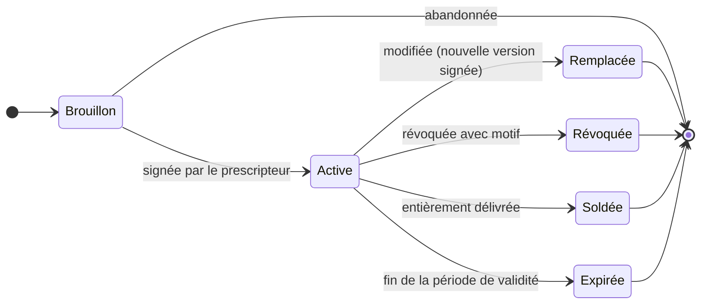
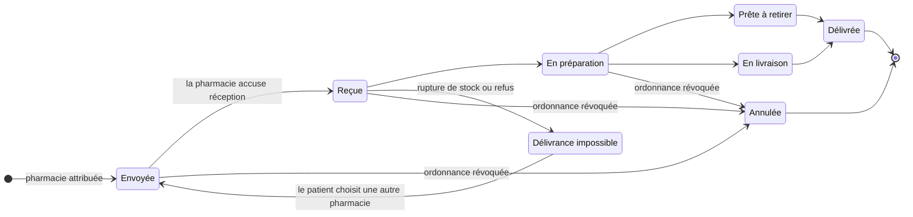
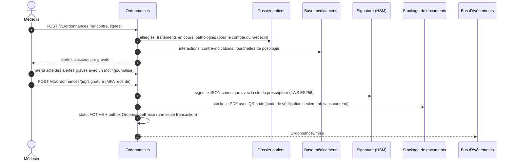

# 2.5 ⑤ Service de gestion des ordonnances

| Priorité | Zone | Criticité | Détient |
|----------|------|-----------|---------|
| Moyenne — M3 gestion des ordonnances | Clinique | Niveau 1 | Ordonnances et leurs versions, signatures, résultats des contrôles de sécurité, statut de délivrance, demandes de renouvellement |

**Mission** — transformer la décision d'un médecin en une ordonnance électronique **sûre, signée et vérifiable**, qui
arrive à la bonne pharmacie en quelques secondes, qui peut être corrigée ou révoquée instantanément, et dont le patient
peut suivre l'avancement.

## Responsabilités

| Fonctionnalité de l'Annexe 1 | Comment MedX la réalise |
|------------------------------|-------------------------|
| Permettre aux médecins de créer, modifier ou révoquer des ordonnances après la consultation | Brouillon rattaché à une rencontre → **contrôles de sécurité** automatiques → **signature électronique** (authentification renforcée) → active. Une modification crée une nouvelle version signée qui remplace la précédente ; une révocation est un changement de statut signé, avec motif. |
| Prévenir les pharmacies des nouvelles ordonnances ou des changements | Événements `OrdonnanceEmise / OrdonnanceModifiee / OrdonnanceRevoquee` → l'Interface pharmacie pousse vers la boîte de la pharmacie et vers le webhook du LGO ; les révocations sont **critiques** (plusieurs canaux, relances jusqu'à l'accusé de réception). |
| Permettre aux patients de voir leurs ordonnances actives | API et écran patient : ordonnances actives, renouvellements restants, dates de validité, PDF imprimable avec QR code. |
| Suivre le statut de délivrance | Machine à états de la délivrance alimentée par les mises à jour de la pharmacie ; chaque changement est visible par le patient et par le prescripteur. |

## Cycles de vie de l'ordonnance et de la délivrance

Le **statut légal** de l'ordonnance et le **statut de délivrance** en pharmacie sont deux machines à états distinctes —
les confondre est une source d'erreurs classique (par exemple « prête à retirer » sur une ordonnance révoquée).

La délivrance partielle et les renouvellements sont suivis ligne par ligne (`quantite_delivree`,
`renouvellements_restants`).

## Créer et signer une ordonnance

- **Contrôles de sécurité (aide à la décision clinique)** : interactions médicamenteuses, allergies et allergies
  croisées, redondances thérapeutiques, contre-indications (grossesse, âge, fonction rénale quand elle est connue),
  posologie. L'appel au Dossier patient utilise l'**échange de jeton** (RFC 8693) : la requête est autorisée au nom du
  médecin, pas d'un service privilégié. Si un contrôle est indisponible, le médecin en est explicitement informé et
  doit en prendre acte avant de signer.
- **Signature** : l'ordonnance canonique (JSON RFC 8785) est signée avec la clé du prescripteur, conservée dans le HSM
  et utilisable seulement après une MFA récente ; alternativement, signature qualifiée d'un prestataire de confiance
  ou carte professionnelle (eIDAS). La version signée est **immuable**.
- **QR code / code de vérification** : permet à une pharmacie de vérifier l'authenticité et le **statut actuel** (non
  révoquée, pas déjà délivrée, non expirée) — il ne contient pas le contenu de l'ordonnance.

## Modifier et révoquer

| Action | Règles | Côté pharmacie |
|--------|--------|----------------|
| **Modifier** | Seulement si l'ordonnance n'est pas entièrement délivrée. Crée la version *n+1* (nouvelle signature), qui référence la version *n* ; celle-ci devient *remplacée* ; les quantités déjà délivrées restent valables. | `OrdonnanceModifiee` (priorité élevée) ; si la préparation a commencé, le pharmacien doit prendre acte du changement avant de continuer. |
| **Révoquer** | Motif obligatoire (erreur, effet indésirable, changement de traitement). Changement de statut signé. | `OrdonnanceRevoquee` (**critique**) : alerte sur le portail + webhook du LGO ; sans accusé de réception sous 15 min, relance par SMS ou téléphone vers la pharmacie. Si l'ordonnance est déjà délivrée, le prescripteur est alerté pour contacter le patient. |
| **Renouveler** | Le patient demande un renouvellement depuis l'application → tâche pour le prescripteur → nouvelle ordonnance liée à la précédente, ou refus avec un message. | Nouvel `OrdonnanceEmise`. |

Les médicaments soumis à une réglementation particulière (stupéfiants) suivent des règles plus strictes, paramétrables
selon le pays (exigences d'ordonnance sécurisée, durées maximales, pas de renouvellement à distance, contrôles
d'identité supplémentaires en pharmacie).

## API (sélection)

| Méthode | Point d'accès | Rôle |
|---------|---------------|------|
| `POST` | `/v1/ordonnances` | Créer un brouillon (rencontre, lignes) |
| `POST` | `/v1/ordonnances/{id}/controles` | Lancer / relancer les contrôles de sécurité |
| `POST` | `/v1/ordonnances/{id}/signature` | Signer (authentification renforcée) → active |
| `POST` | `/v1/ordonnances/{id}/versions` | Modifier → nouvelle version signée |
| `POST` | `/v1/ordonnances/{id}/revocation` | Révoquer avec motif |
| `PUT` | `/v1/ordonnances/{id}/pharmacie` | Le patient choisit ou change de pharmacie |
| `GET` | `/v1/patients/moi/ordonnances?statut=active` | Vue patient |
| `GET` | `/v1/ordonnances/{id}/delivrance` | Chronologie du statut de délivrance |
| `GET` | `/v1/ordonnances/verification?code=` | Vérification par la pharmacie (authenticité + statut) |
| `GET` | `/fhir/MedicationRequest?patient=` | Vue d'interopérabilité |

## Événements

- **Publie** `ordonnance.v1` : OrdonnanceEmise, OrdonnanceModifiee, OrdonnanceRevoquee, OrdonnanceExpiree,
  PharmacieAttribuee, StatutDelivranceModifie.
- **Consomme** `pharmacie.delivrance.v1` (accusés de réception et mises à jour de statut, idempotents grâce au numéro
  de séquence), `identite.utilisateur.v1` (un prescripteur suspendu ne peut plus signer ; ses ordonnances actives sont
  signalées pour revue).

## Données détenues

PostgreSQL : `ordonnance`, `version_ordonnance` (signée, immuable), `ligne_ordonnance` (code du médicament, posologie
structurée, quantité, renouvellements, substitution autorisée), `signature`, `historique_statut` (ajout seul),
`delivrance`, `controle_securite` (alertes et dérogations motivées), `demande_renouvellement`, `outbox`. Les données
de référence sur les médicaments sont une réplique en lecture seule, rafraîchie depuis la base médicaments (données
publiques, pas des données de santé). Détail au [§3.4](../03-modele-donnees-et-stockage.md#34-modèles-logiques-par-service).

## Sécurité et confidentialité

- La signature exige une authentification forte récente ; les clés de signature ne quittent jamais le HSM.
- **Le strict nécessaire pour les pharmacies** : nom et date de naissance du patient, (numéro d'assuré quand il est
  requis), lignes de l'ordonnance, identité et signature du prescripteur — jamais de diagnostic ni de notes.
- Chaque lecture par une pharmacie est auditée ; le point de vérification est limité en débit pour empêcher
  l'énumération des codes.

## Scalabilité et résilience

- 120 000 ordonnances par jour en année 3 (≈ 1,4/s en moyenne, ≈ 15/s en pointe) plus environ 5 mises à jour de statut
  chacune — une charge légère ; le service monte en charge horizontalement et la recherche de médicaments est en cache.
- La transmission des révocations est pensée pour la **sécurité, pas pour le débit** : outbox (aucun événement
  perdu), poussée + webhook + relances, et une tâche de rapprochement qui compare toutes les 5 minutes les statuts de
  l'ordonnance et ceux de la pharmacie.

## Décisions de conception et compromis

| Décision | Alternative | Pourquoi ce choix |
|----------|-------------|-------------------|
| Modification = nouvelle version signée | Modification en place | Traçabilité légale : la pharmacie et l'auditeur voient toujours ce qui a été signé, quand, et ce qui l'a remplacé. |
| Statut légal et statut de délivrance séparés | Un seul champ de statut | Évite les états contradictoires ; chacun a un seul propriétaire (prescripteur d'un côté, pharmacie de l'autre). |
| Correspondance FHIR `MedicationRequest` / `MedicationDispense` / `Task` | Format propriétaire | Voie directe vers les services nationaux d'ordonnance électronique : là où un tel service existe (par exemple l'*ordonnance numérique* en France), un adaptateur y enregistre chaque ordonnance et le service national devient la référence pour la délivrance. |
| Contrôle des allergies via le Dossier patient au moment de la signature | Copie locale des allergies | Des données toujours à jour pour une décision de sécurité ; un échec est toujours explicite, jamais silencieux. |
