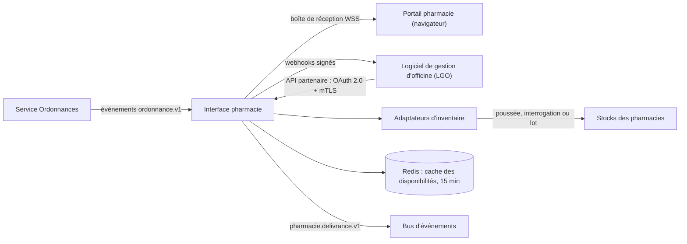
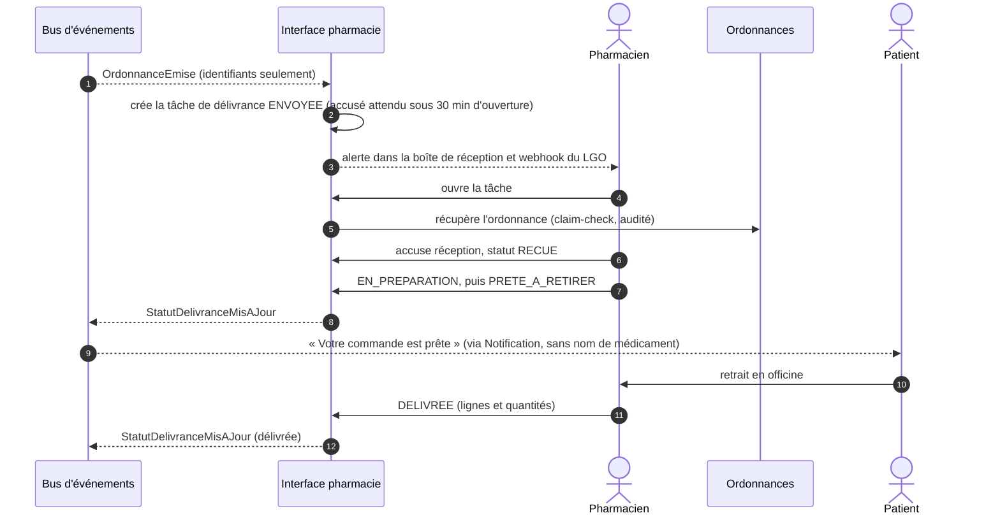

# 2.6 ⑥ Service d'interface pharmacie

| Priorité | Zone | Criticité | Détient |
|----------|------|-----------|---------|
| Basse — B1 interface pharmacie | Clinique (données d'ordonnance minimisées) | Niveau 2 | Répertoire des pharmacies, intégrations, tâches de délivrance, échanges patient–pharmacie, cache des disponibilités en stock |

**Mission** — relier chaque pharmacie aux ordonnances MedX, de l'officine indépendante équipée d'un simple navigateur
au groupement doté de son propre logiciel de gestion d'officine (LGO) — de manière fiable et avec le minimum de données
patient.

## Responsabilités

| Fonctionnalité de l'Annexe 1 | Comment MedX la réalise |
|------------------------------|-------------------------|
| Accuser réception des ordonnances et mettre à jour leur statut (« Prête à retirer », « Expédiée »…) | **Boîte de réception** en temps réel (portail) ou **webhook + API partenaire** (LGO) ; accusé de réception avec suivi du délai ; mises à jour de statut validées par la machine à états de la délivrance, puis transmises au service Ordonnances. |
| Permettre les échanges entre patients et pharmacies | **Fils de discussion** sécurisés rattachés à une ordonnance (questions de disponibilité, propositions de substitution, horaires de retrait), avec notifications des deux côtés et modèles de messages. |
| S'intégrer aux systèmes de gestion des stocks | **Adaptateurs d'inventaire** par éditeur de LGO derrière une interface de disponibilité commune ; niveaux de disponibilité en cache ; fonction « trouver une pharmacie proche qui a mon médicament ». |

## Modes d'intégration

| Mode | Pour qui | Détails |
|------|----------|---------|
| **Portail pharmacie** | Toutes les pharmacies, sans intégration | Application web avec boîte de réception en temps réel, affichage et impression de l'ordonnance, lecture du QR code (webcam) pour la vérification, boutons de statut, échanges avec les patients. |
| **API partenaire + webhooks** | Pharmacies dont l'éditeur de LGO s'intègre | API REST et FHIR (`Task`, `MedicationDispense`) ; OAuth 2.0 *client credentials* avec jetons liés au certificat **mTLS** ; webhooks sortants **signés (HMAC-SHA256 + horodatage)** avec protection contre le rejeu, nouvelles tentatives avec temporisation exponentielle pendant 24 h, puis file de lettres mortes et repli sur le portail. |
| **Adaptateurs d'inventaire** | Pharmacies qui partagent leurs données de stock | Interface commune `verifierDisponibilite(pharmacie, lignes)` qui renvoie EN_STOCK, FAIBLE, RUPTURE ou INCONNU ; stratégies : poussée des variations de stock, interrogation en temps réel (délai de 2 à 3 s) ou lot nocturne, selon l'éditeur. |

## Flux de délivrance

- **Délivrance impossible** (rupture de stock, substitution refusée) : le patient est prévenu et se voit proposer des
  pharmacies proches qui déclarent le médicament en stock ; une nouvelle attribution relance le flux.
- **Ordonnances sans accusé de réception** : si le délai est dépassé, le patient est prévenu et peut choisir une autre
  pharmacie.
- **Les mises à jour de statut sont idempotentes** : chacune porte un numéro de séquence ; les doublons et les
  nouvelles tentatives de webhook arrivées dans le désordre sont ignorés.

## Minimisation des données

Une pharmacie ne voit que les ordonnances **qui lui sont attribuées** (ou présentées par le patient via le QR code), et
seulement les champs nécessaires à la délivrance : nom et date de naissance du patient, numéro d'assuré quand il est
requis, lignes de l'ordonnance, identité et signature du prescripteur. **Ni diagnostic, ni notes de consultation, ni
accès au dossier.** Les données de stock sont présentées aux patients sous forme de niveaux de disponibilité, pas de
quantités (confidentialité commerciale).

## API (sélection)

| Méthode | Point d'accès | Rôle |
|---------|---------------|------|
| `GET` | `/v1/pharmacie/boite-reception?statut=` | Boîte de réception de la pharmacie |
| `POST` | `/v1/pharmacie/delivrances/{id}/accuse-reception` | Accuser réception |
| `POST` | `/v1/pharmacie/delivrances/{id}/statut` | Mettre à jour le statut (numéro de séquence, idempotent) |
| `POST` | `/v1/pharmacie/delivrances/{id}/delivrance` | Enregistrer les lignes et quantités délivrées |
| `GET` | `/v1/pharmacies/recherche?lat=&lon=&produit=` | Pharmacies proches avec disponibilité (patient) |
| `POST` | `/v1/echanges` · `/v1/echanges/{id}/messages` | Échange patient–pharmacie |
| `GET` | `/partenaire/fhir/Task?owner={pharmacie}&status=requested` | Mode interrogation du LGO |
| `POST` | `/partenaire/v1/delivrances/{id}/statut` | Envoi de statut par le LGO |

## Événements

- **Publie** `pharmacie.delivrance.v1` : ReceptionAccusee, StatutDelivranceMisAJour, DelivranceImpossible,
  MessagePharmaciePublie.
- **Consomme** `ordonnance.v1` : OrdonnanceEmise, OrdonnanceModifiee, OrdonnanceRevoquee, PharmacieAttribuee.

## Données détenues

PostgreSQL : `pharmacie` (numéro FINESS, adresse, géolocalisation, horaires, services), `integration` (mode, point
d'accès, références d'identifiants dans Vault), `tache_delivrance`, `evenement_statut` (ajout seul), `echange`,
`message` (chiffré), `outbox`. Redis : cache des disponibilités. Recherche géographique avec PostGIS. Détail au
[§3.4](../03-modele-donnees-et-stockage.md#34-modèles-logiques-par-service).

## Scalabilité et résilience

- 15 000 pharmacies, environ 600 000 mises à jour de statut par jour en année 3 (≈ 7/s) : charge légère ; les
  travailleurs d'envoi des webhooks montent en charge selon le retard de la file.
- Un LGO lent ou en panne ne bloque jamais MedX : les webhooks sont asynchrones, avec nouvelles tentatives et file de
  lettres mortes, et le portail reste toujours disponible en repli.
- Les requêtes d'inventaire sont mises en cache (15 min) et limitées dans le temps ; « inconnu » est une réponse
  acceptable.

## Décisions de conception et compromis

| Décision | Alternative | Pourquoi ce choix |
|----------|-------------|-------------------|
| Portail **et** API | API seulement | Inclusion : les petites officines peuvent rejoindre MedX dès le premier jour ; les pharmacies intégrées bénéficient de l'automatisation. Coût : deux canaux à maintenir. |
| Un adaptateur par éditeur de LGO derrière une interface unique | Imposer un format à tous les éditeurs | Les éditeurs s'intègrent à leur rythme ; le cœur de MedX reste propre (couche anti-corruption). |
| Niveaux de disponibilité plutôt que quantités | Stock exact | Suffisant pour la décision du patient ; protège les données commerciales des pharmacies. |
| Priorité basse, livré après le cœur clinique | Livraison précoce | Respecte les priorités de MedX ; en attendant, l'ordonnance est imprimable avec un QR code vérifiable, utilisable dans n'importe quelle pharmacie. |
