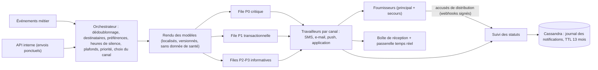
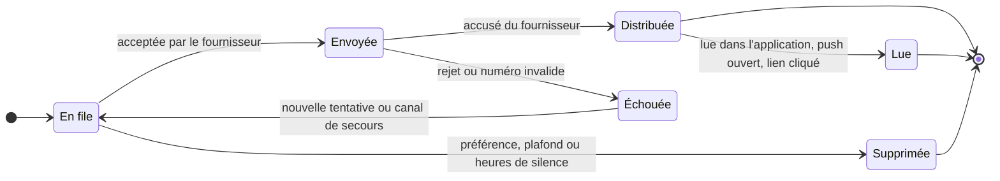

# 2.7 ⑦ Service de notification

| Priorité | Zone | Criticité | Détient |
|----------|------|-----------|---------|
| Basse — B2 préférences (appliquées) · B3 suivi de distribution et de lecture — **une version minimale est livrée avec les fonctionnalités de priorité moyenne** (confirmations de réservation, rappels) | Communication (aucune donnée de santé) | Niveau 2 (les messages critiques ont leur propre file) | Modèles, réplique locale des préférences, journal des notifications, statuts de distribution, boîte de réception dans l'application |

**Mission** — dire la bonne chose à la bonne personne, sur le bon canal, au bon moment, **sans jamais mettre
d'information de santé dans un SMS, un e-mail ou une bannière de notification**.

## Responsabilités

| Fonctionnalité de l'Annexe 1 | Comment MedX la réalise |
|------------------------------|-------------------------|
| Envoyer alertes, rappels et mises à jour (SMS, e-mail, dans l'application) | Chaîne de traitement pilotée par les événements, avec des travailleurs par canal pour **SMS, e-mail, push (APNs/FCM) et dans l'application** (passerelle temps réel + boîte de réception) ; deux fournisseurs par canal externe, avec bascule automatique. |
| Gérer les préférences de notification (consentement, désinscription, fréquence) | Préférences détenues par la gestion des utilisateurs et répliquées localement à partir de `PreferencesMisesAJour` ; évaluées par catégorie × canal, avec heures de silence, plafonds de fréquence et résumés groupés. |
| Suivre la distribution et la lecture | Machine à états alimentée par les accusés des fournisseurs et les accusés de lecture des applications, stockée dans un journal en ajout seul ; gestion des rejets ; tableaux de bord de distribution. |

## Chaîne de traitement

## Files de priorité

| File | Exemples | Comportement | Objectif |
|------|----------|--------------|----------|
| **P0 critique** | Ordonnance révoquée (vers la pharmacie), consultation urgente attribuée (vers un médecin), alerte de bris de glace (vers le DPO) | Ignore les heures de silence ; plusieurs canaux en parallèle ; escalade si non lue (par exemple SMS après 5 min, puis téléphone) | envoi < 10 s |
| **P1 transactionnelle** | Confirmation ou modification de réservation, rappels, « traitement prêt », reçu de paiement | Catégorie obligatoire (le canal peut être choisi, pas désactivé) | envoi < 60 s |
| **P2 informative** | Nouveau document ou nouveau message disponible | Entièrement pilotée par les préférences ; résumé groupé possible | < 5 min |
| **P3 marketing** | Lettre d'information, enquêtes | **Consentement explicite uniquement** (RGPD / ePrivacy), plafonds de fréquence | par lots |

Chaque file a son propre topic Kafka et son propre groupe de travailleurs : une rafale de rappels ne peut jamais
retarder une alerte de révocation.

## Contenus sans données de santé

| Canal | Exemple de ce que MedX envoie | Ce qu'il ne contient jamais |
|-------|-------------------------------|-----------------------------|
| SMS | « MedX : votre téléconsultation a lieu demain à 10 h 30. Rejoignez-la depuis l'application. » | Nom ou spécialité du médecin, motif, noms de médicaments, résultats |
| E-mail | Objet générique, lien profond vers l'application, authentification de l'expéditeur (SPF, DKIM, DMARC) | Pièces jointes contenant des données de santé (factures et documents se téléchargent dans l'application) |
| Push | « Vous avez un nouveau message » | Le contenu du message sur l'écran verrouillé |
| Dans l'application | Tout le détail, après authentification | — |

Les modèles ne peuvent utiliser que des **variables en liste blanche** ; un contrôle en CI rejette tout modèle qui fait
référence à un champ clinique.

## Préférences

- Détenues et modifiées dans la gestion des utilisateurs (source unique de vérité) ; répliquées ici via les
  événements `PreferencesMisesAJour` dans une table locale et un cache Redis → aucune dépendance synchrone au moment
  de l'envoi.
- Évaluées par **catégorie × canal** (rendez-vous, ordonnances, documents, messages, marketing), avec heures de silence
  dans le fuseau horaire de l'utilisateur, plafonds de fréquence (par exemple 3 SMS non critiques par jour au plus) et
  résumés quotidiens.
- Les notifications obligatoires (sécurité, légal, P0/P1) ne peuvent pas être entièrement désactivées, seulement
  redirigées vers un autre canal.

## Suivi de distribution et de lecture (B3)

- Les événements de statut sont ajoutés (jamais modifiés en place), avec les références du fournisseur et les
  horodatages.
- **Aucun pixel de suivi dans les e-mails** (confidentialité) : « lu » signifie pour un e-mail qu'un lien a été cliqué
  ou que l'élément a été ouvert dans l'application.
- Les rejets définitifs marquent la coordonnée comme invalide et émettent `CoordonneeInvalide` pour que l'utilisateur
  soit invité à la corriger.
- Tableaux de bord : taux de distribution par canal et par fournisseur, latence par file ; alerte quand un fournisseur
  se dégrade (bascule automatique vers le second fournisseur).

## Fiabilité

- **Idempotence** : clé de dédoublonnage = identifiant de l'événement + destinataire + canal (Redis, 24 h) — un rejeu
  ne provoque jamais de double envoi.
- Nouvelles tentatives avec temporisation exponentielle et gigue, bascule entre fournisseurs, file de lettres mortes
  avec rejeu par un opérateur.
- Les lots de rappels (par exemple tous les rendez-vous de 9 h) sont étalés avec de la gigue sur la fenêtre d'envoi.

## API (sélection)

| Méthode | Point d'accès | Rôle |
|---------|---------------|------|
| `POST` | `/v1/notifications` | Envoi ponctuel interne (de service à service uniquement) |
| `GET` | `/v1/utilisateurs/moi/notifications?curseur=` | Boîte de réception dans l'application |
| `POST` | `/v1/utilisateurs/moi/notifications/{id}/lecture` | Accusé de lecture |
| `POST` | `/v1/webhooks/fournisseurs/{fournisseur}` | Accusés de distribution (signature vérifiée) |
| `GET` | `/v1/admin/notifications/indicateurs` | Statistiques de distribution (agrégées, sans contenu) |

## Événements

- **Consomme** presque tous les topics métier (voir le [catalogue des événements](README.md#catalogue-des-événements))
  et `identite.preferences.v1`.
- **Publie** `notification.distribution.v1` : NotificationEnvoyee, NotificationDistribuee, NotificationLue,
  NotificationEchouee, CoordonneeInvalide.

## Données détenues

PostgreSQL : `modele` (versionné, par langue), `replique_preferences`, `config_fournisseur`. Cassandra :
`notification_par_destinataire` (partition = destinataire + mois), `evenement_statut_notification`, TTL de 13 mois.
Redis : clés de dédoublonnage, compteurs de fréquence, limites de débit. Détail au
[§3.4](../03-modele-donnees-et-stockage.md#34-modèles-logiques-par-service).

## Scalabilité et résilience

- 2 M de notifications par jour en année 3 (≈ 25/s en moyenne, **≈ 500/s lors des pointes de rappels**) : Kafka
  absorbe les rafales ; les travailleurs montent en charge selon le retard de chaque file ; les fournisseurs sont
  limités en débit par compte.
- Cassandra absorbe linéairement ce journal très sollicité en écriture (≈ 4 événements de statut par notification),
  avec une expiration par TTL plutôt que des suppressions coûteuses.

## Décisions de conception et compromis

| Décision | Alternative | Pourquoi ce choix |
|----------|-------------|-------------------|
| Messages externes génériques, sans donnée de santé | Messages riches (« votre rendez-vous de dermatologie… ») | Les SMS et les e-mails ne sont ni privés ni dans le périmètre HDS ; le confort est préservé par des liens profonds vers l'application authentifiée. |
| Base orientée colonnes (Cassandra) pour le journal | PostgreSQL | Série temporelle très sollicitée en écriture, interrogée par destinataire, avec expiration par TTL : un usage naturel ; PostgreSQL reste utilisé pour les modèles et les préférences. |
| Construire l'orchestrateur, acheter les canaux | Un SaaS de notification pour tout | Les règles de préférences, de données de santé et de priorité sont propres à MedX et sensibles ; l'acheminement des messages est une commodité. |
| Une file par priorité | Une seule file | Garantit que les messages de sécurité critiques ne sont jamais bloqués derrière des rappels en masse. |
