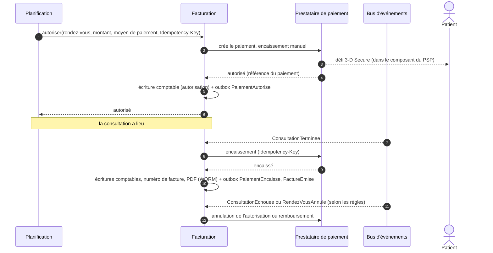
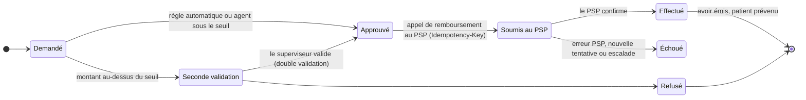

# 2.8 ⑧ Service de facturation et paiement

| Priorité | Zone | Criticité | Détient |
|----------|------|-----------|---------|
| Basse — B5 paiement sécurisé · B6 remboursements | Paiement (périmètre PCI réduit au minimum) | Niveau 2 | Tarifs, paiements (références PSP), grand livre en partie double, factures et avoirs, remboursements, versements |

**Mission** — facturer le bon montant au bon moment, ne jamais toucher un numéro de carte, tenir une comptabilité qui
se rapproche au centime près, et rembourser vite et de manière traçable quand quelque chose se passe mal.

## Responsabilités

| Fonctionnalité de l'Annexe 1 | Comment MedX la réalise |
|------------------------------|-------------------------|
| Gérer les honoraires de consultation et traiter les paiements | Tarif par praticien et par type de consultation ; **pré-autorisation à la réservation, encaissement après la consultation** ; règles d'annulation ; reversements aux praticiens et aux pharmacies via le PSP (modèle de place de marché). |
| Émettre les factures des consultations et des médicaments | Facture émise à l'encaissement (au nom du praticien ou de la pharmacie) : numérotation continue par émetteur, PDF immuable stocké en WORM, **aucun détail clinique** sur la facture. |
| Traiter les remboursements si nécessaire | Automatiques (le médecin annule, la consultation a échoué techniquement) ou manuels (support sous un seuil, double validation au-delà) ; avoirs ; trace complète dans le grand livre. |
| Fournir des mécanismes de transaction sécurisés | **Champs de paiement hébergés par le PSP** (les données de carte n'atteignent jamais MedX) → PCI DSS **SAQ A** ; 3-D Secure 2 (authentification forte DSP2) ; moyens de paiement tokenisés ; webhooks signés ; idempotence partout. |

## Cycle de vie d'un paiement

- **Expiration des autorisations** — une autorisation de carte expire au bout d'environ 7 jours : pour un rendez-vous
  réservé plus tôt que cela, la carte est enregistrée avec authentification forte (*setup intent*) et l'autorisation
  est demandée automatiquement 24 h avant.
- **Règles d'annulation** — gratuite jusqu'à 24 h avant ; frais d'annulation tardive ou d'absence annoncés à la
  réservation ; **annulation par le médecin ou échec technique → libération / remboursement intégral automatique**.
- **Médicaments** — quand une pharmacie propose la livraison ou le retrait avec paiement en ligne, la commande est
  payée par le même flux ; la facture est émise au nom de la pharmacie.
- **Reversements** — les comptes de place de marché du PSP répartissent chaque paiement entre le praticien ou la
  pharmacie et la commission de MedX ; le PSP vérifie l'identité des bénéficiaires (KYC).

## Remboursements (B6)

## Grand livre et rapprochement

- **Grand livre en partie double, en ajout seul** : chaque mouvement d'argent est une écriture équilibrée (créance
  patient, dette envers le praticien ou la pharmacie, chiffre d'affaires MedX, compte d'attente PSP, remboursements).
  Les écritures ne sont jamais modifiées — une correction est une nouvelle écriture.
- **Idempotence** : chaque appel au PSP porte une clé d'idempotence ; chaque webhook du PSP est dédoublonné par
  identifiant d'événement et son contenu brut est conservé pour l'audit.
- **Rapprochement quotidien** avec le relevé de règlement du PSP ; tout écart ouvre un incident.
- Les **factures** sont immuables ; un remboursement produit un **avoir**, jamais une facture modifiée. Conservation
  10 ans (droit commercial), stockage WORM.

## Réduction du périmètre PCI DSS

| Mesure | Effet |
|--------|-------|
| Champs hébergés / composants intégrés du PSP (iframes) dans les applications | Les numéros de carte vont directement de l'appareil au PSP ; MedX ne stocke que des jetons, la marque et les 4 derniers chiffres. |
| Intégrité des scripts de la page de paiement (CSP, SRI, détection des changements — exigences PCI DSS v4 6.4.3 et 11.6.1) | Protège la page qui intègre le composant du PSP contre l'injection de scripts (*e-skimming*). |
| Clés d'API PSP restreintes dans Vault, renouvelées | Une clé divulguée ne permet ni de lire des données de carte ni de déplacer des fonds au-delà de ses droits. |
| Espace de noms paiement isolé par politique réseau | Seuls la Planification, la passerelle (webhooks) et le bus d'événements peuvent joindre la Facturation. |
| Aucune donnée de santé dans la facturation | Les factures indiquent « Téléconsultation », jamais une spécialité ni un diagnostic. |

## API (sélection)

| Méthode | Point d'accès | Rôle |
|---------|---------------|------|
| `POST` | `/v1/moyens-paiement/preparation` | Renvoie un secret client PSP pour les champs hébergés |
| `POST` | `/v1/paiements/autorisations` | Interne (Planification) : autoriser des honoraires |
| `POST` | `/v1/paiements/{id}/encaissement` | Interne : encaisser après la consultation |
| `POST` | `/v1/remboursements` | Demander un remboursement (règles automatiques, agent de support) |
| `POST` | `/v1/remboursements/{id}/validation` | Seconde validation au-delà du seuil |
| `GET` | `/v1/utilisateurs/moi/factures` · `/v1/factures/{id}/pdf` | Factures du patient |
| `POST` | `/v1/webhooks/psp` | Événements du PSP (signature vérifiée, dédoublonnés) |

## Événements

- **Publie** `facturation.paiement.v1` : PaiementAutorise, PaiementEchoue, PaiementEncaisse, PaiementAnnule,
  RemboursementEffectue, RemboursementEchoue, FactureEmise.
- **Consomme** `consultation.seance.v1` (encaissement ou remboursement), `planification.rendez-vous.v1` (annulations,
  absences), `pharmacie.delivrance.v1` (commandes de médicaments payées).

## Données détenues

PostgreSQL : `client` (référence client PSP), `moyen_paiement` (jeton, marque, 4 derniers chiffres), `paiement`,
`compte_comptable`, `ecriture` + `ligne_ecriture` (ajout seul), `facture` + `ligne_facture`, `avoir`, `remboursement`,
`evenement_psp` (brut, dédoublonnage), `versement`, `outbox`. Montants stockés en **entiers dans l'unité mineure +
devise ISO 4217**. PDF des factures dans le stockage de documents (WORM). Détail au
[§3.4](../03-modele-donnees-et-stockage.md#34-modèles-logiques-par-service).

## Scalabilité et résilience

- ≈ 200 000 paiements par jour en année 3 (≈ 2 à 3/s) : le débit n'est pas le défi, **l'exactitude** l'est — d'où
  l'idempotence, l'outbox, le grand livre et le rapprochement.
- Si le PSP est indisponible, les réservations peuvent se poursuivre en mode « payer plus tard » (paramétrable selon le
  risque), encaissées au retour du PSP ; aucune demande n'est perdue grâce à l'outbox et aux nouvelles tentatives.

## Décisions de conception et compromis

| Décision | Alternative | Pourquoi ce choix |
|----------|-------------|-------------------|
| Champs de paiement hébergés par le PSP (SAQ A) | Manipuler les données de carte (SAQ D) | Supprime le périmètre de conformité le plus lourd et la cible la plus attractive. Coût : moins de maîtrise de l'interface de paiement. |
| Grand livre en partie double propre à MedX | S'en remettre au tableau de bord du PSP | L'auditabilité, la répartition place de marché, les remboursements et le rapprochement exigent une comptabilité propre à MedX. |
| Pré-autoriser puis encaisser | Débiter à la réservation | Le patient ne paie que les consultations qui ont eu lieu ; moins de remboursements. Coût : gestion de l'expiration des autorisations. |
| Priorité basse, mais sécurité dès la conception | Reporter la sécurité avec la fonctionnalité | Le paiement est livré en dernier, mais sa conception écarte déjà les données de carte de MedX. |
