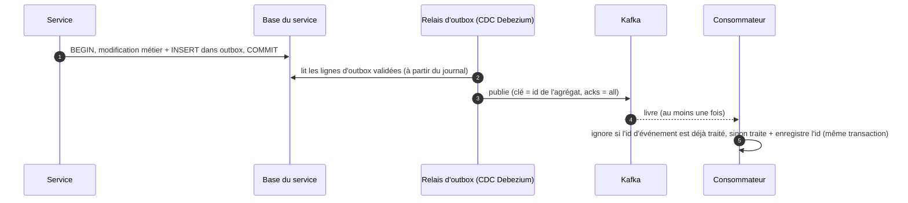
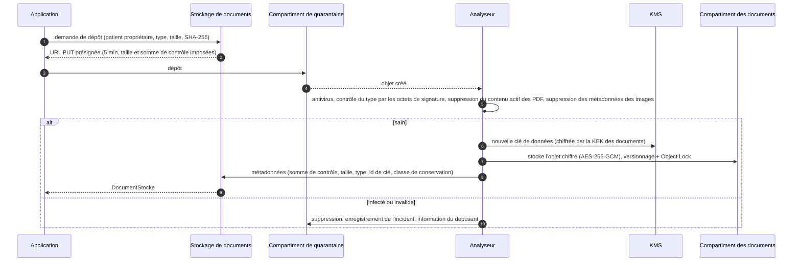

# 2.9 Composants de plateforme

Des capacités partagées utilisées par tous les services métier. Plusieurs d'entre elles portent des exigences de
**priorité haute** (H1 chiffrement, H4 autorisations, H5 intégrité et stockage sécurisé des fichiers) : elles sont
donc construites une seule fois, par l'équipe plateforme, et réutilisées partout.

| Composant | Priorité servie | Niveau |
|-----------|-----------------|--------|
| [Passerelle API et périmètre d'entrée](#passerelle-api-et-périmètre-dentrée) | H1, H4 | 0 |
| [Passerelle temps réel](#passerelle-temps-réel) | M2 | 1 |
| [Point de décision de politique (OPA)](#point-de-décision-de-politique-opa) | H4, M4 | 0 |
| [Bus d'événements (Kafka) et outbox](#bus-dévénements-kafka-et-outbox) | H5 | 1 |
| [Stockage sécurisé de documents](#stockage-sécurisé-de-documents) | H1, H5 | 1 |
| [Piste d'audit](#piste-daudit) | H2, H3, H5 | 1 (écritures tamponnées dans les outbox) |
| [Clés et secrets](#clés-et-secrets) | H1 | 0 |
| [Observabilité et supervision de sécurité](#observabilité-et-supervision-de-sécurité) | toutes | 1 |
| [Plateforme de données désidentifiées](#plateforme-de-données-désidentifiées) | B4 | 2 |

## Passerelle API et périmètre d'entrée

- Le **CDN** ne sert que des ressources statiques (paquets des applications, images) ; les réponses d'API qui
  contiennent des données personnelles portent `Cache-Control: no-store` et ne sont jamais mises en cache en bordure.
- **WAF** avec les règles OWASP de base, gestion des robots, réputation géographique et IP, correctifs virtuels ;
  **protection DDoS** des couches 3 à 7.
- **Passerelle API** (fondée sur Envoy) : terminaison TLS 1.3 (HSTS), routage par public (`/patient`, `/praticien`,
  `/pharmacie`, `/partenaire` ; `/admin` n'est **pas exposé publiquement** — joignable seulement via le proxy d'accès
  zéro confiance), validation des JWT de trois émetteurs (realms) avec JWKS en cache, validation des preuves DPoP,
  mTLS pour les partenaires, **limites de débit et quotas** par utilisateur, par IP et par client (plus strictes sur
  la connexion, la recherche et la vérification), limites de taille des requêtes, validation par schéma OpenAPI, CORS,
  en-têtes de sécurité, identifiants de corrélation, réception des webhooks par fournisseur avec vérification de
  signature.
- Les journaux d'accès ne contiennent que des métadonnées (route, code de statut, latence, sujet pseudonyme) — jamais
  de corps de requête ni de paramètres contenant des données personnelles.

## Passerelle temps réel

- Connexions WebSocket (WSS) pour le chat, la présence, les statuts en direct et les notifications dans l'application
  — **une connexion par application**, qui multiplexe les canaux.
- Authentification à la connexion (jeton d'accès) ; chaque abonnement à un canal (`utilisateur:{id}`,
  `consultation:{id}`, `pharmacie:{id}`) est autorisé par le service propriétaire ; les connexions sont revalidées au
  renouvellement du jeton et fermées en cas de révocation.
- Diffusion sans état via Redis pub/sub (ou NATS) : n'importe quel nœud peut livrer à n'importe quel utilisateur ;
  battements de cœur, jetons de reprise après reconnexion, vidage des connexions lors des déploiements.
- Dimensionnement : 200 000 connexions simultanées en pointe en année 3 ≈ 10 pods d'environ 25 000 connexions chacun,
  mis à l'échelle selon le nombre de connexions.

## Point de décision de politique (OPA)

- **Sidecar** à côté de chaque service : décision en moins de 1 ms, sans aller-retour réseau, et qui continue de
  fonctionner si le serveur de politiques est indisponible.
- Politiques écrites en Rego, conservées dans Git, relues, **testées unitairement en CI** (cas positifs et négatifs pour
  chaque règle), compilées en **paquets signés** distribués aux sidecars (récupérés toutes les 60 s, dernier paquet
  valide conservé).
- Entrées : sujet (issu du jeton validé), action, ressource (type, patient propriétaire, labels de sécurité), finalité,
  et **faits** propres à la requête lus par le service (autorisation de soin, consentement, autorisation d'urgence).
- Sorties : `allow` + **obligations** (masquage, exclusions, niveau d'audit).
- Les journaux de décision (sans donnée de santé) alimentent la chaîne d'audit pour les investigations.

## Bus d'événements (Kafka) et outbox

- **Pas de double écriture** : un événement existe si et seulement si la modification métier a été validée.
- Kafka : 3 brokers sur 3 AZ, facteur de réplication 3, `min.insync.replicas = 2`, `acks = all`, producteurs
  idempotents ; TLS + authentification SASL/mTLS, **ACL par service** (un service ne peut produire que sur ses propres
  topics et ne consommer que ce dont il a besoin), chiffrement au repos.
- Registre de schémas avec contrôle de compatibilité en CI ; un changement incompatible = une nouvelle version de topic.
- Rétention de 7 jours (30 jours pour `audit.evenements.v1`) ; topic de lettres mortes par groupe de consommateurs, avec
  alerte et rejeu.

## Stockage sécurisé de documents

- **Double chiffrement** : chiffrement applicatif AES-256-GCM avec une clé de données par fichier (chiffrée par la KEK
  des documents et rattachée au patient propriétaire pour l'effacement cryptographique) **plus** chiffrement SSE-KMS au
  niveau du compartiment.
- **Intégrité** : SHA-256 calculé par le client, vérifié au dépôt, revérifié à chaque téléchargement et par une tâche
  hebdomadaire de contrôle ; versionnage des objets ; **Object Lock** (mode conformité) pour les documents soumis à une
  durée légale de conservation.
- **Accès** : les téléchargements passent par le stockage de documents, qui demande à la politique du service
  propriétaire (Dossier patient, Consultation, Facturation) si l'appelant peut lire ce document ; déchiffrement en
  flux ; chaque téléchargement est audité. Les objets en quarantaine sont supprimés au plus tard au bout de 24 h.
- **Limites** : 50 Mo par fichier ; types autorisés PDF, JPEG, PNG, HEIC (l'imagerie DICOM est hors périmètre de la v1).
- **Durabilité** : durabilité du stockage objet de 11 neuf + réplication entre régions + copie de sauvegarde immuable.

## Piste d'audit

- **Ce qui est audité** : chaque lecture, création, modification, export, partage, bris de glace, événement
  d'authentification et action d'administration portant sur des données personnelles. Schéma aligné sur `AuditEvent`
  FHIR / IHE BALP : qui (sujet, rôle, organisation, niveau d'assurance, appareil, IP), quoi (action, type et id de
  ressource, patient), quand, pourquoi (**finalité** : soins, soins d'urgence, demande du patient, paiement,
  exploitation, support), résultat, identifiant de corrélation.
- **Chaîne** : les services écrivent les événements d'audit dans **leur outbox, dans la même transaction** que l'accès →
  Kafka `audit.evenements.v1` (ACL restreinte) → service d'audit → (1) **archive WORM** : lots chaînés par hachage,
  racine de Merkle signée par une clé HSM et horodatée chaque jour, stockés avec Object Lock dans le **compte de
  sécurité** ; (2) **index de recherche** (OpenSearch restreint, 13 mois) pour les investigations et pour la page
  « qui a consulté mon dossier » du patient ; (3) flux vers le **SIEM** pour les règles en temps réel.
- **Qui peut la lire** : le DPO et les auditeurs (lecture seule, eux-mêmes audités) ; les patients voient l'historique
  des accès à leur dossier ; aucun ingénieur ne peut modifier ou supprimer des données d'audit.
- **Conservation** : au moins 6 ans, paramétrable jusqu'à la durée de conservation du dossier médical.

## Clés et secrets

- **KMS adossé à des HSM** (FIPS 140-3 niveau 3) : clés de chiffrement de clés par service × environnement × classe de
  données ; usage restreint par politique IAM (le rôle de la Facturation ne peut pas déchiffrer avec les clés du
  Dossier patient) ; rotation annuelle automatique ; clés multirégions pour la reprise ; chaque usage journalisé.
- **Chiffrement d'enveloppe** dans les services (voir le [§5.6](../05-securite-et-conformite.md#56-chiffrement-au-repos-et-gestion-des-clés)) :
  clés de données par patient / par fichier / par consultation, gardées déchiffrées en mémoire 5 min au plus.
- **HashiCorp Vault** : identifiants de base de données dynamiques (durée de vie 1 h), moteur Transit pour chiffrer les
  secrets d'intégration (jetons OAuth des agendas, identifiants des LGO), PKI pour les certificats internes, secrets
  injectés à l'exécution — **aucun secret dans le code, les images ou des variables d'environnement en clair** ;
  séparation des tâches entre gardiens des clés et administrateurs de données.

## Observabilité et supervision de sécurité

- **OpenTelemetry** partout : traces (`traceparent` W3C propagé dans les en-têtes HTTP et Kafka), métriques (RED pour
  les services, USE pour les ressources), journaux structurés. Outils : Prometheus/Grafana, Loki, Tempo.
- **Jamais de donnée de santé dans la télémétrie** : champs des journaux en liste blanche, identifiants tokenisés, corps
  de requête jamais journalisés ; un analyseur échantillonne les journaux à la recherche de motifs de données de santé
  et alerte.
- **SLO et budgets d'erreur** par niveau de criticité ; alertes multi-fenêtres sur la vitesse de consommation du
  budget ; **sondes synthétiques** qui appellent le chemin d'urgence chaque minute depuis les deux régions.
- Règles de corrélation du **SIEM** : bris de glace, lectures massives de dossiers, tentatives d'accès sans relation
  de soin, voyages impossibles, MFA désactivée, élévation de privilèges, exports anormaux ; **analyse comportementale
  des utilisateurs et des entités (UEBA)** pour détecter les « curieux internes » (par exemple un médecin qui ouvre les
  dossiers de patients sans rendez-vous, ou celui d'une célébrité).

## Plateforme de données désidentifiées

- Usages : analytique produit, planification de capacité, indicateurs de qualité, recherche (avec consentement), et
  **jeux de données pour la recette, la démonstration et les tests** (B4).
- Capture des changements depuis les répliques des services vers une **enclave de traitement sécurisée** dans le compte
  de production, où tournent les tâches de pseudonymisation et d'anonymisation ; seules les sorties désidentifiées
  quittent l'enclave (fichiers en colonnes interrogés par un moteur analytique).
- Techniques et contrôles décrits au [§5.7](../05-securite-et-conformite.md#57-masquage-caviardage-et-anonymisation) :
  suppression des identifiants directs, pseudonymes à clé, généralisation, décalage des dates, contrôles de
  k-anonymat, validation du DPO.
- La recette et la démonstration utilisent des **patients synthétiques** (par exemple générés avec Synthea au format
  FHIR) — jamais de vraies données de santé.
