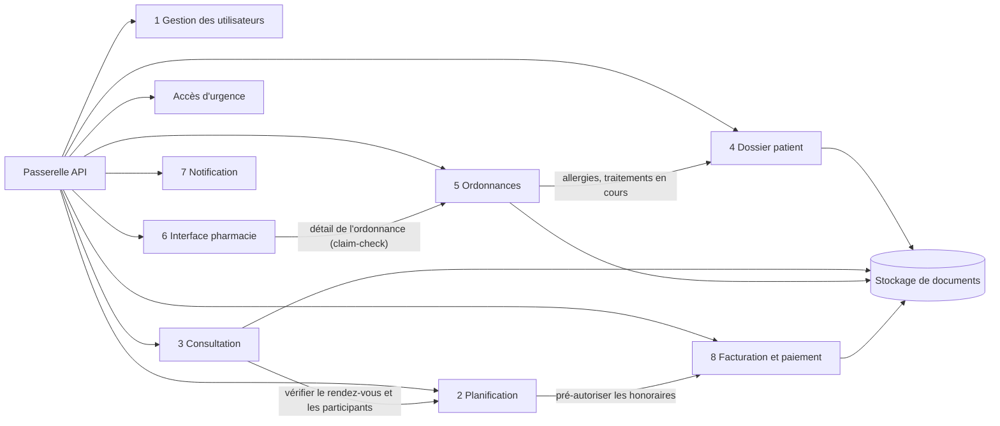

# 2. Conception détaillée des composants

> **Livrable 2.** Fonctionnalités, interfaces et interactions de chaque composant de MedX.
> Vue d'ensemble de l'architecture : [document 1 — Architecture de haut niveau](../01-architecture-haut-niveau.md).

## Mode de lecture

Chacun des huit composants métier de l'Annexe 1 a son propre document, avec la même structure :
**mission et priorité → responsabilités (reliées à l'Annexe 1) → conception interne → flux clés → API →
événements → données détenues → sécurité → scalabilité et résilience → décisions de conception et compromis.**

| # | Composant | Priorité (Annexe 2) | Zone | Niveau | Document |
|---|-----------|---------------------|------|--------|----------|
| ① | Gestion des utilisateurs (identité et accès) | **Haute** (H4) · Basse (B2 préférences) | Identité et accès | 0 | [01-gestion-utilisateurs.md](01-gestion-utilisateurs.md) |
| ② | Planification des téléconsultations | Moyenne (M1, M5) | Clinique | 1 | [02-planification.md](02-planification.md) |
| ③ | Consultation (vidéo, chat, fichiers) | Moyenne (M2) | Clinique + plan média | 1 | [03-consultation.md](03-consultation.md) |
| ④ | Dossier patient + accès d'urgence | **Haute** (H2, H3, H5) · Moyenne (M4) | Clinique | 0 / 1 | [04-dossier-patient.md](04-dossier-patient.md) |
| ⑤ | Gestion des ordonnances | Moyenne (M3) | Clinique | 1 | [05-ordonnances.md](05-ordonnances.md) |
| ⑥ | Interface pharmacie | Basse (B1) | Clinique (données minimisées) | 2 | [06-interface-pharmacie.md](06-interface-pharmacie.md) |
| ⑦ | Notification | Basse (B2, B3) | Communication | 2 | [07-notification.md](07-notification.md) |
| ⑧ | Facturation et paiement | Basse (B5, B6) | Paiement | 2 | [08-facturation-paiement.md](08-facturation-paiement.md) |
| — | Composants de plateforme (passerelles, moteur de politiques, bus d'événements, stockage de documents, audit, clés, observabilité, plateforme de données) | **Haute** (H1, H4, H5) · Basse (B4) | Périmètre d'entrée / plateforme | 0–2 | [09-composants-plateforme.md](09-composants-plateforme.md) |

## Modèle de service commun

Chaque service est généré à partir du même **modèle standard** (*golden path*) : la sécurité et l'exploitabilité ne
dépendent donc pas de la mémoire de chaque équipe.

| Sujet | Règle appliquée à chaque service |
|-------|----------------------------------|
| **Contrat d'API** | OpenAPI 3.1 (CapabilityStatement FHIR pour le service Dossier patient), version dans l'URI (`/v1`), ajouts seulement au sein d'une version, pagination par curseur, erreurs au format `application/problem+json` (RFC 9457), `Idempotency-Key` obligatoire sur chaque `POST` qui crée quelque chose. |
| **Authentification** | Jeton JWT revalidé dans le service (défense en profondeur, même derrière la passerelle) ; identité de service à service via le mTLS du maillage (identités SPIFFE). |
| **Autorisation** | Un point d'application de la politique (PEP) dans le service interroge le sidecar OPA local avec `sujet · action · ressource · finalité` ; refus par défaut ; obligations (masquage) appliquées avant que la réponse ne sorte. |
| **Données** | Base/schéma et identifiants privés (délivrés par Vault, durée de vie 1 h) ; migrations relues (Flyway) ; identifiants **UUIDv7** (ordonnés dans le temps, jamais d'entiers séquentiels exposés aux clients) ; table `outbox` pour les événements. |
| **Événements** | Enveloppe CloudEvents, schéma dans le registre, publication via le relais d'outbox ; consommateurs idempotents (table des événements traités), topic de lettres mortes après 5 tentatives. |
| **Résilience** | ≥ 3 répliques réparties sur 3 AZ (niveaux 0 et 1), sondes de disponibilité et de vie, arrêt propre, budgets d'interruption de pods, délais d'expiration + nouvelles tentatives avec gigue + disjoncteurs (maillage), cloisonnement des chemins critiques. |
| **Observabilité** | Traces OpenTelemetry (`traceparent` W3C propagé aussi dans les en-têtes Kafka), métriques RED, journaux JSON structurés **sans donnée de santé** (champs en liste blanche, identifiants tokenisés), tableau de bord et alertes SLO. |
| **Livraison** | CI : tests unitaires, de contrat (pilotés par le consommateur) et d'intégration, SAST, analyse des dépendances et des conteneurs, images signées ; CD : GitOps, déploiement canari via le maillage avec retour arrière automatique. |

## Dépendances synchrones

Les appels synchrones sont limités aux cas où un utilisateur attend une réponse. Le graphe est acyclique et ne
dépasse jamais deux sauts ; tout le reste passe par des événements.



| Appelant → appelé | Pourquoi en synchrone | Gestion des pannes |
|-------------------|-----------------------|--------------------|
| Planification → Facturation | Le patient attend la confirmation de réservation, qui dépend de l'autorisation de paiement | Délai de 5 s, créneau bloqué 10 min pour permettre au patient de réessayer ; aucune nouvelle tentative sans clé d'idempotence |
| Consultation → Planification | Les jetons de salle ne sont délivrés qu'aux participants du rendez-vous, dans sa fenêtre horaire | Réplique locale des rendez-vous du jour (construite à partir des événements) utilisée si la Planification est indisponible |
| Ordonnances → Dossier patient | Les contrôles d'allergies et d'interactions ont besoin des listes à jour d'allergies et de traitements | En cas d'échec, le médecin voit « contrôle de sécurité indisponible » et doit le reconnaître explicitement avant de signer |
| Interface pharmacie → Ordonnances | Les pharmacies ne récupèrent le détail de l'ordonnance qu'à l'ouverture (les événements ne portent que des identifiants) | Nouvelles tentatives avec temporisation ; le portail affiche l'ordonnance « en chargement » |
| Services → stockage de documents | Dépôt / téléchargement de fichiers | Dépôts reprenables ; téléchargements réessayés |

## Catalogue des événements

Nommage des topics : `<domaine>.<agrégat>.v<majeure>`. Clé de partition = identifiant de l'agrégat (préserve l'ordre
par agrégat). Les événements portent **des identifiants, des statuts et des horodatages — jamais de contenu
clinique** ; les consommateurs récupèrent le détail auprès du service propriétaire, sous leur propre autorisation
(*claim-check*).

| Topic | Événements | Producteur | Principaux consommateurs |
|-------|------------|------------|--------------------------|
| `identite.utilisateur.v1` | UtilisateurInscrit, ProfilMisAJour, PraticienVerifie, PraticienSuspendu, UtilisateurDesactive, RoleAttribue, DelegationAccordee/Revoquee | ① Gestion des utilisateurs | ② (activer/geler les agendas), ④ (créer le dossier et les clés, révoquer les autorisations), ⑦, ⑧ |
| `identite.preferences.v1` | PreferencesMisesAJour | ① | ⑦ |
| `planification.rendez-vous.v1` | RendezVousReserve, RendezVousDeplace, RendezVousAnnule, PatientAbsent, RappelRendezVousDu, CreneauProposeListeAttente, DemandeUrgenteCreee/Attribuee | ② | ③ (préparer les salles), ④ (autorisations de soin), ⑦, ⑧ (annulation / remboursement) |
| `consultation.seance.v1` | ConsultationOuverte, ConsultationDemarree, ConsultationTerminee, ConsultationEchouee, TranscriptionChatPrete | ③ | ② (terminé / absent), ④ (rencontre, archivage de la transcription), ⑧ (encaissement ou remboursement), ⑦ |
| `dossier.patient.v1` | DossierMisAJour, DocumentAjoute, ResultatPublie, ConsentementModifie | ④ | projections de ④ (résumé critique, chronologie), ⑦ (« nouveau document disponible ») |
| `dossier.urgence.v1` | BrisDeGlaceAccorde, RevueBrisDeGlaceAttendue, BrisDeGlaceRevu | ④ | Audit/SIEM (alerte en temps réel), ⑦ (délégué à la protection des données, information du patient) |
| `ordonnance.v1` | OrdonnanceEmise, OrdonnanceModifiee, OrdonnanceRevoquee, OrdonnanceExpiree, PharmacieAttribuee, StatutDelivranceModifie | ⑤ | ⑥, ④ (liste des traitements), ⑦, ⑧ (commandes de médicaments) |
| `pharmacie.delivrance.v1` | ReceptionAccusee, StatutDelivranceMisAJour, DelivranceImpossible, MessagePharmaciePublie | ⑥ | ⑤ (statut de référence), ⑦ |
| `notification.distribution.v1` | NotificationEnvoyee, NotificationDistribuee, NotificationLue, NotificationEchouee, CoordonneeInvalide | ⑦ | ① (coordonnée invalide), analytique |
| `facturation.paiement.v1` | PaiementAutorise, PaiementEchoue, PaiementEncaisse, PaiementAnnule, RemboursementEffectue, RemboursementEchoue, FactureEmise | ⑧ | ② (saga de réservation), ⑦ (reçus), ⑥ (commandes payées) |
| `audit.evenements.v1` | EvenementAudit (un par accès ou modification d'une donnée personnelle) | chaque service, via son outbox | Piste d'audit, SIEM |

**Exemple d'événement** (ni nom de médicament ni diagnostic — seulement ce dont un consommateur a besoin pour
décider s'il doit récupérer davantage d'informations) :

```json
{
  "specversion": "1.0",
  "id": "01929e8c-6f1a-7c2b-9d3e-5a4b3c2d1e0f",
  "source": "medx/service-ordonnances",
  "type": "medx.ordonnance.emise.v1",
  "subject": "ordonnance/01929e8c-51aa-7d10-8f00-1b2c3d4e5f60",
  "time": "2026-03-02T10:15:30Z",
  "datacontenttype": "application/json",
  "traceparent": "00-4bf92f3577b34da6a3ce929d0e0e4736-00f067aa0ba902b7-01",
  "data": {
    "idOrdonnance": "01929e8c-51aa-7d10-8f00-1b2c3d4e5f60",
    "version": 1,
    "idPatient": "01927f3a-0c55-7e21-a9f4-6d7e8f9a0b1c",
    "idPrescripteur": "01920b11-7a2e-7c3d-8e4f-5a6b7c8d9e0f",
    "idPharmacie": "01925d22-3b4c-7d5e-8f6a-7b8c9d0e1f2a",
    "valableJusquAu": "2026-06-02"
  }
}
```

## Synthèse des interactions

| Composant | Appelle (synchrone) | Publie | Consomme |
|-----------|---------------------|--------|----------|
| ① Gestion des utilisateurs | Fournisseur d'identité (intégré), fédération d'identité | `identite.*` | `notification.distribution.v1` (coordonnées invalides) |
| ② Planification | Facturation, fournisseurs d'agendas | `planification.rendez-vous.v1` | `identite.utilisateur.v1`, `consultation.seance.v1`, `facturation.paiement.v1` |
| ③ Consultation | Planification, stockage de documents, API du SFU | `consultation.seance.v1` | `planification.rendez-vous.v1` |
| ④ Dossier patient | Stockage de documents, KMS | `dossier.*` | `identite.utilisateur.v1`, `planification.rendez-vous.v1`, `consultation.seance.v1`, `ordonnance.v1` |
| ⑤ Ordonnances | Dossier patient, base médicaments, stockage de documents, signature HSM | `ordonnance.v1` | `pharmacie.delivrance.v1`, `identite.utilisateur.v1` |
| ⑥ Interface pharmacie | Ordonnances, logiciels de pharmacie | `pharmacie.delivrance.v1` | `ordonnance.v1` |
| ⑦ Notification | Fournisseurs de messagerie | `notification.distribution.v1` | presque tous les topics |
| ⑧ Facturation et paiement | PSP, stockage de documents | `facturation.paiement.v1` | `planification.rendez-vous.v1`, `consultation.seance.v1`, `ordonnance.v1` |
