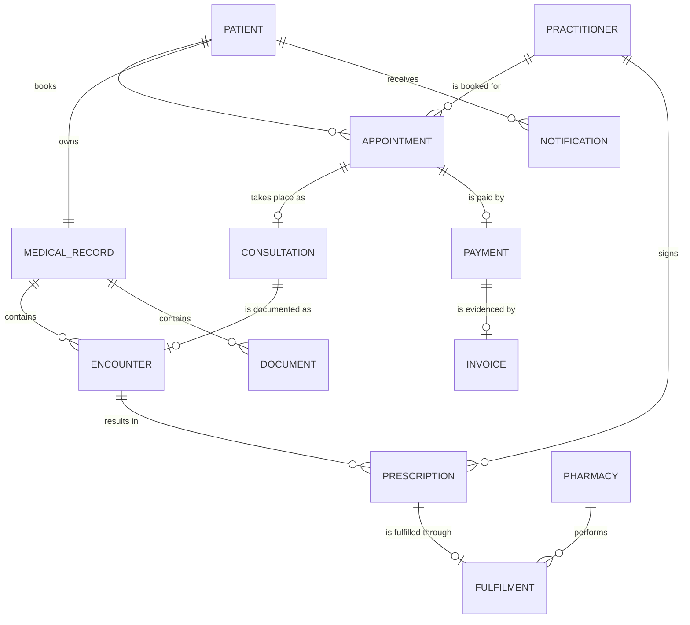
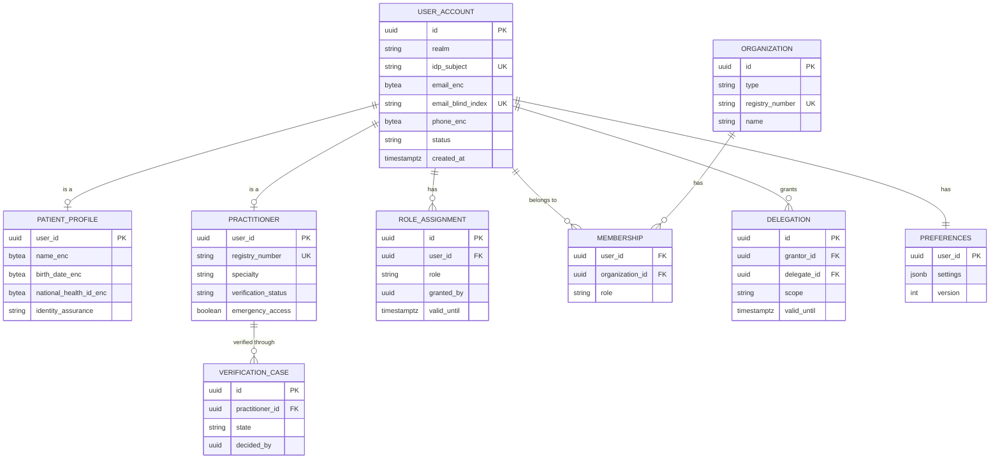
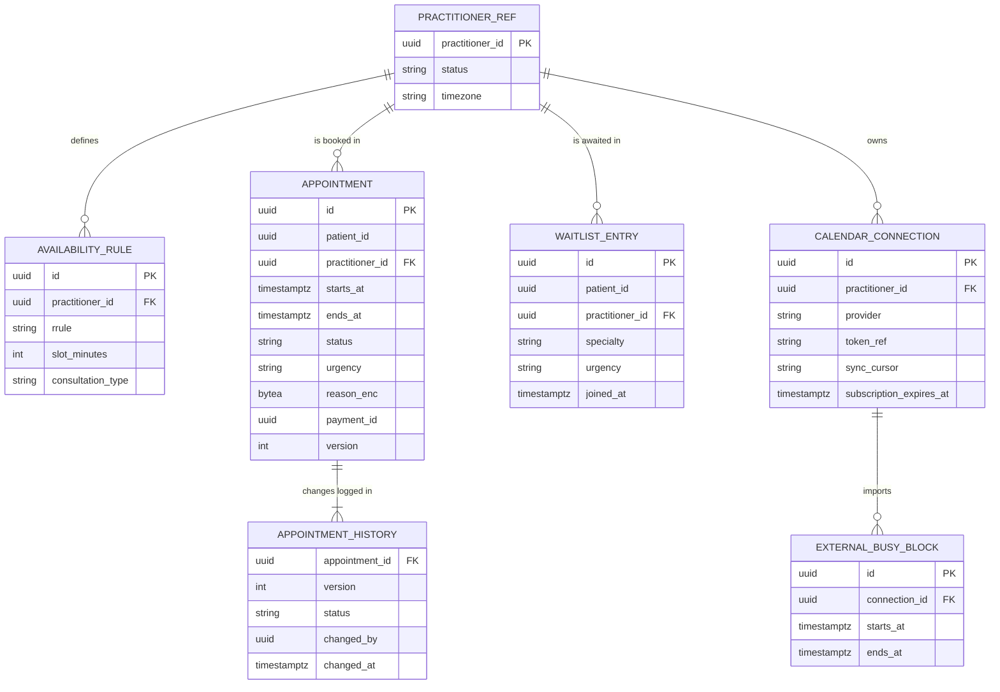
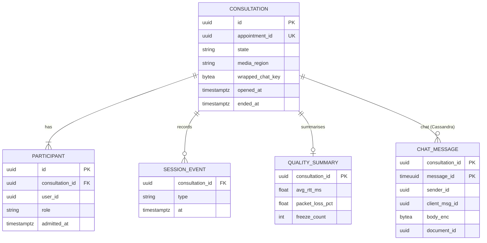
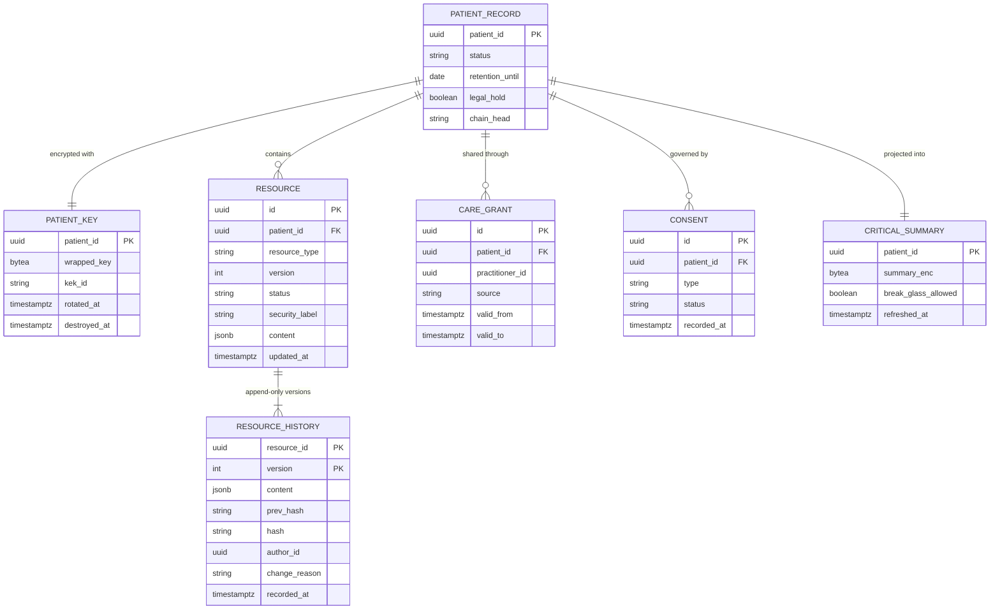
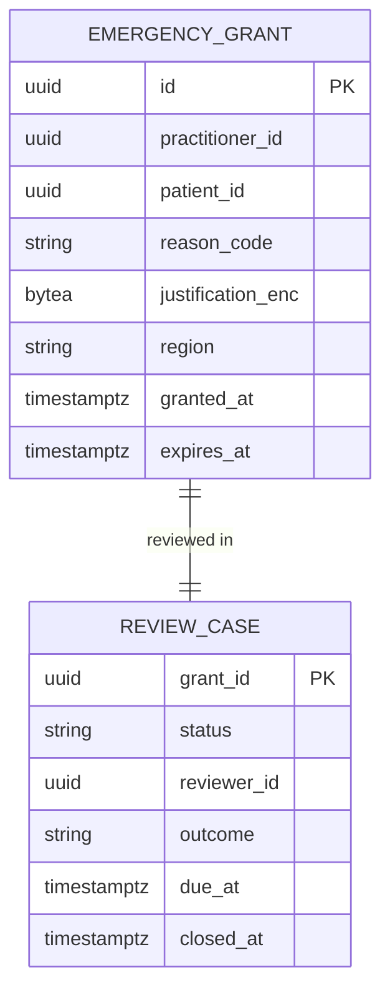
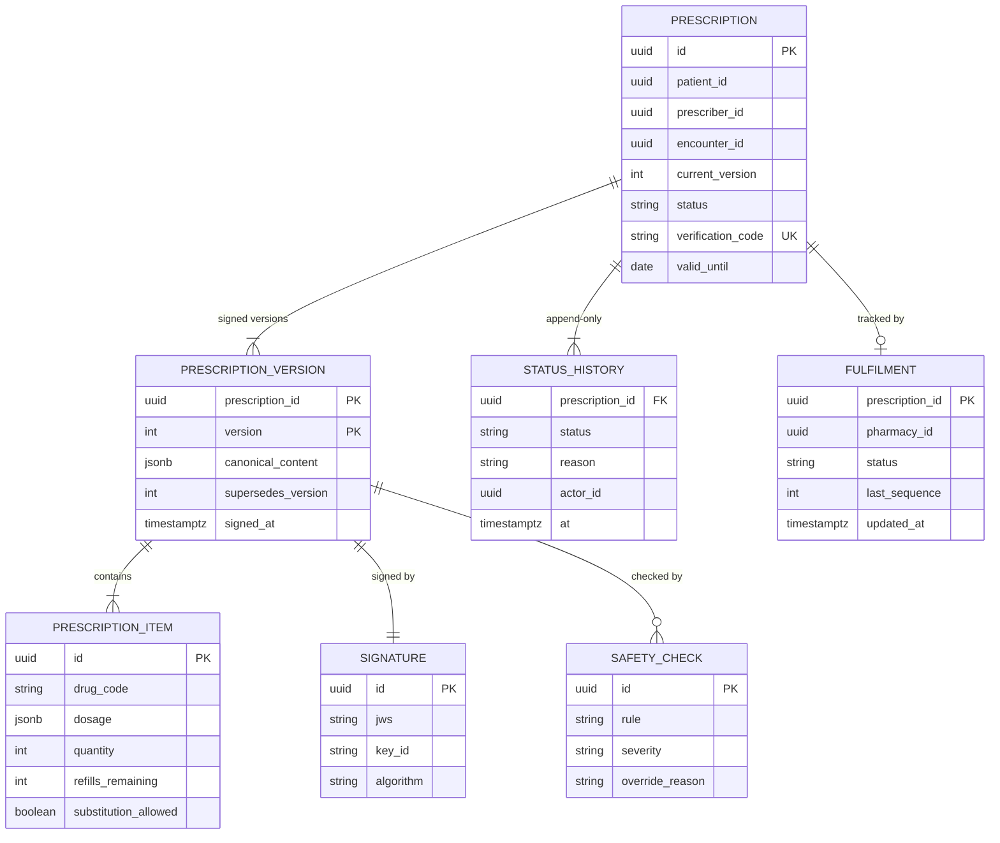
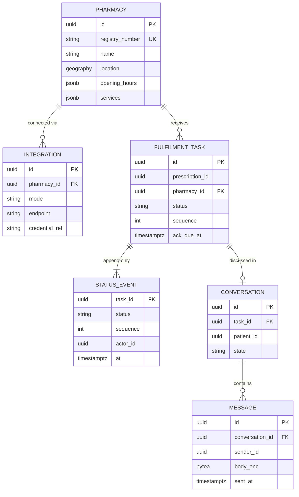
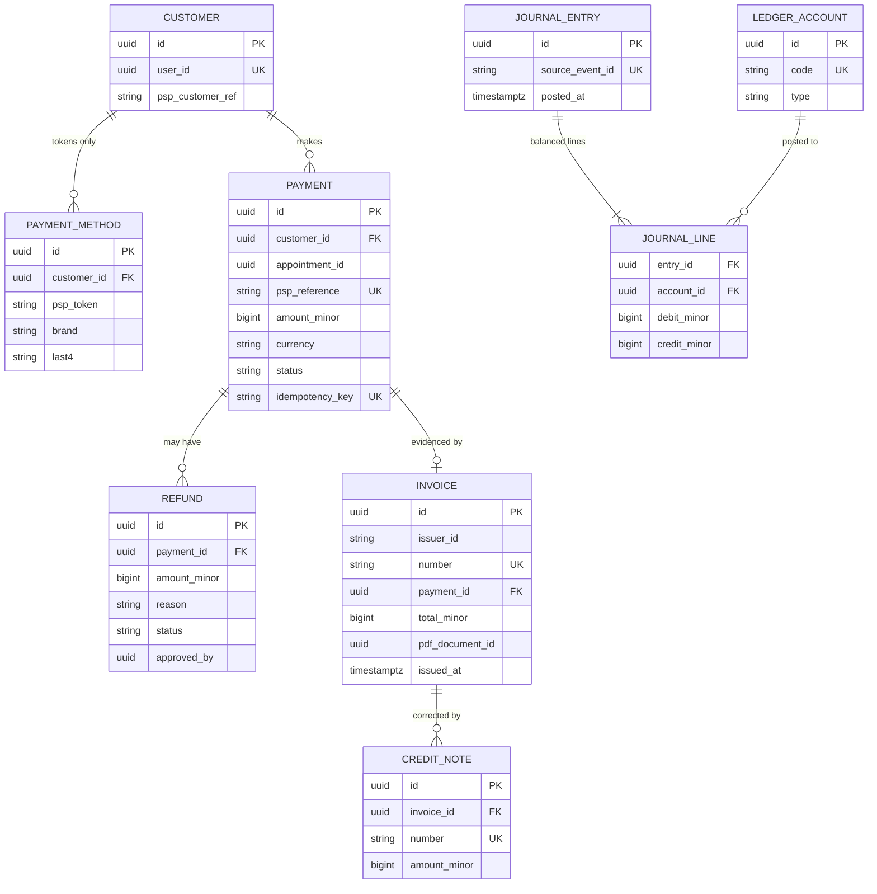

# 3. Data Model & Storage Strategy

> **Deliverable 3.** Synthetic analysis of the data model and of the storage chosen for each component.
> Component behaviour is described in [2. Detailed component designs](02-component-design/README.md).

## 3.1 Principles

1. **Database per service.** Each service owns its schema, credentials and migrations; no other service reads its
   tables. Cross-service references are **identifiers only** (UUIDv7), resolved through APIs or events.
2. **PostgreSQL by default.** Transactions, constraints, JSONB, mature replication and point-in-time recovery, a
   managed Multi-AZ offering inside the HDS scope, and skills that are easy to hire. A specialised store is added
   only when it solves a problem PostgreSQL does not solve well (§3.3).
3. **Classify before storing.** Every field has a data class (§3.2) that decides its encryption, masking, logging and
   retention rules.
4. **Append-only for anything clinical, legal or financial.** Records, prescriptions, fulfilment statuses, ledger and
   audit are never updated in place — changes are new versions or new entries.
5. **Derived data is disposable.** Caches, search indexes and projections can be rebuilt from the systems of record;
   they are never the only copy of anything.
6. **Every store is encrypted, private, backed up, monitored and has a retention rule** — no exception.

## 3.2 Data classification

| Class | Definition | Examples | Mandatory controls |
|-------|------------|----------|--------------------|
| **C4 — Sensitive health data** | Clinical content, sensitive categories, national health identifier | Notes, diagnoses, results, documents, chat content, mental/sexual health, genetics, INS | Clinical zone only · per-patient application encryption **+** storage encryption · ABAC with purpose of use · never cached (except encrypted emergency summary) · never in logs, events, search indexes or non-prod |
| **C3 — Health-related personal data** | Data revealing that a person receives care | Appointments, doctor–patient links, prescriptions, fulfilment statuses | Clinical zone · storage encryption, sensitive fields encrypted · minimised for pharmacies · audited access |
| **C2 — Personal data** | Identity and contact data without health information | Name, e-mail, phone, address, preferences, invoices | Field encryption for contact data · masking for support · GDPR rights applied |
| **C1 — Internal** | Operational, non-personal | Configuration, metrics, pseudonymous telemetry | Access control, standard encryption |
| **C0 — Public** | Meant to be published | Doctor public profiles, drug reference data, static content | Integrity controls |

## 3.3 Storage technology choices

| Technology | Role at MedX | Chosen because | Deliberately **not** used for |
|------------|--------------|----------------|-------------------------------|
| **PostgreSQL** (managed, Multi-AZ, synchronous standby, read replicas, cross-region replica) | System of record of all eight services, the FHIR store, emergency grants, document metadata | ACID, rich constraints (e.g., exclusion constraint against double booking), JSONB for FHIR resources, row-level security, PITR, mature HA | Very high-volume append-only logs with TTL (chat hot store, notification log) |
| **Redis / Valkey** (cluster, replicas in 3 AZs, TLS, encryption at rest) | Slot holds, availability cache, sessions and token denylist, rate limits, idempotency keys, presence, pub/sub | Sub-millisecond latency, atomic `SET NX`, TTLs, pub/sub | Any source of truth (everything in Redis can be rebuilt) |
| **Cassandra** (RF 3 across 3 AZs, TLS, encryption at rest) | Consultation chat hot store (30 days), notification log (13 months) | Linear write scalability, time-ordered partitions, native TTL, multi-datacenter replication | Relational integrity, ad hoc queries, long-term clinical storage |
| **Object storage** (S3-compatible: versioning, Object Lock, SSE-KMS, cross-region replication) | Medical documents, chat transcripts, prescription PDFs, invoices, audit archive, backups | 11-nines durability, WORM retention, lifecycle tiers, low cost at 150 TB | Small structured records |
| **OpenSearch** (private, encrypted, fine-grained access control) | Doctor directory, drug catalogue search, restricted audit investigation index | Full-text, facets, geo queries, fast aggregation | Storing clinical content (it is **not** a PHI store) |
| **Kafka** (3 brokers, RF 3) | Event log, 7 days (30 days for audit) | Durable, ordered per key, replayable | Long-term storage |
| **Columnar analytics store** (Parquet files + query engine) | De-identified analytics | Cheap scans over large volumes | Identifiable data |

**Alternatives considered** — a document database for FHIR JSON (PostgreSQL JSONB gives the same flexibility with
cross-resource transactions and one less technology to secure); a ledger database for audit (hash-chained batches
on WORM object storage give tamper evidence without a niche product); DynamoDB-style key-value stores (vendor
lock-in and harder portability across HDS providers).

## 3.4 Logical data models per service

### Storage strategy per component — synthesis

| Component | System of record | Secondary stores | Key design points | Volume (Year 3) |
|-----------|------------------|------------------|-------------------|-----------------|
| ① User Management | PostgreSQL `usermgmt` + Keycloak's PostgreSQL | Redis (sessions, denylist) | Contact data encrypted, e-mail blind index, preferences as versioned JSONB | ~50 GB |
| ② Scheduling | PostgreSQL `scheduling` | Redis (holds, availability, queues), OpenSearch (directory) | Exclusion constraint, append-only history, reason encrypted | ~250 GB/year |
| ③ Consultation | PostgreSQL `consultation` | Cassandra (chat, 30-day TTL), Redis (routing, presence), Document Store | Chat encrypted per consultation, transcript archived to the record | ~50 GB/year + ~120 GB hot chat |
| ④ Patient Records | PostgreSQL `records` (FHIR resources + history) | Read replicas (3 AZs + DR), Document Store | Append-only history, hash chain, per-patient keys, projections | **~10 TB** structured |
| ④ Emergency Access | PostgreSQL `emergency` (own, per region) | Records read replicas | Grant + audit in one transaction, active in two regions | < 10 GB |
| ⑤ Prescription | PostgreSQL `prescription` | Drug reference replica, OpenSearch (drug search) | Signed immutable versions, two state machines | ~250 GB/year |
| ⑥ Pharmacy Interface | PostgreSQL `pharmacy` (+ PostGIS) | Redis (availability cache) | Append-only status events, credentials in Vault | ~100 GB/year |
| ⑦ Notification | Cassandra (log, 13-month TTL) | PostgreSQL (templates, preference replica), Redis (dedupe, caps) | No PHI stored at all | ~1.2 TB (13 months, before replication) |
| ⑧ Billing & Payment | PostgreSQL `billing` | Document Store (invoice PDFs, WORM) | Double-entry append-only ledger, minor-unit integers, PSP tokens only | ~100 GB/year |
| Document Store | Object storage | PostgreSQL (metadata, wrapped keys) | Quarantine → scan → encrypt → Object Lock | **~150 TB** cumulative |
| Audit Trail | Object storage (WORM, security account) | OpenSearch (13 months), SIEM | Hash-chained batches, signed daily Merkle roots | ~0.7 TB/year compressed |

### Cross-service domain model

Entities belong to one service; relationships across services are references by identifier.



| Entity | Owner service | Store |
|--------|---------------|-------|
| Patient, Practitioner, Pharmacy (identity, organisation) | ① User Management | PostgreSQL |
| Appointment | ② Scheduling | PostgreSQL |
| Consultation | ③ Consultation | PostgreSQL + Cassandra (chat) |
| Medical record, Encounter, clinical resources | ④ Patient Records | PostgreSQL (FHIR) |
| Document | Document Store (metadata) / ④ (clinical reference) | Object storage + PostgreSQL |
| Prescription | ⑤ Prescription | PostgreSQL |
| Fulfilment | ⑥ Pharmacy Interface (operational) / ⑤ (legal status) | PostgreSQL |
| Notification | ⑦ Notification | Cassandra |
| Payment, Invoice | ⑧ Billing & Payment | PostgreSQL + object storage |

### ① User Management



*Blind index*: `email_blind_index = HMAC-SHA256(k, normalised e-mail)` lets the service find an account by e-mail
without storing the address in clear; the HMAC key lives in Vault.

### ② Scheduling



The exclusion constraint on `(practitioner_id, tstzrange(starts_at, ends_at))` for active statuses is described in
[§2.2](02-component-design/02-scheduling.md#booking-saga-and-double-booking-prevention).
Redis keys: `hold:{practitioner}:{start}` (TTL 10 min), `avail:{practitioner}:{date}` (hash of free slots),
`waitlist:{practitioner|specialty}` (sorted set by urgency then time).

### ③ Consultation



Cassandra partition = `consultation_id` (all messages of one consultation together, ordered by `timeuuid`);
`default_time_to_live` = 30 days; the transcript is archived into the record before expiry.

### ④ Patient Records and Emergency Access





- `RESOURCE.content` holds the FHIR JSON; elements classified C4 (free-text notes, sensitive categories, national
  identifier) are replaced by **ciphertext encrypted with the patient key** (AES-256-GCM, additional authenticated
  data = resource ID + version, so ciphertext cannot be moved to another resource).
- FHIR search parameters are extracted into indexed tables at write time (as HAPI FHIR does) — only
  non-sensitive search parameters (codes, dates, statuses) are indexed in clear.
- Tables are **partitioned by hash of `patient_id`** from day one, preparing for sharding by patient.
- The database role of the service has `INSERT/SELECT` only on `RESOURCE_HISTORY`; a trigger rejects any update.

### ⑤ Prescription



### ⑥ Pharmacy Interface



### ⑦ Notification (Cassandra)

Query-driven tables: "a user's notifications, newest first" and "the status history of one notification".

```sql
CREATE TABLE notification_by_recipient (
    recipient_id    uuid,
    month           text,          -- '2026-03': bounds partition size
    created_at      timeuuid,
    notification_id uuid,
    category        text,
    priority        text,
    channel         text,
    template_id     text,
    status          text,
    PRIMARY KEY ((recipient_id, month), created_at)
) WITH CLUSTERING ORDER BY (created_at DESC)
  AND default_time_to_live = 34214400;   -- 396 days, about 13 months

CREATE TABLE notification_status_event (
    notification_id uuid,
    at              timeuuid,
    status          text,
    provider        text,
    provider_ref    text,
    PRIMARY KEY ((notification_id), at)
) WITH default_time_to_live = 34214400;
```

No message body with personal content is stored — only the template ID and the rendering variables' references.

### ⑧ Billing & Payment



Invariant enforced by a deferred constraint trigger: for every `JOURNAL_ENTRY`, Σ debits = Σ credits.
`source_event_id` is unique → the same PSP event can never be posted twice.

### Audit Trail (WORM archive + index)

```json
{
  "id": "0192a4c1-8f3e-7b21-9c4d-2e5f6a7b8c9d",
  "recorded": "2026-03-02T03:12:44.182Z",
  "action": "read",
  "purposeOfUse": "ETREAT",
  "outcome": "success",
  "breakGlass": true,
  "agent": { "id": "0192…", "role": "doctor", "organization": "0192…", "aal": 3, "ip": "203.0.113.10", "device": "web" },
  "entity": { "patientId": "0192…", "resourceType": "Composition", "resourceId": "0192…" },
  "source": { "service": "emergency-access", "region": "eu-central", "traceId": "4bf92f3577b34da6a3ce929d0e0e4736" },
  "batch": { "id": "2026-03-02T03:12Z-eu-central-17", "prevHash": "9f2c…", "hash": "b71e…" }
}
```

## 3.5 Consistency model

| Data | Consistency needed | Mechanism |
|------|--------------------|-----------|
| Slot uniqueness | **Strong** | Exclusion constraint (single primary) + Redis hold |
| Clinical record writes | **Strong**, no lost update | Single primary, `If-Match` optimistic concurrency, read-your-writes routing for the author |
| Prescription legal status | **Strong** in the Prescription service; propagated to pharmacies in seconds | State machine + outbox + reconciliation every 5 min |
| Payments and ledger | **Strong**, effect exactly once | Idempotency keys, unique source event IDs, balanced entries |
| Booking + payment across services | **Eventually consistent business transaction** | Saga with compensation (release slot, void authorisation) |
| Availability cache, directory, timeline projection | Eventual (seconds) | Recomputed from events; rebuildable |
| Critical (emergency) summary | Eventual (p99 < 5 s) | Event-driven projection; the emergency view also lists changes of the last 24 h read directly from the replica |
| Notification preferences replica | Eventual (seconds) | `PreferencesUpdated` events |

## 3.6 Identifiers

- **UUIDv7** for every entity: globally unique across services and regions, time-ordered (good index locality),
  not guessable in sequence — never auto-increment integers exposed in URLs (prevents enumeration attacks).
- **Patient identity**: MedX patient ID (internal, pseudonymous) + national health identifier (INS) stored encrypted
  and used only for identity matching and national-service exchanges.
- Human-facing references (invoice numbers, prescription verification codes) are separate, purpose-specific
  identifiers.

## 3.7 Data lifecycle and retention

| Data | Retention | End of life | Basis |
|------|-----------|-------------|-------|
| Medical record (resources, documents, transcripts, prescriptions) | **20 years after the last encounter** (France; longer for minors), configurable per jurisdiction; legal hold possible | **Crypto-shredding** (patient keys destroyed) then physical deletion | Public-health law |
| Chat hot store | 30 days (transcript already archived in the record) | TTL expiry | Minimisation |
| Video/audio | **Not recorded** | — | Privacy by design |
| Appointments | 5 years after the appointment, then anonymised for statistics | Anonymisation job | Evidence of care, disputes |
| User account (patient) | While active; closed after 3 years of inactivity with prior notice | Deletion of C2 data; medical record kept under its own rule | GDPR storage limitation |
| Practitioner identity | As long as records reference the practitioner | Kept (attribution of records) | Integrity of records |
| Invoices, ledger | 10 years | Deletion | Commercial law |
| Payment tokens | Until removed by the user, or 13 months after last use | Deleted at the PSP and locally | PCI DSS, minimisation |
| Notification log | 13 months | TTL expiry | Evidence of delivery |
| Audit trail | ≥ 6 years, configurable up to record retention | Object Lock expiry then deletion | Accountability |
| Technical/security logs | 12 months | Deletion | Security investigations |
| Backups | PITR 35 days · daily snapshots 35 days · monthly snapshots 12 months | Automatic expiry (immutable until then) | Recovery |
| Key registries (wrapped patient keys) | Backups kept 35 days only | Expiry | Makes crypto-shredding effective in backups |
| De-identified analytics | Anonymous data: unlimited · pseudonymised datasets: 2 years | Deletion | Research, statistics |

**Right to erasure vs medical retention** — GDPR art. 17(3) exempts data that must be kept for healthcare or legal
obligations: a patient can close their account and delete contact data, but the medical record stays under its
legal retention (the patient is told so clearly).

## 3.8 Data integrity mechanisms

| Threat | Mechanisms |
|--------|------------|
| Concurrent edits (lost update) | Optimistic concurrency (`If-Match`/version), single primary for writes |
| Invalid or inconsistent data | FHIR profile & terminology validation, foreign keys and check constraints, state machines, exclusion constraint |
| Partial failures between services | Transactional outbox, idempotent consumers, sagas with compensation, reconciliation jobs |
| Silent tampering (insider, compromised admin) | Append-only history, per-patient hash chains, daily Merkle root signed in HSM and timestamped, WORM audit archive, verification jobs |
| Corrupted files | SHA-256 checksum at upload, at every download and in weekly scrub jobs; object versioning |
| Accidental or malicious deletion, ransomware | No delete privilege for application roles on history; Object Lock (compliance mode); **immutable, cross-account backup vault**; deletion protection on databases |
| Loss of a zone or region | Synchronous standby in another AZ (RPO 0), cross-region replicas (RPO ≤ 1 min), replicated object storage |
| Undetected backup failure | Automated restore tests every week (sample) and full restore drill every quarter, with integrity verification |

## 3.9 Backup and recovery

| Store | Backup | Restore objective |
|-------|--------|-------------------|
| PostgreSQL (all services) | Continuous WAL archiving → **PITR 35 days**; daily snapshots; monthly snapshots 12 months; copies in the immutable vault (other account, other region) | Point-in-time restore of one service without touching others |
| Cassandra | Daily snapshots + incremental backups to object storage | Chat is rebuildable from record transcripts; notification log is non-critical |
| Object storage | Versioning + Object Lock + cross-region replication + vault copy | Object or version restore; region failover |
| Kafka | Not backed up as a store (events are also in databases); MirrorMaker to DR for continuity | Replay from outboxes if needed |
| Redis / OpenSearch | Not backed up (derived data) — rebuilt from systems of record | Rebuild jobs (minutes to hours) |
| Keys (KMS/HSM) | Provider-managed, multi-region keys; Vault DR replication | — |

## 3.10 Data residency and replication

- All health data is stored and processed in the **EEA**, in HDS-certified regions (primary France, DR Germany).
- Cross-region replication is encrypted in transit and re-encrypted at rest with multi-region keys.
- Expansion to another jurisdiction (e.g., the US) is done with a **separate regional cell**: a full copy of the
  platform with its own data, keys and compliance scope (HIPAA); only non-personal configuration is shared
  globally. Patient data never flows between cells except at the patient's request.
