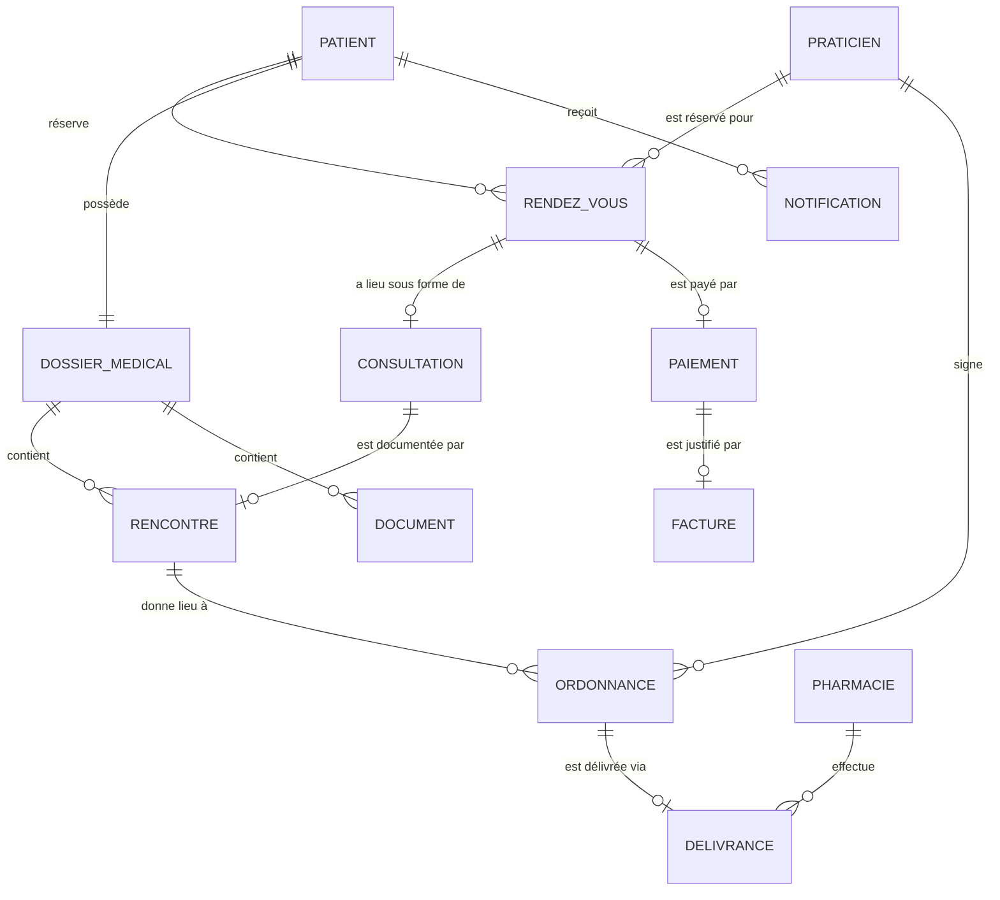
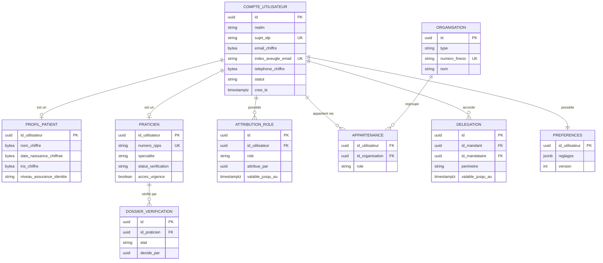
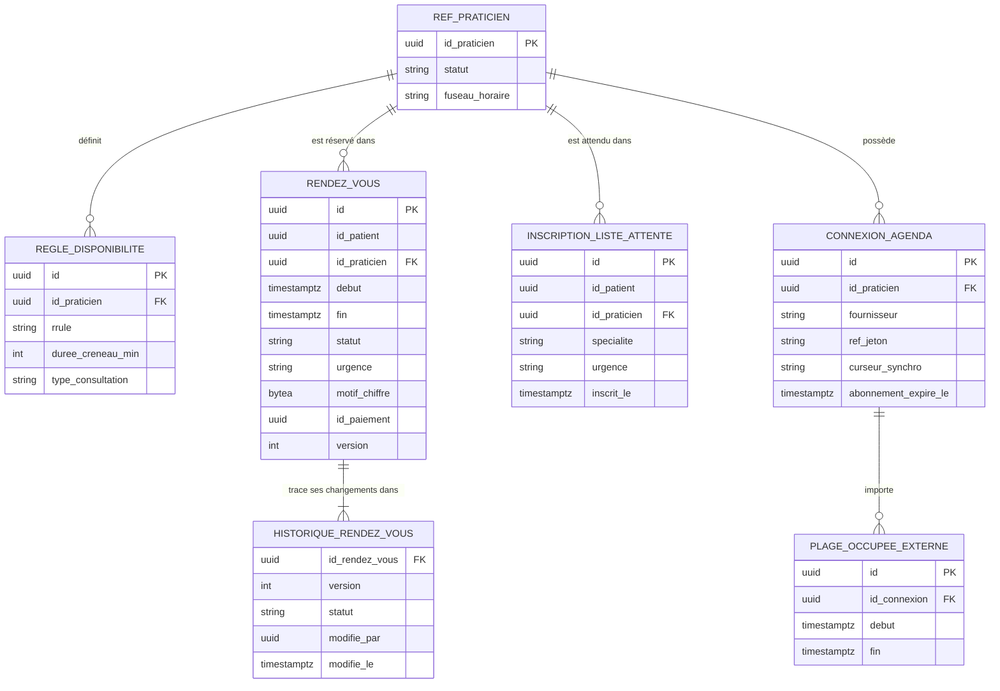
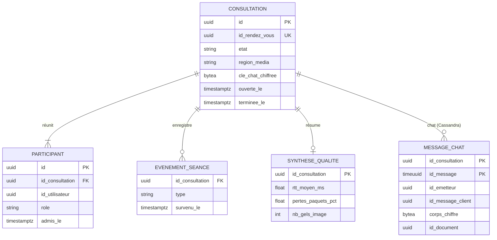
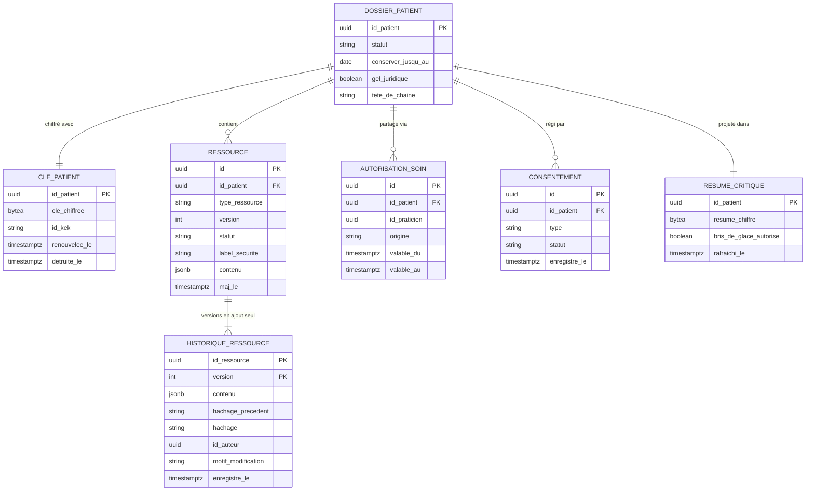
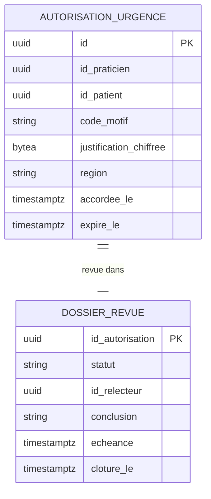
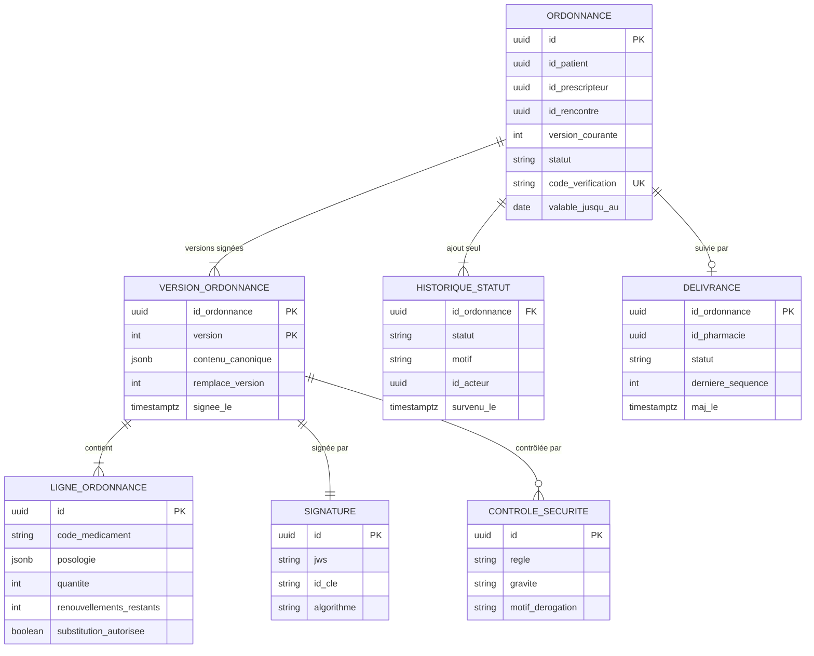
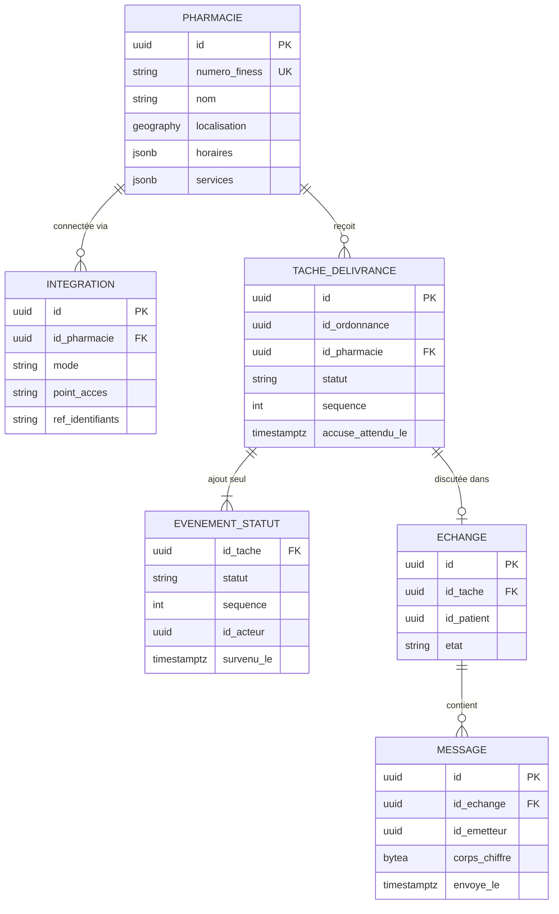
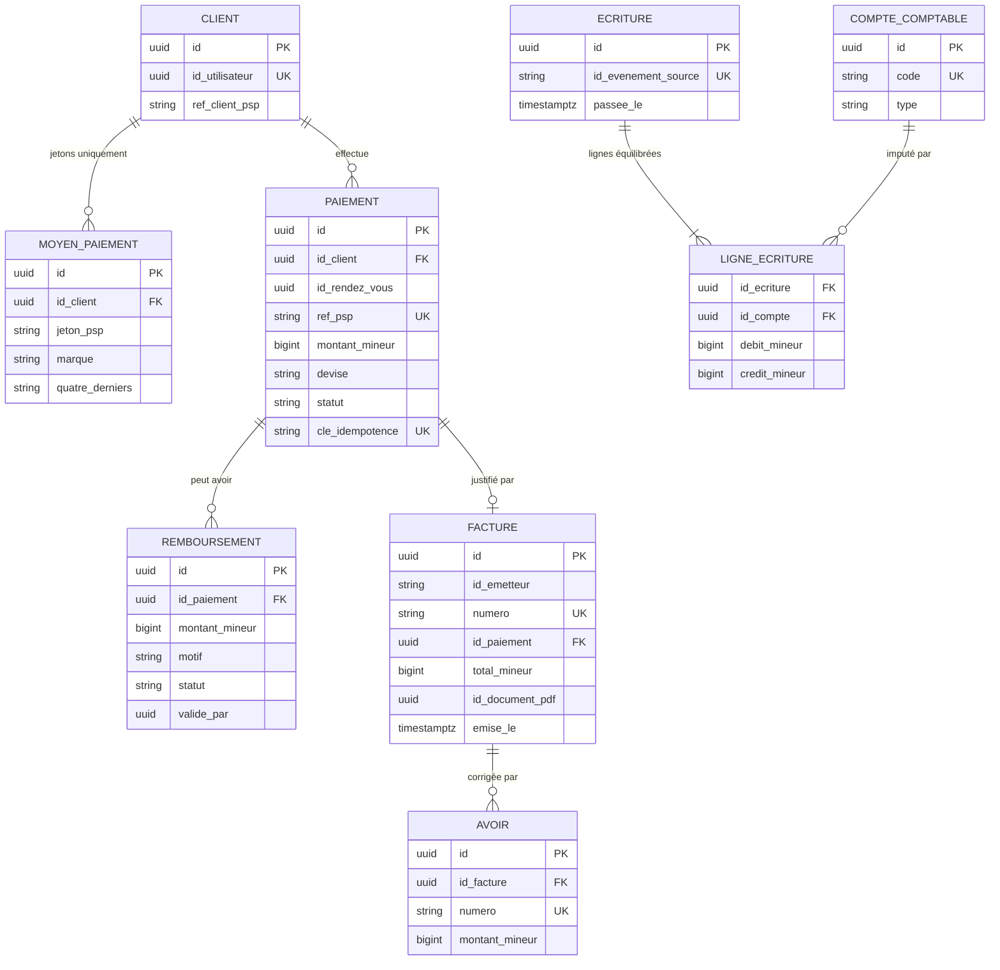

# 3. Modèle de données et stratégie de stockage

> **Livrable 3.** Analyse synthétique du modèle de données et du stockage retenu pour chaque composant.
> Le comportement des composants est décrit dans le [document 2 — Conception détaillée des composants](02-conception-composants/README.md).

## 3.1 Principes

1. **Une base par service.** Chaque service possède son schéma, ses identifiants de connexion et ses migrations ;
   aucun autre service ne lit ses tables. Les références entre services sont **uniquement des identifiants** (UUIDv7),
   résolus via les API ou les événements.
2. **PostgreSQL par défaut.** Transactions, contraintes, JSONB, réplication et restauration à un instant donné
   éprouvées, offre managée multi-AZ dans le périmètre HDS, et compétences faciles à recruter. Une base spécialisée
   n'est ajoutée que si elle résout un problème que PostgreSQL traite mal (§3.3).
3. **Classer avant de stocker.** Chaque champ appartient à une classe de données (§3.2) qui décide de son chiffrement,
   de son masquage, de sa journalisation et de sa durée de conservation.
4. **Ajout seul pour tout ce qui est clinique, légal ou financier.** Dossiers, ordonnances, statuts de délivrance,
   grand livre et audit ne sont jamais modifiés en place — un changement est une nouvelle version ou une nouvelle
   écriture.
5. **Les données dérivées sont jetables.** Caches, index de recherche et projections peuvent être reconstruits à
   partir des systèmes de référence ; ils ne sont jamais l'unique copie de quoi que ce soit.
6. **Chaque base est chiffrée, privée, sauvegardée, supervisée et soumise à une règle de conservation** — sans
   exception.

> **Convention de nommage** — suivant le langage du domaine (DDD), les tables, colonnes, événements et API portent
> des noms français en `snake_case` sans accents ; les noms normalisés (ressources FHIR comme `Patient` ou
> `MedicationRequest`, types SQL, champs CloudEvents) restent inchangés.

## 3.2 Classification des données

| Classe | Définition | Exemples | Contrôles obligatoires |
|--------|------------|----------|------------------------|
| **C4 — Données de santé sensibles** | Contenu clinique, catégories sensibles, identifiant national de santé | Notes, diagnostics, résultats, documents, contenu du chat, santé mentale ou sexuelle, génétique, INS | Zone clinique uniquement · chiffrement applicatif par patient **+** chiffrement du stockage · ABAC avec finalité · jamais en cache (sauf le résumé d'urgence chiffré) · jamais dans les journaux, les événements, les index de recherche ni hors production |
| **C3 — Données personnelles liées à la santé** | Données révélant qu'une personne est prise en charge | Rendez-vous, liens médecin–patient, ordonnances, statuts de délivrance | Zone clinique · chiffrement du stockage, champs sensibles chiffrés · minimisées pour les pharmacies · accès audités |
| **C2 — Données personnelles** | Données d'identité et de contact sans information de santé | Nom, e-mail, téléphone, adresse, préférences, factures | Chiffrement au niveau du champ pour les coordonnées · masquage pour le support · droits RGPD appliqués |
| **C1 — Interne** | Opérationnel, non personnel | Configuration, métriques, télémétrie pseudonyme | Contrôle d'accès, chiffrement standard |
| **C0 — Public** | Destiné à être publié | Profils publics des médecins, données de référence des médicaments, contenus statiques | Contrôles d'intégrité |

## 3.3 Choix des technologies de stockage

| Technologie | Rôle chez MedX | Retenue parce que | Volontairement **pas** utilisée pour |
|-------------|----------------|-------------------|--------------------------------------|
| **PostgreSQL** (managé, multi-AZ, réplique synchrone, répliques de lecture, réplique entre régions) | Système de référence des huit services, entrepôt FHIR, autorisations d'urgence, métadonnées des documents | ACID, contraintes riches (par exemple la contrainte d'exclusion contre les doubles réservations), JSONB pour les ressources FHIR, sécurité au niveau des lignes, restauration à un instant donné, haute disponibilité éprouvée | Les journaux très volumineux en ajout seul avec expiration (historique récent du chat, journal des notifications) |
| **Redis / Valkey** (cluster, répliques dans 3 AZ, TLS, chiffrement au repos) | Blocages de créneaux, cache des disponibilités, sessions et liste de refus des jetons, limites de débit, clés d'idempotence, présence, pub/sub | Latence inférieure à la milliseconde, `SET NX` atomique, TTL, pub/sub | Toute source de vérité (tout ce qui est dans Redis peut être reconstruit) |
| **Cassandra** (RF 3 sur 3 AZ, TLS, chiffrement au repos) | Historique récent du chat de consultation (30 jours), journal des notifications (13 mois) | Scalabilité linéaire en écriture, partitions ordonnées dans le temps, TTL natif, réplication multi-datacenter | L'intégrité relationnelle, les requêtes ad hoc, le stockage clinique de long terme |
| **Stockage objet** (compatible S3 : versionnage, Object Lock, SSE-KMS, réplication entre régions) | Documents médicaux, transcriptions de chat, PDF d'ordonnances, factures, archive d'audit, sauvegardes | Durabilité de 11 neuf, conservation WORM, niveaux de stockage, faible coût pour 150 To | Les petits enregistrements structurés |
| **OpenSearch** (privé, chiffré, contrôle d'accès fin) | Annuaire des médecins, recherche dans le catalogue des médicaments, index d'investigation d'audit (restreint) | Plein texte, facettes, requêtes géographiques, agrégations rapides | Le stockage de contenu clinique (ce **n'est pas** une base de données de santé) |
| **Kafka** (3 brokers, RF 3) | Journal d'événements, 7 jours (30 jours pour l'audit) | Durable, ordonné par clé, rejouable | Le stockage de long terme |
| **Stockage analytique en colonnes** (fichiers Parquet + moteur de requêtes) | Analytique sur données désidentifiées | Parcours peu coûteux de gros volumes | Les données identifiantes |

**Alternatives étudiées** — une base orientée documents pour le JSON FHIR (le JSONB de PostgreSQL offre la même
souplesse avec des transactions entre ressources et une technologie de moins à sécuriser) ; une base de type registre
immuable pour l'audit (des lots chaînés par hachage sur un stockage objet WORM apportent la preuve d'intégrité sans
produit de niche) ; des bases clé-valeur propriétaires d'un fournisseur (dépendance et portabilité plus difficile entre
hébergeurs HDS).

## 3.4 Modèles logiques par service

### Stratégie de stockage par composant — synthèse

| Composant | Système de référence | Stockages secondaires | Points clés de conception | Volume (année 3) |
|-----------|----------------------|-----------------------|---------------------------|------------------|
| ① Gestion des utilisateurs | PostgreSQL `gestion_utilisateurs` + base PostgreSQL de Keycloak | Redis (sessions, liste de refus) | Coordonnées chiffrées, index aveugle pour l'e-mail, préférences en JSONB versionné | ~50 Go |
| ② Planification | PostgreSQL `planification` | Redis (blocages, disponibilités, files), OpenSearch (annuaire) | Contrainte d'exclusion, historique en ajout seul, motif chiffré | ~250 Go/an |
| ③ Consultation | PostgreSQL `consultation` | Cassandra (chat, TTL 30 jours), Redis (routage, présence), stockage de documents | Chat chiffré par consultation, transcription archivée dans le dossier | ~50 Go/an + ~120 Go de chat récent |
| ④ Dossier patient | PostgreSQL `dossier` (ressources FHIR + historique) | Répliques de lecture (3 AZ + reprise), stockage de documents | Historique en ajout seul, chaîne de hachage, clés par patient, projections | **~10 To** structurés |
| ④ Accès d'urgence | PostgreSQL `urgence` (propre au service, par région) | Répliques de lecture du dossier | Autorisation + audit dans une seule transaction, actif dans deux régions | < 10 Go |
| ⑤ Ordonnances | PostgreSQL `ordonnances` | Réplique de la base médicaments, OpenSearch (recherche de médicaments) | Versions signées immuables, deux machines à états | ~250 Go/an |
| ⑥ Interface pharmacie | PostgreSQL `pharmacie` (+ PostGIS) | Redis (cache des disponibilités) | Événements de statut en ajout seul, identifiants dans Vault | ~100 Go/an |
| ⑦ Notification | Cassandra (journal, TTL 13 mois) | PostgreSQL (modèles, réplique des préférences), Redis (dédoublonnage, plafonds) | Aucune donnée de santé stockée | ~1,2 To (13 mois, avant réplication) |
| ⑧ Facturation et paiement | PostgreSQL `facturation` | Stockage de documents (PDF des factures, WORM) | Grand livre en partie double en ajout seul, entiers en unité mineure, jetons PSP uniquement | ~100 Go/an |
| Stockage de documents | Stockage objet | PostgreSQL (métadonnées, clés chiffrées) | Quarantaine → analyse → chiffrement → Object Lock | **~150 To** cumulés |
| Piste d'audit | Stockage objet (WORM, compte de sécurité) | OpenSearch (13 mois), SIEM | Lots chaînés par hachage, racines de Merkle signées chaque jour | ~0,7 To/an compressé |

### Modèle de domaine transverse

Chaque entité appartient à un seul service ; les relations entre services sont des références par identifiant.



| Entité | Service propriétaire | Stockage |
|--------|----------------------|----------|
| Patient, praticien, pharmacie (identité, organisation) | ① Gestion des utilisateurs | PostgreSQL |
| Rendez-vous | ② Planification | PostgreSQL |
| Consultation | ③ Consultation | PostgreSQL + Cassandra (chat) |
| Dossier médical, rencontre, ressources cliniques | ④ Dossier patient | PostgreSQL (FHIR) |
| Document | Stockage de documents (métadonnées) / ④ (référence clinique) | Stockage objet + PostgreSQL |
| Ordonnance | ⑤ Ordonnances | PostgreSQL |
| Délivrance | ⑥ Interface pharmacie (opérationnel) / ⑤ (statut légal) | PostgreSQL |
| Notification | ⑦ Notification | Cassandra |
| Paiement, facture | ⑧ Facturation et paiement | PostgreSQL + stockage objet |

### ① Gestion des utilisateurs



*Index aveugle* : `index_aveugle_email = HMAC-SHA256(k, e-mail normalisé)` permet de retrouver un compte par e-mail
sans stocker l'adresse en clair ; la clé HMAC est conservée dans Vault.

### ② Planification



La contrainte d'exclusion sur `(id_praticien, tstzrange(debut, fin))` pour les statuts actifs est décrite au
[§2.2](02-conception-composants/02-planification.md#saga-de-réservation-et-prévention-des-doubles-réservations).
Clés Redis : `blocage:{praticien}:{debut}` (TTL 10 min), `dispo:{praticien}:{date}` (table des créneaux libres),
`attente:{praticien|specialite}` (ensemble trié par urgence puis ancienneté).

### ③ Consultation



Partition Cassandra = `id_consultation` (tous les messages d'une consultation ensemble, ordonnés par `timeuuid`) ;
`default_time_to_live` = 30 jours ; la transcription est archivée dans le dossier avant l'expiration.

### ④ Dossier patient et accès d'urgence





- `RESSOURCE.contenu` contient le JSON FHIR ; les éléments classés C4 (notes en texte libre, catégories sensibles,
  identifiant national) y sont remplacés par un **texte chiffré avec la clé du patient** (AES-256-GCM, données
  authentifiées additionnelles = id de ressource + version, pour qu'un texte chiffré ne puisse pas être déplacé vers une
  autre ressource).
- Les paramètres de recherche FHIR sont extraits dans des tables indexées à l'écriture (comme le fait HAPI FHIR) —
  seuls des paramètres non sensibles (codes, dates, statuts) sont indexés en clair.
- Les tables sont **partitionnées par hachage de `id_patient`** dès le départ, ce qui prépare le partitionnement
  horizontal par patient.
- Le rôle de base de données du service n'a que `INSERT/SELECT` sur `HISTORIQUE_RESSOURCE` ; un déclencheur rejette
  toute modification.

### ⑤ Ordonnances



### ⑥ Interface pharmacie



### ⑦ Notification (Cassandra)

Tables conçues à partir des requêtes : « les notifications d'un utilisateur, les plus récentes d'abord » et
« l'historique des statuts d'une notification ».

```sql
CREATE TABLE notification_par_destinataire (
    id_destinataire  uuid,
    mois             text,          -- '2026-03' : borne la taille des partitions
    cree_le          timeuuid,
    id_notification  uuid,
    categorie        text,
    priorite         text,
    canal            text,
    id_modele        text,
    statut           text,
    PRIMARY KEY ((id_destinataire, mois), cree_le)
) WITH CLUSTERING ORDER BY (cree_le DESC)
  AND default_time_to_live = 34214400;   -- 396 jours, environ 13 mois

CREATE TABLE evenement_statut_notification (
    id_notification  uuid,
    survenu_le       timeuuid,
    statut           text,
    fournisseur      text,
    ref_fournisseur  text,
    PRIMARY KEY ((id_notification), survenu_le)
) WITH default_time_to_live = 34214400;
```

Aucun corps de message au contenu personnel n'est stocké — seulement l'identifiant du modèle et les références des
variables de rendu.

### ⑧ Facturation et paiement



Invariant imposé par un déclencheur de contrainte différé : pour chaque `ECRITURE`, Σ débits = Σ crédits.
`id_evenement_source` est unique → le même événement PSP ne peut jamais être comptabilisé deux fois.

### Piste d'audit (archive WORM + index)

```json
{
  "id": "0192a4c1-8f3e-7b21-9c4d-2e5f6a7b8c9d",
  "enregistreLe": "2026-03-02T03:12:44.182Z",
  "action": "lecture",
  "finalite": "ETREAT",
  "resultat": "succes",
  "brisDeGlace": true,
  "acteur": { "id": "0192…", "role": "medecin", "organisation": "0192…", "niveauAssurance": 3, "ip": "203.0.113.10", "appareil": "web" },
  "entite": { "idPatient": "0192…", "typeRessource": "Composition", "idRessource": "0192…" },
  "source": { "service": "acces-urgence", "region": "eu-central", "idTrace": "4bf92f3577b34da6a3ce929d0e0e4736" },
  "lot": { "id": "2026-03-02T03:12Z-eu-central-17", "hachagePrecedent": "9f2c…", "hachage": "b71e…" }
}
```

## 3.5 Modèle de cohérence

| Donnée | Cohérence requise | Mécanisme |
|--------|-------------------|-----------|
| Unicité des créneaux | **Forte** | Contrainte d'exclusion (base principale unique) + blocage Redis |
| Écritures dans le dossier clinique | **Forte**, aucune mise à jour perdue | Base principale unique, concurrence optimiste `If-Match`, lectures de l'auteur dirigées vers la base principale |
| Statut légal des ordonnances | **Forte** dans le service Ordonnances ; propagée aux pharmacies en quelques secondes | Machine à états + outbox + rapprochement toutes les 5 min |
| Paiements et grand livre | **Forte**, effet exactement une fois | Clés d'idempotence, identifiants d'événements source uniques, écritures équilibrées |
| Réservation + paiement entre services | **Transaction métier à cohérence à terme** | Saga avec compensation (libérer le créneau, annuler l'autorisation) |
| Cache des disponibilités, annuaire, chronologie | À terme (quelques secondes) | Recalculés à partir des événements ; reconstructibles |
| Résumé critique (urgence) | À terme (p99 < 5 s) | Projection sur événement ; la vue d'urgence liste aussi les changements des dernières 24 h, lus directement sur la réplique |
| Réplique des préférences de notification | À terme (quelques secondes) | Événements `PreferencesMisesAJour` |

## 3.6 Identifiants

- **UUIDv7** pour chaque entité : uniques entre services et régions, ordonnés dans le temps (bonne localité d'index),
  impossibles à deviner séquentiellement — jamais d'entiers auto-incrémentés exposés dans les URL (protection contre
  les attaques par énumération).
- **Identité du patient** : identifiant patient MedX (interne, pseudonyme) + identifiant national de santé (INS) stocké
  chiffré, utilisé seulement pour le rapprochement d'identité et les échanges avec les services nationaux.
- Les références destinées aux humains (numéros de facture, codes de vérification des ordonnances) sont des
  identifiants distincts, dédiés à leur usage.

## 3.7 Cycle de vie et conservation des données

| Donnée | Durée de conservation | Fin de vie | Fondement |
|--------|-----------------------|------------|-----------|
| Dossier médical (ressources, documents, transcriptions, ordonnances) | **20 ans après la dernière consultation** (France ; davantage pour les mineurs), paramétrable selon le pays ; gel juridique possible | **Effacement cryptographique** (destruction des clés du patient), puis suppression physique | Code de la santé publique |
| Historique récent du chat | 30 jours (transcription déjà archivée dans le dossier) | Expiration par TTL | Minimisation |
| Vidéo / audio | **Non enregistrés** | — | Confidentialité dès la conception |
| Rendez-vous | 5 ans après le rendez-vous, puis anonymisation pour les statistiques | Tâche d'anonymisation | Preuve de prise en charge, litiges |
| Compte utilisateur (patient) | Tant qu'il est actif ; clôturé après 3 ans d'inactivité, avec préavis | Suppression des données C2 ; le dossier médical suit sa propre règle | Limitation de la conservation (RGPD) |
| Identité des praticiens | Tant que des dossiers y font référence | Conservée (attribution des dossiers) | Intégrité des dossiers |
| Factures, grand livre | 10 ans | Suppression | Code de commerce |
| Jetons de paiement | Jusqu'à leur retrait par l'utilisateur, ou 13 mois après la dernière utilisation | Supprimés chez le PSP et localement | PCI DSS, minimisation |
| Journal des notifications | 13 mois | Expiration par TTL | Preuve de distribution |
| Piste d'audit | ≥ 6 ans, paramétrable jusqu'à la durée de conservation du dossier | Fin de l'Object Lock puis suppression | Responsabilité |
| Journaux techniques et de sécurité | 12 mois | Suppression | Investigations de sécurité |
| Sauvegardes | Restauration à un instant donné 35 jours · instantanés quotidiens 35 jours · instantanés mensuels 12 mois | Expiration automatique (immuables jusque-là) | Reprise |
| Registres de clés (clés patient chiffrées) | Sauvegardes conservées 35 jours seulement | Expiration | Rend l'effacement cryptographique effectif dans les sauvegardes |
| Analytique désidentifiée | Données anonymes : illimitée · jeux pseudonymisés : 2 ans | Suppression | Recherche, statistiques |

**Droit à l'effacement et conservation médicale** — l'article 17(3) du RGPD exclut les données qui doivent être
conservées pour les soins ou pour une obligation légale : un patient peut clôturer son compte et faire supprimer ses
coordonnées, mais le dossier médical reste soumis à sa durée légale de conservation (le patient en est clairement
informé).

## 3.8 Mécanismes d'intégrité des données

| Menace | Mécanismes |
|--------|------------|
| Modifications concurrentes (mise à jour perdue) | Concurrence optimiste (`If-Match` / version), base principale unique pour les écritures |
| Données invalides ou incohérentes | Validation par profils FHIR et terminologies, clés étrangères et contraintes de vérification, machines à états, contrainte d'exclusion |
| Pannes partielles entre services | Outbox transactionnelle, consommateurs idempotents, sagas avec compensation, tâches de rapprochement |
| Altération silencieuse (malveillance interne, administrateur compromis) | Historique en ajout seul, chaînes de hachage par patient, racine de Merkle quotidienne signée par HSM et horodatée, archive d'audit WORM, tâches de vérification |
| Fichiers corrompus | Somme de contrôle SHA-256 au dépôt, à chaque téléchargement et lors de contrôles hebdomadaires ; versionnage des objets |
| Suppression accidentelle ou malveillante, rançongiciel | Aucun droit de suppression pour les rôles applicatifs sur l'historique ; Object Lock (mode conformité) ; **coffre de sauvegardes immuable dans un autre compte** ; protection contre la suppression des bases |
| Perte d'une zone ou d'une région | Réplique synchrone dans une autre AZ (RPO 0), répliques entre régions (RPO ≤ 1 min), stockage objet répliqué |
| Défaillance de sauvegarde non détectée | Tests de restauration automatisés chaque semaine (échantillon) et exercice de restauration complète chaque trimestre, avec vérification d'intégrité |

## 3.9 Sauvegarde et restauration

| Stockage | Sauvegarde | Objectif de restauration |
|----------|------------|--------------------------|
| PostgreSQL (tous les services) | Archivage continu des WAL → **restauration à un instant donné sur 35 jours** ; instantanés quotidiens ; instantanés mensuels sur 12 mois ; copies dans le coffre immuable (autre compte, autre région) | Restauration à un instant donné d'un seul service sans toucher aux autres |
| Cassandra | Instantanés quotidiens + sauvegardes incrémentales vers le stockage objet | Le chat se reconstruit à partir des transcriptions du dossier ; le journal des notifications n'est pas critique |
| Stockage objet | Versionnage + Object Lock + réplication entre régions + copie dans le coffre | Restauration d'un objet ou d'une version ; bascule régionale |
| Kafka | Pas sauvegardé en tant que stockage (les événements sont aussi en base) ; MirrorMaker vers la reprise pour la continuité | Rejeu depuis les outbox si nécessaire |
| Redis / OpenSearch | Pas sauvegardés (données dérivées) — reconstruits à partir des systèmes de référence | Tâches de reconstruction (de quelques minutes à quelques heures) |
| Clés (KMS/HSM) | Gérées par le fournisseur, clés multirégions ; réplication de reprise de Vault | — |

## 3.10 Résidence et réplication des données

- Toutes les données de santé sont stockées et traitées dans l'**EEE**, dans des régions certifiées HDS (principale
  en France, reprise en Allemagne).
- La réplication entre régions est chiffrée en transit et rechiffrée au repos avec des clés multirégions.
- L'ouverture à un autre pays (par exemple les États-Unis) se fait avec une **cellule régionale séparée** : une copie
  complète de la plateforme, avec ses propres données, ses clés et son périmètre de conformité (HIPAA) ; seule la
  configuration non personnelle est partagée au niveau global. Les données patient ne circulent jamais entre cellules,
  sauf à la demande du patient.
