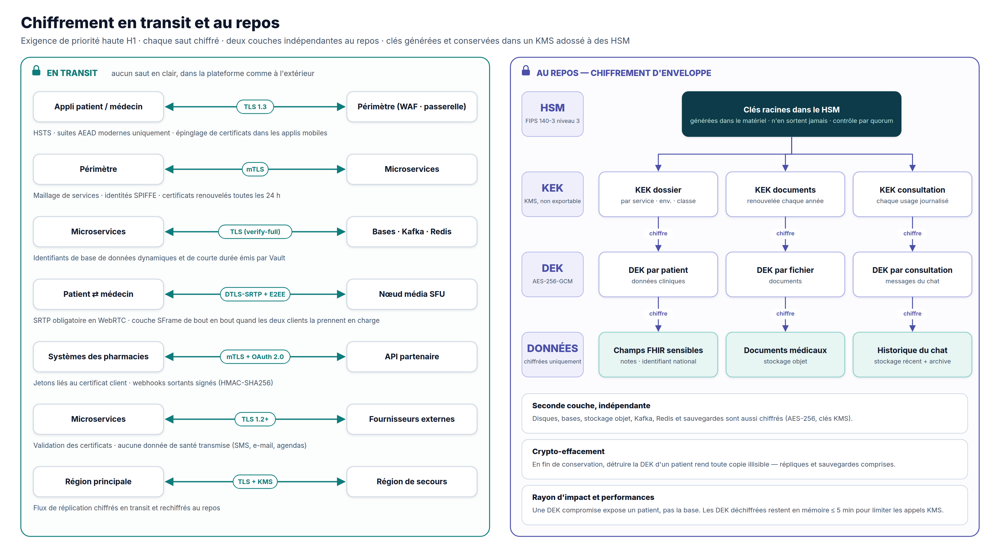
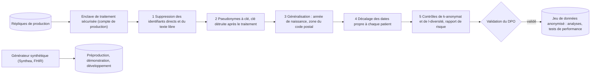

# 5. Sécurité et conformité

> **Livrable 5.** Protocoles de sécurité, méthodes de chiffrement et mesures de conformité qui protègent les données
> de santé de MedX. C'est ici que les exigences de priorité haute H1 (confidentialité des données), H3 (contrôle de
> l'accès d'urgence), H4 (authentification et autorisation) et H5 (intégrité) deviennent des contrôles concrets.

## 5.1 Objectifs et principes

| Objectif | Signification pour MedX |
|----------|-------------------------|
| **Confidentialité** | Les données de santé ne sont vues que par le patient et les professionnels qui le soignent, pour une finalité légitime. |
| **Intégrité** | Dossiers, ordonnances et paiements sont complets, exacts, et toute altération est détectable. |
| **Disponibilité** | Les informations critiques restent accessibles en urgence, même pendant une panne (niveau 0). |
| **Traçabilité** | Chaque accès à une donnée de santé peut être attribué, justifié et contrôlé. |
| **Protection de la vie privée** | Collecter le minimum, ne l'utiliser que pour sa finalité, ne le conserver que le temps requis, respecter les droits des patients. |

**Principes** : défense en profondeur · zéro confiance (aucune confiance implicite accordée au réseau : chaque appel
est authentifié, autorisé et chiffré) · moindre privilège · refus par défaut · protection des données dès la
conception et par défaut · présomption de compromission (limiter le rayon d'impact, détecter vite, restaurer depuis
des sauvegardes immuables) · sécurité sous forme de code (politiques, infrastructure et contrôles versionnés et
testés).

## 5.2 Cadre réglementaire et normatif

| Cadre | Pourquoi il s'applique | Obligations clés | Comment la conception s'y conforme |
|-------|------------------------|------------------|------------------------------------|
| **RGPD** (UE 2016/679) | Les données de santé sont une catégorie particulière (art. 9) | Base légale (art. 9(2)(h), prise en charge sanitaire), protection des données dès la conception (art. 25), sécurité (art. 32), **AIPD** (art. 35), DPO (art. 37), registre des traitements (art. 30), droits des personnes, notification des violations sous **72 h** (art. 33-34), contrats de sous-traitance (art. 28), aucun transfert hors EEE sans garanties | §5.11 opérations de conformité ; chiffrement, minimisation et conservation intégrés ; hébergement exclusivement dans l'EEE |
| **Certification HDS** (Code de la santé publique, art. L.1111-8) | Hébergement de données de santé de patients français | Hébergement par des prestataires certifiés HDS ; HDS v2 (2024) impose un hébergement dans l'EEE ; certification de MedX pour les activités qu'elle opère elle-même | Régions cloud certifiées HDS (France + Allemagne) ; seuls des services certifiés traitent des données de santé ; plan de certification de MedX (§5.12) |
| **Référentiels nationaux de la e-santé** (ANS : PGSSI-S, INS, Pro Santé Connect, cadre d'interopérabilité) | Systèmes d'information de santé français | Politique de sécurité, identifiant national de santé, authentification des professionnels, formats interopérables | Politiques alignées sur la PGSSI-S, INS dans la ressource Patient, fédération Pro Santé Connect, modèle FHIR / IPS |
| **Règles de la télémédecine** (Code de la santé publique, art. R.6316-1 et suivants) | Téléconsultations | Professionnels authentifiés, patients identifiés et consentants, échanges sécurisés, compte rendu au dossier | Praticiens vérifiés + MFA, assurance de l'identité du patient, consentement à la réservation, vidéo chiffrée de bout en bout, compte rendu de consultation au dossier |
| **HIPAA** (États-Unis) — en cas d'expansion | Données de santé de patients américains | Privacy, Security et Breach Notification Rules ; BAA ; « minimum nécessaire » | Cellule américaine séparée, mêmes contrôles, BAA avec les sous-traitants |
| **PCI DSS v4.0** | Paiements par carte | Protéger les données des titulaires de carte | Champs hébergés par le PSP → **SAQ A** ; intégrité des scripts de la page de paiement |
| **eIDAS** (UE 910/2014 modifié par 2024/1183) | Signatures et horodatages électroniques | Valeur juridique des signatures et des horodatages | Signatures des prescripteurs (options qualifiées), horodatages qualifiés pour les ancrages d'intégrité |
| **NIS2** (UE 2022/2555) | La santé est un secteur hautement critique | Mesures de gestion des risques ; signalement des incidents : alerte précoce sous 24 h, notification sous 72 h, rapport final sous 1 mois | Mesures adoptées dès la conception (§5.8 à 5.10) ; processus de signalement dans le plan de gestion des incidents |
| **Espace européen des données de santé** (UE 2025/327) | Accès des patients à leurs données de santé électroniques et échanges (obligations progressives) | Droits d'accès et de partage des patients, exigences d'interopérabilité et de journalisation des systèmes de DSE | Modèle FHIR / IPS, export patient et journal des accès, piste d'audit |
| **Règlement relatif aux dispositifs médicaux** (UE 2017/745) | Un logiciel d'aide à la décision clinique peut être un dispositif médical | Qualification, marquage CE si concerné | Triage et contrôles de prescription évalués pour qualification ; maintenus à base de règles et validés |
| **Normes** | Assurance et bonnes pratiques | ISO/IEC 27001 et 27701, ISO 27799 (santé), OWASP ASVS et API Top 10, NIST SP 800-63B, CIS Benchmarks, sécurité FHIR (portées SMART), IHE BALP (audit) | Utilisées comme référentiels de contrôles (§5.8) |

## 5.3 Modèle de menaces

Construit avec STRIDE à partir des flux de données de l'architecture ; le tableau liste les menaces au plus fort impact
pour MedX.

| # | Menace | Exemple | Principales parades | Risque résiduel |
|---|--------|---------|---------------------|-----------------|
| T1 | Prise de contrôle de compte | Bourrage d'identifiants sur des patients, hameçonnage d'un médecin | MFA (résistante à l'hameçonnage pour les professionnels), vérification des mots de passe compromis, limitation de débit, jetons liés par DPoP, alertes de nouvel appareil | Faible |
| T2 | Contrôle d'accès défaillant au niveau objet | Modifier un identifiant dans une URL pour lire le dossier d'un autre patient | Décision ABAC sur chaque objet, UUID, tests d'autorisation négatifs en CI, validation de schéma à la passerelle | Faible |
| T3 | Curiosité d'un initié | Un employé ou un médecin qui consulte le dossier d'une célébrité | Aucun accès du personnel aux données de santé, modèle d'autorisations de soin, audit de chaque lecture, alertes UEBA, journal des accès visible par le patient, sanctions | Moyen → Faible |
| T4 | Rançongiciel / attaque destructrice | Chiffrement ou suppression des bases et des sauvegardes | Coffre de sauvegarde immuable dans un compte séparé, Object Lock, moindre privilège, segmentation, EDR, restaurations testées | Faible |
| T5 | Exfiltration de données | Instantané divulgué, compartiment mal configuré, service compromis | Chiffrement applicatif par patient (les données volées sont chiffrées), politiques de clés KMS, listes blanches en sortie, CSPM, DLP sur les journaux | Faible |
| T6 | Injections et attaques web | Injection SQL, XSS, SSRF | Requêtes paramétrées, encodage des sorties, CSP stricte, WAF, SAST / DAST, contrôle des sorties réseau | Faible |
| T7 | Écoute des consultations | Homme du milieu sur la vidéo | DTLS-SRTP + chiffrement de bout en bout, TLS 1.3, épinglage de certificats dans les applications | Faible |
| T8 | Dépôt de fichier malveillant | Logiciel malveillant déguisé en PDF médical | Quarantaine, antivirus, contrôle du type par signature binaire, assainissement des PDF, analyseurs isolés | Faible |
| T9 | Compromission de la chaîne d'approvisionnement | Dépendance ou image de base malveillante | Analyse des dépendances, versions épinglées, SBOM, images signées vérifiées à l'admission, provenance des builds | Moyen |
| T10 | Déni de service et abus | Robots de réservation, aspiration de l'annuaire | CDN / WAF, gestion des robots, limitation de débit, salle d'attente virtuelle | Faible |
| T11 | Fraude à l'ordonnance | Ordonnances falsifiées ou réutilisées | Ordonnances signées, point de vérification avec statut en temps réel, QR codes sans contenu | Faible |
| T12 | Abus du bris de glace | Fausse urgence pour lire un dossier | Droit dédié, justification, MFA renforcée, alerte en temps réel, information du patient, revue obligatoire, sanctions | Faible à moyen |
| T13 | Fraude au paiement | Cartes volées | 3-D Secure (authentification forte), score de risque du PSP, limites de vélocité | Faible |
| T14 | Fuite par les notifications | Un SMS qui révèle un diagnostic à un proche | Aucune donnée de santé dans les messages externes, variables de modèle en liste blanche | Faible |
| T15 | Mauvaise configuration du cloud | Compartiment public, journalisation désactivée | Garde-fous d'organisation (accès public interdit, désactivation du chiffrement ou de la journalisation interdite), analyse de l'IaC, CSPM | Faible |

## 5.4 Gestion des identités et des accès

Le détail se trouve au [§2.1 Gestion des utilisateurs](02-conception-composants/01-gestion-utilisateurs.md) ; les
règles qui touchent à la sécurité sont :

- **Niveau d'authentification** — patients : mot de passe ou passkey + MFA selon le risque ; professionnels : MFA
  résistante à l'hameçonnage en permanence (passkeys, clés de sécurité, carte professionnelle via Pro Santé Connect) ;
  **la signature d'une ordonnance et le bris de glace exigent une authentification récente liée à un matériel**
  (renforcement dans les 15 minutes). Jetons de courte durée, restreints à une audience, liés par DPoP ou par
  certificat.
- **Autorisation** — RBAC pour les permissions générales + ABAC (relation de soin, consentement, finalité, étiquettes
  de sensibilité, organisation) évalué par OPA à côté de chaque service ; refus par défaut ; obligations de masquage.
- **Accès à privilèges** — aucun accès administrateur permanent à la production : élévation juste-à-temps avec
  approbation, MFA, 4 heures au maximum et enregistrement de session ; les administrateurs de la plateforme **ne
  peuvent pas lire les données de santé** (les clés de chiffrement applicatif ne sont pas utilisables par leurs rôles).
- **Identités de service** — identités SPIFFE via le maillage (mTLS) ; les politiques d'autorisation du maillage
  définissent quel service peut appeler quel service ; un rôle IAM cloud par service, au moindre privilège (par
  exemple, seul le rôle du dossier patient peut utiliser la KEK du dossier patient).
- **Cycle de vie** — désactivation automatique des comptes des collaborateurs qui partent ; synchronisation mensuelle
  avec les registres professionnels qui suspend les praticiens radiés ; **recertification trimestrielle** des droits
  tels que `acces_urgence` ; séparation des tâches entre développeurs, administrateurs de bases de données et
  dépositaires de clés ; principe des quatre yeux pour les opérations sensibles.

## 5.5 Chiffrement en transit

| Canal | Protocole | Configuration |
|-------|-----------|---------------|
| Applications ↔ périmètre | **TLS 1.3** (TLS 1.2 avec suites ECDHE + AEAD uniquement pour les anciens appareils ; TLS ≤ 1.1 désactivé) | HSTS avec préchargement, agrafage OCSP, renouvellement automatique des certificats, épinglage de clés publiques (avec clés de secours) dans les applications mobiles |
| Périmètre ↔ services, service ↔ service | **mTLS** (maillage de services, mode STRICT — le texte clair est refusé) | Identités SPIFFE des charges de travail, certificats renouvelés toutes les 24 h, politiques d'autorisation par appelant |
| Services ↔ bases de données | TLS avec vérification du serveur | PostgreSQL `sslmode=verify-full` ; TLS pour Redis, Kafka (plus authentification client mTLS), Cassandra (client et entre nœuds), OpenSearch |
| Audio / vidéo | **DTLS-SRTP** (obligatoire en WebRTC) + **chiffrement de bout en bout** (SFrame) pour le tête-à-tête lorsque c'est pris en charge | TURN sur TLS 443 sur les réseaux restrictifs |
| Logiciels de pharmacie, partenaires | **mTLS + OAuth 2.0** avec jetons liés au certificat | Webhooks sortants signés HMAC-SHA256 avec horodatage et protection contre le rejeu |
| Fournisseurs externes (SMS, e-mail, push, agendas, PSP) | TLS 1.2+ avec validation des certificats | Aucune donnée de santé dans les contenus ; SMTP avec MTA-STS, SPF / DKIM / DMARC |
| Réplication entre régions | TLS | Rechiffré au repos avec des clés multi-régions |

**Politique cryptographique** — suites TLS 1.3 (AES-128/256-GCM, ChaCha20-Poly1305) avec confidentialité persistante
(X25519, P-256). Comme les données de santé doivent rester confidentielles pendant des décennies, MedX active
l'**échange de clés hybride post-quantique** (X25519 + ML-KEM) partout où les clients et les répartiteurs de charge le
prennent en charge, contre les attaques « collecter maintenant, déchiffrer plus tard » (l'agilité cryptographique est
une exigence de conception : les algorithmes relèvent de la configuration, pas du code).

## 5.6 Chiffrement au repos et gestion des clés

**Deux couches indépendantes**

| Couche | Portée | Mécanisme | Protège contre |
|--------|--------|-----------|----------------|
| **1 — Chiffrement du stockage** | Chaque volume, base de données, instantané, sauvegarde, objet, journal Kafka, Redis, Cassandra, OpenSearch | AES-256 avec des clés KMS gérées par MedX | Disques perdus, instantanés volés, accès aux supports côté fournisseur |
| **2 — Chiffrement applicatif (enveloppe)** | Données C4 : éléments FHIR sensibles, documents, messagerie, identifiants nationaux, coordonnées | **AES-256-GCM** dans le service avec des clés de données par patient / par fichier / par consultation ; les données authentifiées additionnelles lient le chiffré à son enregistrement | Compromission au niveau de la base, administrateurs aux privilèges excessifs, répliques ou exports mal configurés, injection SQL renvoyant des lignes brutes |

**Hiérarchie des clés** — clés racines dans des **HSM (FIPS 140-3 niveau 3)** → **KEK** dans le KMS par service ×
environnement × classe de données (jamais exportées) → **clés de données (DEK)** générées par le KMS, stockées
uniquement sous forme chiffrée à côté des données → données chiffrées.

| Étape du cycle de vie | Règle |
|-----------------------|-------|
| Génération | Uniquement dans le HSM / KMS ; aucune clé à long terme générée par une application |
| Accès | Politiques de clés KMS : seul le rôle du service propriétaire peut déchiffrer avec sa KEK ; les administrateurs de clés ne peuvent pas les utiliser pour déchiffrer ; chaque usage est journalisé dans le compte de sécurité |
| Cache | DEK déchiffrées conservées en mémoire du processus ≤ 5 minutes (LRU borné), jamais écrites sur disque ni dans les journaux |
| Renouvellement | KEK renouvelées automatiquement chaque année (anciennes versions conservées pour le déchiffrement ; DEK rechiffrées progressivement) ; DEK renouvelées en cas de soupçon de compromission |
| Séparation | Clés de production inutilisables depuis les comptes hors production → un instantané de production ne peut pas être déchiffré hors production |
| Reprise après sinistre | Clés multi-régions pour la région de secours ; Vault répliqué |
| Destruction | **Crypto-effacement** : à la fin de la durée de conservation, les clés de données du patient sont détruites ; les registres de clés ne gardent que 35 jours de sauvegardes, de sorte que toute copie restante des données — répliques, sauvegardes — devient illisible |

**Autres protections** — mots de passe hachés avec Argon2id ; secrets dans Vault (identifiants de base de données
dynamiques, chiffrement Transit pour les jetons d'intégration) ; cartes de paiement tokenisées par le PSP ; les
applications mobiles ne conservent aucune donnée de santé au-delà de la session, sauf les documents explicitement
téléchargés par l'utilisateur, protégés par le chiffrement de fichiers adossé au trousseau du système et effacés à la
déconnexion.

## 5.7 Masquage, caviardage et anonymisation

**Masquage dynamique (M4)** — le moteur de politiques renvoie des obligations de masquage appliquées avant que la
moindre réponse ne quitte un service (les agents de support voient `+33 6 •• •• •• 42`, les pharmaciens ne voient
aucun diagnostic, le bris de glace exclut les notes de psychothérapie…). La matrice complète est au
[§2.4](02-conception-composants/04-dossier-patient.md#masquage-et-caviardage-m4).

**Caviardage** — les documents partagés ou exportés peuvent être expurgés des sections étiquetées ; le caviardage des
PDF supprime la couche de texte (un vrai caviardage, pas un rectangle noir) ; journaux et traces ne contiennent jamais
de données de santé (champs en liste blanche, identifiants tokenisés, analyseur automatique sur des échantillons de
journaux).

**Anonymisation pour la préproduction et les démonstrations (B4)** — règle : *les données de santé de production ne
quittent jamais la production*.

| Environnement | Données | Contrôles |
|---------------|---------|-----------|
| Développement, préproduction, démonstration | Patients **synthétiques** (par exemple des lots FHIR Synthea) et rendez-vous, ordonnances et paiements générés ; locataire de démonstration marqué « DÉMO » | Comptes séparés, aucun chemin réseau ni accès aux clés de production |
| Tests de performance nécessitant des distributions réalistes | Extraits **anonymisés** produits par la chaîne ci-dessus | k ≥ 10 sur les quasi-identifiants, l-diversité sur les attributs sensibles, analyse documentée du risque de réidentification, validation du DPO, expiration du jeu de données |
| Analyses et recherche | Données anonymisées ; données pseudonymisées uniquement sous des contrôles de niveau production et avec base légale ou consentement | Registre des finalités, revues des accès |

## 5.8 Sécurité des applications et des API

- **Cycle de développement sécurisé** — modélisation des menaces pour chaque fonctionnalité significative, référents
  sécurité dans chaque équipe, socle **OWASP ASVS niveau 2** et **niveau 3** pour la gestion des utilisateurs, le
  dossier patient, l'accès d'urgence et les ordonnances ; critères d'acceptation de sécurité dans la définition de
  « terminé ».
- **Contrôles automatiques en CI** — SAST, analyse des dépendances (SCA), détection de secrets, analyse de
  l'infrastructure sous forme de code, analyse des images de conteneurs ; DAST et fuzzing d'API sur la préproduction ;
  **suites de tests d'autorisation** avec cas négatifs (le patient A ne doit jamais lire le patient B).
- **Tests indépendants** — test d'intrusion avant le lancement puis chaque année et après tout changement majeur ;
  programme de bug bounty après le lancement.
- **Protections des API (OWASP API Top 10)** — autorisation au niveau des objets et des propriétés, listes blanches
  des réponses (pas d'exposition massive), modèles de requête explicites (pas d'affectation de masse), limites de
  débit et quotas, protection SSRF par une passerelle de sortie aux destinations en liste blanche, inventaire complet
  des API dans la passerelle.
- **Web** — CSP stricte à base de nonces, Trusted Types, SRI, HSTS, `frame-ancestors 'none'` (sauf le composant du
  PSP), cookies SameSite, jetons CSRF pour les sessions par cookie.
- **Mobile (OWASP MASVS)** — épinglage de certificats, attestation de l'application, écrans sensibles masqués dans les
  captures d'écran et le sélecteur de tâches, aucune donnée de santé dans les journaux de l'appareil, appareils
  rootés / jailbreakés traités comme un signal de risque.
- **Chaîne d'approvisionnement** — dépendances épinglées, SBOM pour chaque image, images de base minimales
  (distroless) mises à jour chaque semaine, **images signées vérifiées à l'admission**, provenance des builds (SLSA),
  uniquement des modifications revues (branches protégées).

## 5.9 Sécurité de l'infrastructure et du réseau

- **Zone d'atterrissage** — comptes séparés (production, secours, sécurité et archive des journaux, services
  partagés, hors production) sous garde-fous d'organisation : stockage public interdit, désactivation du chiffrement ou
  de la journalisation interdite, régions hors EEE interdites.
- **Réseau** — sous-réseaux privés pour tous les services et toutes les bases ; exposition publique limitée aux
  répartiteurs de charge et aux nœuds média ; politiques réseau Kubernetes en **refus par défaut** ; politiques
  d'autorisation du maillage ; points d'accès privés vers les services cloud ; sorties uniquement via des passerelles
  contrôlées avec listes blanches.
- **Durcissement des charges de travail** — benchmarks CIS, profil Pod Security « restricted », conteneurs non root
  et en lecture seule, seccomp / AppArmor, détection des menaces à l'exécution, EDR sur les nœuds ; délais de
  correction des vulnérabilités : critiques < 7 jours, élevées < 30 jours.
- **Accès du personnel** — proxy zéro confiance tenant compte de l'identité (ni VPN, ni SSH) ; accès à la production
  uniquement par élévation juste-à-temps.
- **Sécurité physique** — héritée du fournisseur cloud certifié HDS / ISO 27001.

## 5.10 Journalisation, détection et réponse aux incidents

- **Journalisation de sécurité** — événements d'authentification, refus d'autorisation, actions d'administration,
  usage du KMS, flux réseau, piste d'audit ; envoyés vers le **compte de sécurité** (immuable, 12 mois pour les
  journaux techniques, ≥ 6 ans pour la piste d'audit).
- **Détection (SIEM + UEBA)** — événements de bris de glace, tentatives d'accès sans relation de soin, lectures ou
  exports massifs de dossiers, déplacements impossibles, MFA désactivée, élévation de privilèges, volumes anormaux de
  déchiffrements KMS, nouveau point d'accès public.
- **Réponse** — plans documentés pour les violations de données, les rançongiciels, les prises de contrôle de compte
  et les abus du bris de glace ; astreinte 24 h/24 et 7 j/7 ; niveaux de gravité ; préparation à l'investigation
  (journaux conservés, procédures d'instantanés) ; exercices sur table deux fois par an.

| Obligation de notification | Délai |
|----------------------------|-------|
| RGPD — autorité de contrôle (CNIL) | **72 h** après en avoir pris connaissance (art. 33) |
| RGPD — patients concernés | Dans les meilleurs délais lorsque le risque est élevé (art. 34) |
| NIS2 — CSIRT / autorité nationale | Alerte précoce sous **24 h**, notification sous **72 h**, rapport final sous **1 mois** |
| Secteur de la santé en France — incidents graves | Déclaration sur le portail de signalement des autorités sanitaires / CERT Santé |
| HIPAA (cellule américaine) | Personnes concernées sous 60 jours ; HHS selon les règles applicables |

## 5.11 Opérations de conformité à la protection des données

| Domaine | Mesure |
|---------|--------|
| Gouvernance | DPO désigné ; registre des traitements ; **AIPD avant le lancement** et à chaque changement majeur (obligatoire pour des données de santé à grande échelle) ; revue de protection des données dans le processus de conception |
| Bases légales | Soins : art. 9(2)(h) ; contrat et obligations légales pour la facturation ; **consentement explicite** uniquement lorsqu'il est requis (recherche, marketing, partages facultatifs, cookies non essentiels) |
| Transparence | Mentions d'information à plusieurs niveaux dans les applications ; page **« qui a consulté mon dossier »** pour les patients |
| Droits des personnes | Export en libre-service (lot FHIR / PDF), rectification par le médecin traitant (l'amendement conserve l'historique), effacement des données de compte (le dossier médical est conservé pendant sa durée légale), opposition et limitation lorsqu'elles s'appliquent (par exemple recherche, bris de glace lorsque la loi le permet) ; réponse sous un mois |
| Sous-traitants | Contrats de sous-traitance, hébergement certifié HDS, prestataires établis dans l'UE pour toute donnée personnelle ; **aucune donnée de santé envoyée aux fournisseurs de messagerie ou d'agenda** ; BAA pour une future cellule américaine |
| Mineurs | Délégation parentale, règles de confidentialité des adolescents appliquées par les politiques |
| Protection par défaut | Recherche et marketing désactivés par défaut ; partage minimal ; aucun traceur tiers dans les espaces authentifiés |

## 5.12 Feuille de route de conformité et d'assurance

| Jalon | Échéance |
|-------|----------|
| AIPD, registre des traitements, politiques de sécurité (alignées sur la PGSSI-S), contrat d'hébergement certifié HDS | Avant le premier vrai patient |
| Test d'intrusion externe | Avant le lancement, puis chaque année |
| Certification HDS pour les activités opérées par MedX elle-même | Avant le lancement (selon le périmètre) |
| Attestation PCI DSS SAQ A | Au lancement du paiement |
| Certification ISO/IEC 27001 (+ 27701) | Années 1 à 2 |
| SOC 2 Type II, préparation HIPAA | Avant une expansion aux États-Unis |

La conformité est continue : garde-fous et politiques sous forme de code, collecte automatisée des preuves, revues
trimestrielles des accès, exercices annuels de reprise après sinistre et de gestion d'incident.

## 5.13 Exigences de priorité haute — contrôles et preuves

| Exigence | Contrôles | Comment c'est vérifié |
|----------|-----------|-----------------------|
| **H1 Confidentialité des données** (chiffrement au repos et en transit) | TLS 1.3 / mTLS partout ; chiffrement AES-256 du stockage ; chiffrement d'enveloppe par patient ; clés adossées à des HSM ; aucune donnée de santé hors de la zone clinique | Contrôles de conformité du chiffrement sur 100 % des stockages ; analyses de configuration TLS ; maillage en mode STRICT ; détecteur de données de santé dans les journaux |
| **H2 Dossier patient** | Entrepôt FHIR, validation, versionnage, registre des consentements, audit de chaque accès | Vérification nocturne des chaînes de hachage ; tests de couverture de l'audit ; suite de tests du contrôle d'accès |
| **H3 Accès d'urgence** | Bris de glace avec droit dédié, MFA renforcée, autorisation limitée dans le temps, déploiement de niveau 0 dans deux régions, revue a posteriori | Sondes synthétiques (p95, disponibilité) ; **100 % des bris de glace revus sous 72 h** ; exercices de reprise |
| **H4 Authentification et autorisation** | Keycloak (OIDC, MFA), OPA RBAC + ABAC, accès à privilèges juste-à-temps | 100 % de MFA pour les professionnels ; recertification trimestrielle réalisée ; tests unitaires des politiques en CI |
| **H5 Intégrité des données et fichiers sécurisés** | ACID, ajout seul, chaînes de hachage + ancrage, sommes de contrôle, Object Lock, sauvegardes immuables, analyse des fichiers | Tests de restauration hebdomadaires + exercice complet trimestriel ; vérification des sommes de contrôle sans aucune divergence ; contrôles de configuration WORM |
