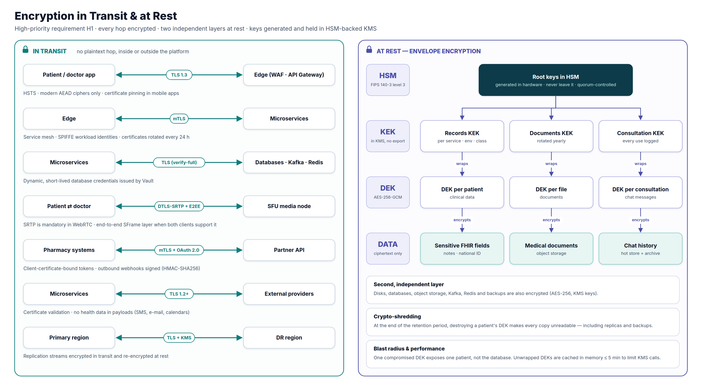
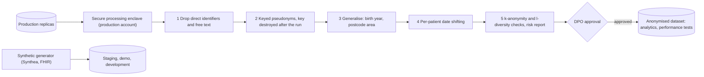

# 5. Security & Compliance

> **Deliverable 5.** Security protocols, encryption methods and compliance measures that protect MedX's health data.
> This is where the High-priority requirements H1 (data privacy), H3 (emergency access controls), H4 (authentication
> & authorization) and H5 (integrity) become concrete controls.

## 5.1 Objectives and principles

| Objective | Meaning for MedX |
|-----------|------------------|
| **Confidentiality** | Health data is seen only by the patient and the professionals who treat them, for a legitimate purpose. |
| **Integrity** | Records, prescriptions and payments are complete, correct and tamper-evident. |
| **Availability** | Critical information is reachable in an emergency, even during failures (Tier 0). |
| **Accountability** | Every access to health data can be attributed, explained and reviewed. |
| **Privacy** | Collect the minimum, use it only for its purpose, keep it only as long as required, respect patients' rights. |

**Principles**: defence in depth · zero trust (no implicit trust from the network: every call is authenticated,
authorised and encrypted) · least privilege · deny by default · privacy by design and by default · assume breach
(limit blast radius, detect fast, recover from immutable backups) · security as code (policies, infrastructure and
controls versioned and tested).

## 5.2 Regulatory and standards framework

| Framework | Why it applies | Key obligations | How the design complies |
|-----------|----------------|-----------------|-------------------------|
| **GDPR** (EU 2016/679) | Health data is a special category (art. 9) | Lawful basis (art. 9(2)(h) provision of health care), privacy by design (art. 25), security (art. 32), **DPIA** (art. 35), DPO (art. 37), records of processing (art. 30), data-subject rights, breach notification within **72 h** (art. 33–34), processor contracts (art. 28), no transfer outside the EEA without safeguards | §5.11 privacy operations; encryption, minimisation and retention built in; EEA-only hosting |
| **HDS certification** (French Public Health Code, art. L.1111-8) | Hosting health data of French patients | Hosting by HDS-certified providers; HDS v2 (2024) requires hosting in the EEA; MedX certified for the activities it operates itself | HDS-certified cloud regions (France + Germany); only certified services used for PHI; MedX certification plan (§5.12) |
| **National e-health frameworks** (ANS: PGSSI-S, INS, Pro Santé Connect, interoperability framework) | French health information systems | Security policy, national patient identifier, professional authentication, interoperable formats | PGSSI-S-aligned policies, INS in the Patient resource, Pro Santé Connect federation, FHIR/IPS model |
| **Telemedicine rules** (Public Health Code, art. R.6316-1 et seq.) | Teleconsultations | Authenticated professionals, identified and consenting patients, secure exchanges, report in the record | Verified practitioners + MFA, patient identity assurance, consent at booking, E2EE video, encounter note in the record |
| **HIPAA** (US) — if MedX expands | US patients' PHI | Privacy, Security and Breach Notification Rules; BAAs; minimum necessary | Separate US cell, same controls, BAAs with sub-processors |
| **PCI DSS v4.0** | Card payments | Protect cardholder data | PSP-hosted fields → **SAQ A**; payment-page script integrity |
| **eIDAS** (EU 910/2014 as amended by 2024/1183) | E-signatures and timestamps | Legal value of signatures and timestamps | Prescriber signatures (qualified options), qualified timestamps for integrity anchors |
| **NIS2** (EU 2022/2555) | Healthcare is a high-criticality sector | Risk-management measures; incident reporting: early warning 24 h, notification 72 h, final report 1 month | Measures adopted by design (§5.8–5.10); reporting process in the incident plan |
| **European Health Data Space** (EU 2025/327) | Patient access and exchange of electronic health data (phased obligations) | Patient access & sharing rights, interoperability and logging requirements for EHR systems | FHIR/IPS model, patient export and access log, audit trail |
| **Medical Device Regulation** (EU 2017/745) | Software that supports clinical decisions may be a medical device | Qualification, CE marking if in scope | Triage and prescription checks assessed for qualification; kept rule-based and validated |
| **Standards** | Assurance and best practice | ISO/IEC 27001 & 27701, ISO 27799 (health), OWASP ASVS & API Top 10, NIST SP 800-63B, CIS Benchmarks, FHIR security (SMART scopes), IHE BALP (audit) | Used as control baselines (§5.8) |

## 5.3 Threat model

Built with STRIDE on the architecture's data flows; the table lists the threats with the highest impact on MedX.

| # | Threat | Example | Main mitigations | Residual risk |
|---|--------|---------|------------------|---------------|
| T1 | Account takeover | Credential stuffing on patients, phishing a doctor | MFA (phishing-resistant for professionals), breached-password check, rate limiting, DPoP-bound tokens, new-device alerts | Low |
| T2 | Broken object-level authorization | Changing an ID in a URL to read another patient's record | ABAC decision on every object, UUIDs, negative authorization tests in CI, gateway schema validation | Low |
| T3 | Insider snooping | Staff or doctor browsing a celebrity's record | No staff access to PHI, care-grant model, audit of every read, UEBA alerts, patient-visible access log, sanctions | Medium → Low |
| T4 | Ransomware / destructive attack | Encryption or deletion of databases and backups | Immutable cross-account backup vault, Object Lock, least privilege, segmentation, EDR, tested restores | Low |
| T5 | Data exfiltration | Leaked snapshot, misconfigured bucket, compromised service | Per-patient application encryption (stolen data is ciphertext), KMS key policies, egress allow-lists, CSPM, DLP on logs | Low |
| T6 | Injection & web attacks | SQL injection, XSS, SSRF | Parameterised queries, output encoding, strict CSP, WAF, SAST/DAST, egress control | Low |
| T7 | Eavesdropping on consultations | Man-in-the-middle on video | DTLS-SRTP + E2EE, TLS 1.3, certificate pinning in apps | Low |
| T8 | Malicious file upload | Malware disguised as a medical PDF | Quarantine, antivirus, magic-byte type checks, PDF sanitisation, isolated scanners | Low |
| T9 | Supply-chain compromise | Malicious dependency or base image | Dependency scanning, pinned versions, SBOM, signed images verified at admission, build provenance | Medium |
| T10 | DDoS and abuse | Booking bots, directory scraping | CDN/WAF, bot management, rate limits, virtual waiting room | Low |
| T11 | Prescription fraud | Forged or re-used prescriptions | Signed prescriptions, verification endpoint with live status, QR codes without content | Low |
| T12 | Break-glass abuse | Fake emergency to read a record | Entitlement, justification, step-up MFA, real-time alert, patient notice, mandatory review, sanctions | Low–Medium |
| T13 | Payment fraud | Stolen cards | 3-D Secure (SCA), PSP risk scoring, velocity limits | Low |
| T14 | Leakage through notifications | An SMS revealing a diagnosis to a family member | No PHI in external messages, allow-listed template variables | Low |
| T15 | Cloud misconfiguration | Public bucket, disabled logging | Organisation guardrails (deny public access, deny disabling encryption/logging), IaC scanning, CSPM | Low |

## 5.4 Identity and access management

Details are in [§2.1 User Management](02-component-design/01-user-management.md); the security-relevant rules are:

- **Authentication assurance** — patients: password/passkey + risk-based MFA; professionals: phishing-resistant MFA
  always (passkeys, security keys, professional smart card via Pro Santé Connect); **prescription signing and
  break-glass require a fresh hardware-bound authentication** (step-up within 15 minutes). Short-lived, audience-
  restricted, DPoP- or certificate-bound tokens.
- **Authorization** — RBAC for coarse permissions + ABAC (care relationship, consent, purpose of use, sensitivity
  labels, organisation) evaluated by OPA next to every service; deny by default; obligations for masking.
- **Privileged access** — no standing administrator access to production: just-in-time elevation with approval,
  MFA, a 4-hour maximum and session recording; platform administrators **cannot read PHI** (application-level
  encryption keys are not usable by their roles).
- **Service identities** — SPIFFE identities through the mesh (mTLS), mesh authorisation policies define which
  service may call which; one cloud IAM role per service with least privilege (e.g., only the Records role may use
  the Records KEK).
- **Lifecycle** — automated deprovisioning for staff leavers; monthly registry sync suspends struck-off
  practitioners; **quarterly recertification** of entitlements such as `emergency_access`; segregation of duties
  between developers, database administrators and key custodians; 4-eyes for sensitive operations.

## 5.5 Encryption in transit

| Channel | Protocol | Configuration |
|---------|----------|---------------|
| Apps ↔ edge | **TLS 1.3** (TLS 1.2 with ECDHE + AEAD suites only for older devices; TLS ≤ 1.1 disabled) | HSTS with preload, OCSP stapling, automatic certificate rotation, public-key pinning (with backup keys) in mobile apps |
| Edge ↔ services, service ↔ service | **mTLS** (service mesh, STRICT mode — plaintext refused) | SPIFFE workload identities, certificates rotated every 24 h, authorisation policies per caller |
| Services ↔ datastores | TLS with server verification | PostgreSQL `sslmode=verify-full`; TLS for Redis, Kafka (plus mTLS client authentication), Cassandra (client and inter-node), OpenSearch |
| Audio/video | **DTLS-SRTP** (mandatory in WebRTC) + **E2EE** (SFrame) for 1-to-1 when supported | TURN over TLS 443 on restrictive networks |
| Pharmacy systems, partners | **mTLS + OAuth 2.0** with certificate-bound tokens | Outbound webhooks signed HMAC-SHA256 with timestamp and replay protection |
| External providers (SMS, e-mail, push, calendars, PSP) | TLS 1.2+ with certificate validation | No PHI in payloads; SMTP with MTA-STS, SPF/DKIM/DMARC |
| Region ↔ region replication | TLS | Re-encrypted at rest with multi-region keys |

**Cipher policy** — TLS 1.3 suites (AES-128/256-GCM, ChaCha20-Poly1305) with forward secrecy (X25519, P-256).
Because health data must stay confidential for decades, MedX enables **hybrid post-quantum key exchange**
(X25519 + ML-KEM) wherever clients and load balancers support it, against "harvest now, decrypt later" attacks
(crypto-agility is a design requirement: algorithms are configuration, not code).

## 5.6 Encryption at rest and key management

**Two independent layers**

| Layer | Scope | Mechanism | Protects against |
|-------|-------|-----------|------------------|
| **1 — Storage encryption** | Every volume, database, snapshot, backup, object, Kafka log, Redis, Cassandra, OpenSearch | AES-256 with customer-managed KMS keys | Lost disks, stolen snapshots, provider-side media access |
| **2 — Application (envelope) encryption** | C4 data: sensitive FHIR elements, documents, chat, national identifiers, contact data | **AES-256-GCM** in the service with per-patient / per-file / per-consultation data keys; additional authenticated data binds ciphertext to its record | Database-level compromise, over-privileged administrators, misconfigured replicas or exports, SQL injection returning raw rows |

**Key hierarchy** — root keys in **HSMs (FIPS 140-3 level 3)** → **KEKs** in KMS per service × environment × data
class (never exported) → **data keys (DEKs)** generated by KMS, stored only in wrapped form next to the data →
ciphertext.

| Lifecycle step | Rule |
|----------------|------|
| Generation | In the HSM/KMS only; no application-generated long-term keys |
| Access | KMS key policies: only the owning service's role may decrypt with its KEK; key administrators cannot use keys to decrypt; every use logged in the security account |
| Caching | Unwrapped DEKs kept in process memory ≤ 5 minutes (bounded LRU), never written to disk or logs |
| Rotation | KEKs rotated automatically every year (old versions kept for decryption; DEKs re-wrapped progressively); DEKs rotated on suspicion of compromise |
| Separation | Production keys unusable from non-production accounts → a production snapshot cannot be decrypted outside production |
| Disaster recovery | Multi-region keys for the DR region; Vault replicated |
| Destruction | **Crypto-shredding**: at the end of retention the patient's data keys are destroyed; key registries keep only 35 days of backups, so every remaining copy of the data — replicas, backups — becomes unreadable |

**Other protections** — passwords hashed with Argon2id; secrets in Vault (dynamic database credentials, Transit
encryption for integration tokens); payment cards tokenised by the PSP; mobile apps keep no health data beyond the
session except documents the user explicitly downloads, protected by OS keystore-backed file encryption and wiped
on logout.

## 5.7 Data masking, redaction and anonymization

**Dynamic masking (M4)** — the policy engine returns masking obligations applied before any response leaves a
service (support agents see `+33 6 •• •• •• 42`, pharmacists see no diagnosis, break-glass excludes psychotherapy
notes…). The complete matrix is in [§2.4](02-component-design/04-patient-records.md#data-masking--redaction-m4).

**Redaction** — documents shared or exported can have tagged sections removed; PDF redaction removes the text layer
(true redaction, not a black rectangle); logs and traces never contain PHI (allow-listed fields, tokenised
identifiers, automated scanner on log samples).

**Anonymization for staging and demo (L4)** — rule: *production health data never leaves production*.

| Environment | Data | Controls |
|-------------|------|----------|
| Development, staging, demo | **Synthetic** patients (e.g., Synthea FHIR bundles) and generated appointments, prescriptions, payments; demo tenant watermarked "DEMO" | Separate accounts, no network path or key access to production |
| Performance tests needing realistic distributions | **Anonymised** extracts produced by the pipeline above | k ≥ 10 on quasi-identifiers, l-diversity on sensitive attributes, documented re-identification risk assessment, DPO approval, dataset expiry |
| Analytics and research | Anonymised data; pseudonymised data only inside production-grade controls and with legal basis/consent | Purpose registry, access reviews |

## 5.8 Application and API security

- **Secure development lifecycle** — threat modelling for each significant feature, security champions in every
  team, **OWASP ASVS level 2** baseline and **level 3** for User Management, Records, Emergency Access and
  Prescription; security acceptance criteria in the definition of done.
- **Automated checks in CI** — SAST, dependency scanning (SCA), secret scanning, infrastructure-as-code scanning,
  container image scanning; DAST and API fuzzing against staging; **authorization test suites** with negative cases
  (patient A must never read patient B).
- **Independent testing** — penetration test before launch and every year, after major changes; bug-bounty programme
  after launch.
- **API protections (OWASP API Top 10)** — object- and property-level authorization, response allow-lists (no mass
  exposure), explicit request models (no mass assignment), rate limits and quotas, SSRF protection through an egress
  gateway with allow-listed destinations, complete API inventory in the gateway.
- **Web** — strict nonce-based CSP, Trusted Types, SRI, HSTS, `frame-ancestors 'none'` (except the PSP component),
  SameSite cookies, CSRF tokens for cookie sessions.
- **Mobile (OWASP MASVS)** — certificate pinning, app attestation, sensitive screens hidden from screenshots and task
  switcher, no health data in device logs, rooted/jailbroken devices treated as a risk signal.
- **Supply chain** — pinned dependencies, SBOM for every image, minimal (distroless) base images patched weekly,
  **signed images verified at admission**, build provenance (SLSA), reviewed changes only (protected branches).

## 5.9 Infrastructure and network security

- **Landing zone** — separate accounts (production, DR, security & log archive, shared services, non-production) under
  organisation guardrails: deny public storage, deny disabling encryption or logging, deny regions outside the EEA.
- **Network** — private subnets for all services and datastores; public exposure limited to load balancers and media
  nodes; Kubernetes network policies **default deny**; mesh authorisation policies; private endpoints to cloud
  services; egress only through controlled gateways with allow-lists.
- **Workload hardening** — CIS benchmarks, Pod Security "restricted" profile, non-root and read-only containers,
  seccomp/AppArmor, runtime threat detection, EDR on nodes; vulnerability SLAs: critical < 7 days, high < 30 days.
- **Staff access** — identity-aware zero-trust proxy (no VPN, no SSH); production access only through JIT elevation.
- **Physical security** — inherited from the HDS / ISO 27001-certified cloud provider.

## 5.10 Logging, detection and incident response

- **Security logging** — authentication events, authorisation denials, admin actions, KMS usage, network flows, audit
  trail; shipped to the **security account** (immutable, 12 months for technical logs, ≥ 6 years for the audit trail).
- **Detection (SIEM + UEBA)** — break-glass events, access without care relationship attempts, mass record reads or
  exports, impossible travel, MFA disabled, privilege escalation, anomalous KMS decrypt volumes, new public endpoint.
- **Response** — documented plans for data breach, ransomware, account takeover and break-glass abuse; 24/7 on-call;
  severity levels; forensic readiness (retained logs, snapshot procedures); tabletop exercises twice a year.

| Notification duty | Deadline |
|-------------------|----------|
| GDPR — supervisory authority (CNIL) | **72 h** after awareness (art. 33) |
| GDPR — affected patients | Without undue delay when the risk is high (art. 34) |
| NIS2 — national CSIRT / authority | Early warning **24 h**, notification **72 h**, final report **1 month** |
| French health sector — serious incidents | Declaration to the health authorities' incident portal / CERT Santé |
| HIPAA (US cell) | Individuals within 60 days; HHS as required |

## 5.11 Privacy compliance operations

| Area | Measure |
|------|---------|
| Governance | DPO appointed; records of processing; **DPIA before launch** and for every major change (large-scale health data makes it mandatory); privacy review in the design process |
| Legal bases | Care: art. 9(2)(h); contract/legal obligations for billing; **explicit consent** only where required (research use, marketing, optional sharing, non-essential cookies) |
| Transparency | Layered privacy notices in the apps; **"who accessed my record"** page for patients |
| Data-subject rights | Self-service export (FHIR bundle / PDF), rectification through the treating doctor (amendment keeps history), erasure of account data (medical record kept under its legal retention), objection and restriction where applicable (e.g., research, break-glass where allowed); answered within one month |
| Sub-processors | Data processing agreements, HDS-certified hosting, EU-based providers for any personal data; **no health data sent to messaging or calendar providers**; BAAs for a future US cell |
| Minors | Parental delegation, adolescent confidentiality rules enforced by policy |
| Privacy by default | Research and marketing opt-in off by default; minimal sharing; no third-party trackers in authenticated areas |

## 5.12 Compliance and assurance roadmap

| Milestone | When |
|-----------|------|
| DPIA, records of processing, security policies (PGSSI-S-aligned), HDS-certified hosting contract | Before the first real patient |
| External penetration test | Before launch, then yearly |
| HDS certification for MedX's own operating activities | Before launch (scope-dependent) |
| PCI DSS SAQ A attestation | At payment launch |
| ISO/IEC 27001 (+ 27701) certification | Year 1–2 |
| SOC 2 Type II, HIPAA readiness | Before US expansion |

Compliance is continuous: guardrails and policies as code, automated evidence collection, quarterly access reviews,
yearly DR and incident exercises.

## 5.13 High-priority requirements — controls and evidence

| Requirement | Controls | How it is verified |
|-------------|----------|--------------------|
| **H1 Data privacy** (encryption at rest & in transit) | TLS 1.3 / mTLS everywhere; AES-256 storage encryption; per-patient envelope encryption; HSM-backed keys; no PHI outside the clinical zone | Encryption compliance checks on 100 % of stores; TLS configuration scans; mesh in STRICT mode; PHI-in-logs scanner |
| **H2 Patient records** | FHIR store, validation, versioning, consent registry, audit of every access | Nightly hash-chain verification; audit coverage tests; access-control test suite |
| **H3 Emergency access** | Break-glass with entitlement, step-up MFA, time-boxed grant, Tier-0 deployment in two regions, post-hoc review | Synthetic probes (p95, availability); **100 % of break-glass cases reviewed within 72 h**; DR drills |
| **H4 Authentication & authorization** | Keycloak (OIDC, MFA), OPA RBAC + ABAC, JIT privileged access | 100 % MFA for professionals; quarterly recertification completed; policy unit tests in CI |
| **H5 Data integrity & secure files** | ACID, append-only, hash chains + anchoring, checksums, Object Lock, immutable backups, file scanning | Weekly restore tests + quarterly full drill; checksum scrub with zero mismatch; WORM configuration checks |
