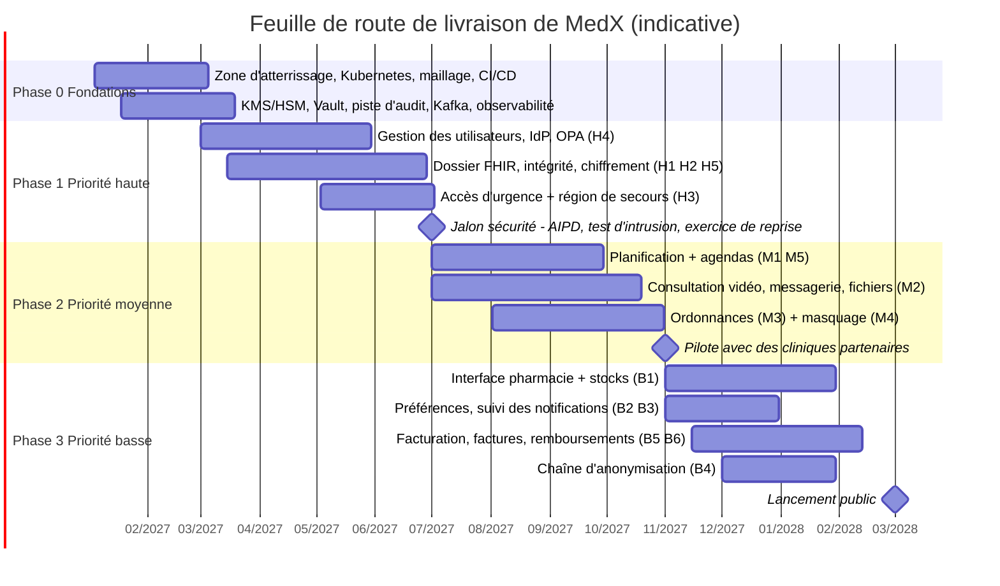

# 8. Feuille de route et risques

> Comment la conception est livrée **dans l'ordre des priorités de MedX**, et ce qui pourrait mal tourner.

## 8.1 Principes de livraison

1. **Les capacités de priorité haute sont des fondations, pas des fonctionnalités** : chiffrement, identité, dossier
   patient, intégrité et accès d'urgence sont construits en premier et sont des **conditions de mise en production**
   pour tout le reste.
2. Les parcours de soin de priorité moyenne sont construits sur ces fondations.
3. Les capacités de priorité basse arrivent en dernier et s'appuient sur des partenaires (prestataire de paiement,
   fournisseurs de messagerie). Des tranches minimales, achetées, arrivent plus tôt **uniquement** quand une
   fonctionnalité de priorité moyenne en a besoin (par exemple un e-mail transactionnel de confirmation de
   réservation).
4. Chaque phase se termine par des critères de sortie **mesurés**, pas déclarés.

## 8.2 Plan par phases (indicatif, démarrage en janvier 2027)

| Phase | Périmètre | Priorités | Critères de sortie |
|-------|-----------|-----------|--------------------|
| **0 — Fondations** (≈ 2 mois) | Comptes et garde-fous, Kubernetes + maillage (mTLS STRICT), CI/CD avec signature et analyses, KMS/HSM + Vault, bus d'événements + relais d'outbox, piste d'audit (WORM), stockage de documents, observabilité, générateur de données synthétiques | H1, H5 (prérequis) | Chaque environnement construit à partir du code ; 100 % des stockages chiffrés ; événements d'audit immuables de bout en bout |
| **1 — Socle clinique sécurisé** (≈ 4 mois) | Gestion des utilisateurs + Keycloak + OPA ; dossier patient (FHIR, versionnage, chaînes de hachage, clés par patient, consentement, autorisations de soin) ; accès d'urgence actif dans deux régions ; région de secours ; AIPD | **H1–H5** | Suite de tests d'autorisation au vert ; vérification des chaînes de hachage au vert ; bris de glace p95 < 300 ms dans les deux régions ; exercice de reprise réussi ; test d'intrusion externe sans constat critique ou élevé ouvert |
| **2 — Parcours de soin** (≈ 4 mois) | Planification (blocages, saga, liste d'attente, file urgente) + connecteurs d'agenda ; consultation (SFU, TURN, messagerie, partage de fichiers, chiffrement de bout en bout) ; ordonnances (signature, contrôles, révocation) ; masquage et caviardage ; notifications transactionnelles minimales | **M1–M5** | Test de charge à 2× la pointe de l'année 1 réussi ; indicateurs de qualité vidéo atteints sur réseaux dégradés ; une révocation atteint le portail pharmacie en < 5 s ; **pilote avec des cliniques partenaires** |
| **3 — Écosystème et activité** (≈ 4 mois) | Portail pharmacie + API partenaire + adaptateurs d'inventaire ; interface des préférences ; suivi des notifications ; facturation, factures, remboursements, grand livre ; chaîne d'anonymisation | **B1–B6** | Attestation PCI SAQ A ; rapprochement au centime près sur 30 jours ; premier éditeur de LGO intégré ; **lancement public** |
| **4 — Croissance et expansion** (continu) | Services nationaux (e-prescription, INS, dossier partagé), ISO 27001, sharding lorsqu'il est déclenché, cellules régionales, cellule américaine prête pour HIPAA | — | Déclenchée par la croissance et les décisions de marché |

**Organisation des équipes** — une équipe plateforme (infrastructure, briques de sécurité, observabilité) et cinq
équipes alignées sur des flux de valeur (identité et accès · dossier clinique et urgence · planification et
consultation · ordonnances et pharmacie · communication et facturation), plus une capacité partagée pour les
interfaces web et mobiles ; un référent sécurité dans chaque équipe.

## 8.3 Registre des risques

| # | Risque | Probabilité | Impact | Atténuation | Responsable |
|---|--------|:-----------:|:------:|-------------|-------------|
| R1 | Évolution du périmètre réglementaire (périmètre HDS des activités propres de MedX, qualification du triage ou des contrôles comme dispositif médical) | Moyenne | Élevé | Revue juridique et DPO précoce ; AIPD ; triage à base de règles et validé médicalement ; plan de certification | DPO / juridique |
| R2 | Une mauvaise expérience vidéo sur les réseaux faibles freine l'adoption | Moyenne | Élevé | Conception « audio d'abord », TURN sur 443, tests avant appel, télémétrie de qualité par région, repli téléphonique | Équipe consultation |
| R3 | Charge d'exploitation des composants opérés par MedX (Keycloak, LiveKit, Kafka) | Moyenne | Moyen | Services managés lorsqu'ils sont dans le périmètre HDS, modèles de service standardisés, procédures d'exploitation, astreinte de l'équipe plateforme | Plateforme |
| R4 | Abus du bris de glace | Faible | Élevé | Droits dédiés, alertes, information du patient, revues obligatoires, sanctions, UEBA | Responsable de la protection des données |
| R5 | Erreur de gestion des clés rendant des données irrécupérables | Faible | Très élevé | Clés multi-régions adossées à des HSM, aucune suppression manuelle de clé en dehors du processus de crypto-effacement, double contrôle, exercices de récupération | Sécurité |
| R6 | Performances de l'entrepôt FHIR à grande échelle | Moyenne | Moyen | Projections, partitionnement dès le premier jour, trajectoire de sharding, tests de charge à 2× | Équipe dossier patient |
| R7 | Adoption lente par les pharmacies (intégrations) | Élevée | Moyen | Portail pour chaque pharmacie dès le premier jour, adaptateurs par éditeur de LGO, partenariats | Produit |
| R8 | Panne d'un fournisseur tiers (PSP, SMS, agendas) | Moyenne | Moyen | Deux fournisseurs par canal de messagerie, dégradation maîtrisée, disjoncteurs | Équipe communication |
| R9 | Dépendance à un fournisseur | Moyenne | Moyen | Standards ouverts (FHIR, OIDC, WebRTC), composants open source, Kubernetes, infrastructure sous forme de code | Architecture |
| R10 | Compétences rares (FHIR, sécurité, WebRTC) | Moyenne | Moyen | Technologies standard, formation, binômage, référents sécurité | Direction technique |
| R11 | Attaque de la chaîne d'approvisionnement via les dépendances | Moyenne | Élevé | SBOM, images signées, contrôle à l'admission, épinglage et analyse des dépendances | Sécurité |

## 8.4 Questions ouvertes pour MedX

1. Rôles juridiques entre MedX et les praticiens (responsable de traitement / sous-traitant) et périmètre de
   certification HDS qui en découle.
2. Calendrier et périmètre obligatoire des intégrations nationales (e-prescription, identifiant national de santé,
   dossier partagé).
3. Modèle de tarification et de remboursement (paiement par le patient, assureurs, tiers payant) — impact sur la
   facturation.
4. Marchés cibles après la France et ordre d'ouverture des cellules régionales.
5. Appétit pour des fonctionnalités assistées par l'IA (triage, prise de notes) : elles entraîneraient des
   obligations au titre du règlement européen sur l'IA et du MDR, et contraindraient les choix de chiffrement de bout
   en bout.
