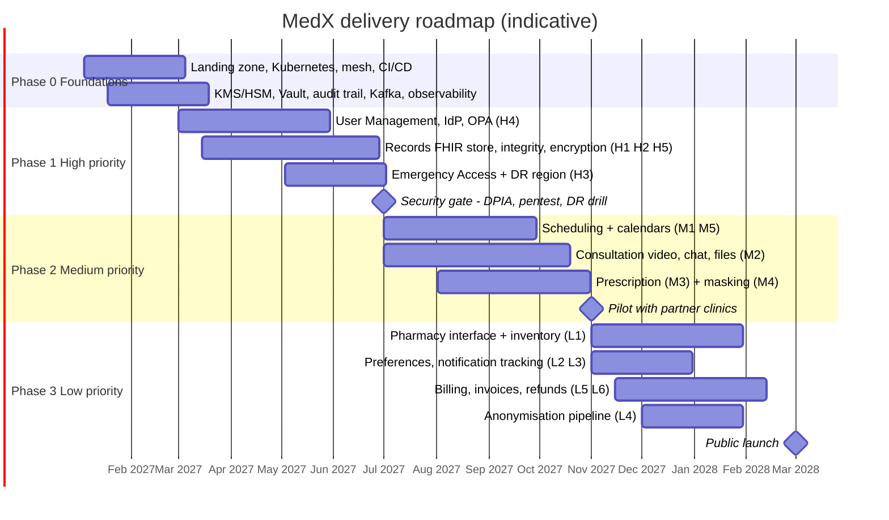

# 8. Roadmap & Risks

> How the design is delivered **in the order of MedX's priorities**, and what could go wrong.

## 8.1 Delivery principles

1. **High-priority capabilities are foundations, not features**: encryption, identity, records, integrity and
   emergency access are built first and are **release gates** for everything else.
2. Medium-priority care workflows are built on top of that foundation.
3. Low-priority capabilities come last and rely on partners (payment provider, messaging providers). Thin, bought
   slices enter earlier **only** when a Medium feature needs them (e.g., a transactional e-mail for a booking
   confirmation).
4. Each phase ends with exit criteria that are **measured**, not declared.

## 8.2 Phased plan (indicative, kick-off January 2027)

| Phase | Scope | Priorities | Exit criteria |
|-------|-------|------------|---------------|
| **0 — Foundations** (≈ 2 months) | Accounts and guardrails, Kubernetes + mesh (mTLS STRICT), CI/CD with signing and scanning, KMS/HSM + Vault, event bus + outbox relay, audit trail (WORM), Document Store, observability, synthetic data generator | H1, H5 (enablers) | Every environment built from code; 100 % of stores encrypted; audit events immutable end-to-end |
| **1 — Secure clinical core** (≈ 4 months) | User Management + Keycloak + OPA; Patient Records (FHIR, versioning, hash chains, per-patient keys, consent, care grants); Emergency Access active in two regions; DR region; DPIA | **H1–H5** | Authorization test suite green; hash-chain verification green; break-glass p95 < 300 ms in both regions; DR drill passed; external pentest with no critical/high finding open |
| **2 — Care workflows** (≈ 4 months) | Scheduling (holds, saga, waitlist, urgent queue) + calendar connectors; Consultation (SFU, TURN, chat, file sharing, E2EE); Prescription (signing, checks, revoke); masking & redaction; thin transactional notifications | **M1–M5** | Load test at 2× Year-1 peak passed; video quality KPIs met on impaired networks; revocation reaches pharmacy portal < 5 s; **pilot with partner clinics** |
| **3 — Ecosystem & business** (≈ 4 months) | Pharmacy portal + partner API + inventory adapters; preferences UI; notification tracking; billing, invoices, refunds, ledger; anonymisation pipeline | **L1–L6** | PCI SAQ A attestation; reconciliation to the cent over 30 days; first PMS vendor integrated; **public launch** |
| **4 — Scale & expand** (continuous) | National services (e-prescription, INS, shared record), ISO 27001, sharding when triggered, regional cells, HIPAA-ready US cell | — | Triggered by growth and market decisions |

**Team topology** — one platform team (infrastructure, security building blocks, observability) and five
stream-aligned teams (identity & access · clinical records & emergency · scheduling & consultation · prescription &
pharmacy · engagement & billing), plus shared web/mobile front-end capacity; a security champion in each team.

## 8.3 Risk register

| # | Risk | Likelihood | Impact | Mitigation | Owner |
|---|------|:----------:|:------:|------------|-------|
| R1 | Regulatory scope changes (HDS scope of MedX's own activities, medical-device qualification of triage or checks) | Medium | High | Early legal and DPO review; DPIA; triage kept rule-based and medically validated; certification plan | DPO / legal |
| R2 | Poor video experience on weak networks harms adoption | Medium | High | Audio-first design, TURN over 443, pre-call tests, quality telemetry per region, phone fallback | Consultation team |
| R3 | Operational load of self-operated components (Keycloak, LiveKit, Kafka) | Medium | Medium | Managed services where they are inside the HDS scope, golden paths, runbooks, platform team on-call | Platform |
| R4 | Break-glass misuse | Low | High | Entitlements, alerts, patient notice, mandatory reviews, sanctions, UEBA | Privacy officer |
| R5 | Key-management error making data unrecoverable | Low | Very high | HSM-backed multi-region keys, no manual key deletion outside the crypto-shredding workflow, dual control, recovery drills | Security |
| R6 | FHIR store performance at scale | Medium | Medium | Projections, partitioning from day one, sharding path, load tests at 2× | Records team |
| R7 | Slow pharmacy adoption (integrations) | High | Medium | Portal for every pharmacy from day one, adapters per PMS vendor, partnerships | Product |
| R8 | Third-party provider outage (PSP, SMS, calendars) | Medium | Medium | Two providers per messaging channel, graceful degradation, circuit breakers | Engagement team |
| R9 | Vendor lock-in | Medium | Medium | Open standards (FHIR, OIDC, WebRTC), open-source components, Kubernetes, infrastructure as code | Architecture |
| R10 | Scarce skills (FHIR, security, WebRTC) | Medium | Medium | Standard technologies, training, pairing, security champions | CTO |
| R11 | Supply-chain attack on dependencies | Medium | High | SBOM, signed images, admission control, dependency pinning and scanning | Security |

## 8.4 Open questions for MedX

1. Legal roles between MedX and practitioners (controller / processor) and resulting HDS certification scope.
2. Timeline and mandatory scope of national integrations (e-prescription, national identifier, shared record).
3. Pricing and reimbursement model (patient pays, insurers, third-party payment) — impacts Billing.
4. Target markets after France and the order of regional cells.
5. Appetite for AI-assisted features (triage, note-taking): would bring EU AI Act and MDR obligations and constrain
   end-to-end encryption choices.
